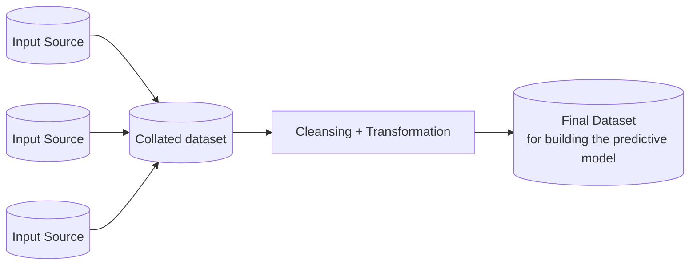
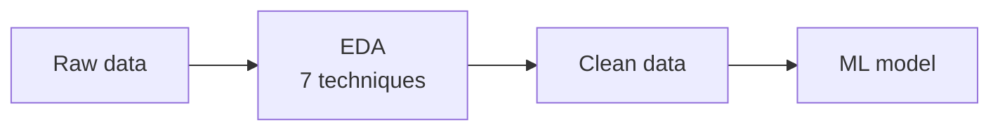

# EDA Automation using LLM Frameworks

Part 1: Ollama -- run large language models on your own computer

---

## Slide 1: LLM (Large Language Model)

| Company         | LLM Name          |
| --------------- | ----------------- |
| OpenAI          | GPT-4.5           |
| Anthropic       | Claude 3.7 Sonnet |
| Google DeepMind | Gemini 2.0 Pro    |
| Alibaba         | Qwen 2.5-Max      |
| Deep Seek       | DeepSeek R1       |
| Meta AI         | Llama 3.1         |
| Mistral AI      | Mistral Large 2   |
| Mistral AI      | Mixtral 8x22B     |
| Nvidia          | Nemotron-4        |
| Microsoft       | Phi-3             |
| Cohere          | Command R         |
| xAI             | Grok-1            |

- Closed models such as GPT and Claude run in the cloud.
- Open-source models such as Llama, Mistral, Qwen and DeepSeek can run locally with Ollama.

---

## Slide 2: Dataset process for predictive models



- Input sources are collated into one dataset.
- **Cleansing + Transformation** (the circled step) turns it into the final dataset.
- The final dataset is used for building the predictive model.
- This step is where most of the work happens.

---

## Slide 3: What is EDA?

**EDA = Exploratory Data Analysis**

- Look at the data closely before you build a model.
- Understand it and fix its problems.
- Raw data becomes clean data for the ML model.
- Step 0 (business understanding) and 7 techniques.

A first look in Pandas:

```python
df.head()                    # first rows
df.info()                    # columns and types
df.describe()                # statistics
df.isnull().sum()            # empty cells
sns.boxplot(x=df["col"])     # outliers
```

---

## Slide 4: EDA: the foundation of ML

- EDA is the foundation of machine learning. How?
- EDA techniques help to convert **raw data** into **clean data** for the **ML model**.



- Step 0 is business understanding. Then follow the 7 techniques.

---

## Slide 5: EDA techniques: steps 0 to 7

| Step | Technique |
| ---- | --------- |
| 0 | Business understanding |
| 1 | Variable identification |
| 2 | Univariate analysis |
| 3 | Bivariate analysis |
| 4 | Outlier treatment |
| 5 | Missing variable treatment |
| 6 | Variable imputation |
| 7 | Variable creation |

---

## Slide 6: Step 0: Business understanding

- Domains: **Bank, Service, Manufacture, SCM** (supply chain management), **FMCG** (fast-moving consumer goods), **Product**.
- No business runs without a customer.
- Business understanding is a non-technical job.

---

## Slide 7: Step 1: Variable identification

| | Independent variable | Dependent variable |
| - | -------------------- | ------------------ |
| Symbol | `x1, x2, x3, x4, x5 ... xn` | `y` |
| Also called | Non-target attribute, non-predicted attribute | Target variable, predicted variable |

- Math formula: `y = x1 + x2 + x3`
- ML formula: `y = m1x1 + m2x2 + m3x3` (`m1`, `m2`, `m3` are the weights the model learns)

---

## Slide 8: Example: a family with 4 attributes

| Member | Variable |
| ------ | -------- |
| Dad (govt employee) | Dependent variable (`y`) |
| Mom (housewife) | Independent variable (`x1`) |
| Son (4th) | Independent variable (`x2`) |
| Daughter (3rd) | Independent variable (`x3`) |

- Math formula: `y = x1 + x2 + x3`
- ML formula: `y = m1x1 + m2x2 + m3x3`

---

## Slide 9: EDA and the 3 ML techniques

| Technique | Dependent variable | Examples |
| --------- | ------------------ | -------- |
| Regression | Continuous | Petrol, gold, stock, crypto, vehicle, land, ticket, flight, house price, electricity bill |
| Classification | Binary or category | Yes / No (1 / 0), pass / fail, spam / not spam, fraud / not fraud |
| Clustering | None | Grouping of similar data |

---

## Slide 10: Algorithms for each technique

- **Regression:** simple linear, multiple linear, polynomial, lasso, ridge, SVR, KNN regression, time series.
- **Classification:** logistic regression (a probability algorithm), SVM, KNN, Naive Bayes (Bayesian theorem), DT (decision tree), RF (random forest).
- **Clustering:** K-means clustering, PCA (principal component analysis).

---

## Slide 11: Types of machine learning

| | Supervised | Unsupervised | Reinforcement |
| - | ---------- | ------------ | ------------- |
| Data | Structured = labeled | Unstructured = unlabeled | Interacts with the environment (the situation) |
| Techniques | Regression, classification | Clustering (no dependent variable) | Agents come into play |
| Stored in | SQL DB (RDBMS): MySQL, PostgreSQL, Oracle | NoSQL DB: MongoDB, Cassandra, HBase. Vector DB for RAG: Pinecone, FAISS, Chroma, Milvus, Qdrant | |

---

## Slide 12: Step 3: Bivariate analysis (correlation)

- Correlation is the relation among 2 attributes. Its range is -1 to 1.
- Negative (-ve): -1 to 0. No correlation: 0. Positive (+ve): 0 to 1.

---

## Slide 13: Steps 4 and 5: Outliers, missing values

- **Outlier treatment:** we detect outliers with graphs. Outliers impact the ML algorithms. In real time we cannot always remove them, so we adjust them with a probability function: the sigmoid curve.
- **Missing value treatment:** 2 types of variables, numerical (number) and categorical (text). Numerical missing: mean, median or mode. Categorical missing: mode and KNN strategy.

---

## Slide 14: Example: filling missing values

Numbers (highlighted = was missing): 13, 15, **21.4**, 24, 20, **21.4**, 35, **35**, 35, 35

- mean = 21.4 (of 13, 15, 24, 20, 35), median = 24, mode = 35 (appears 3 times).
- Two missing numbers are filled with the mean (21.4), one with the mode (35).

| Categorical | temp |
| ----------- | ---- |
| summer | 50 |
| winter | 10 |
| **summer** (was missing) | 54 |
| rainy | 23 |
| winter | 16 |
| rainy | 27 |
| **winter** (was missing) | 6 |
| summer | 53 |

- Rule: above 50 = summer, 20 to 30 = rainy, 1 to 20 = winter.
- A missing season is decided from the temperature in the same row.

---

## Slide 15: Question: filling missing values

**How to fill missing value in your existing project?**

- If numerical value are missing -- **mean, median, mode**
- If categorical value are missing -- **mode & KNN strategy**

---

## Slide 16: Steps 6 and 7: Variable transformation

- A transformer (also called an imputation technique) converts categorical data to numerical data.
- **Dummy variable / one-hot encoder:** number of classes == number of columns.
- **Label encoder:** categories become 0, 1, 2, 3 ...

---

## Slide 17: One-hot encoder: seasons

| Season | SUMMER | WINTER | RAINY | autumn | spring |
| ------ | ------ | ------ | ----- | ------ | ------ |
| summer | 1 | 0 | 0 | 0 | 0 |
| winter | 0 | 1 | 0 | 0 | 0 |
| summer | 1 | 0 | 0 | 0 | 0 |
| rainy | 0 | 0 | 1 | 0 | 0 |
| winter | 0 | 1 | 0 | 0 | 0 |
| rainy | 0 | 0 | 1 | 0 | 0 |
| winter | 0 | 1 | 0 | 0 | 0 |
| summer | 1 | 0 | 0 | 0 | 0 |
| autumn | 0 | 0 | 0 | 1 | 0 |
| spring | 0 | 0 | 0 | 0 | 1 |

- 5 classes = 5 columns. Each row has a single 1.

---

## Slide 18: Label encoder: seasons

| Categorical | Label |
| ----------- | ----- |
| summer | 0 |
| winter | 1 |
| summer | 0 |
| rainy | 2 |
| winter | 1 |
| rainy | 2 |
| winter | 1 |
| summer | 0 |
| autumn | 3 |
| spring | 4 |

- The label encoder converts each categorical value to a number: summer = 0, winter = 1, rainy = 2, autumn = 3, spring = 4.
- Still one column (one-hot makes 5).

---

## Slide 19: What is Ollama?

- Ollama is a tool that lets you **run Large Language Models (LLMs) locally** on your computer.
- It is designed for easy deployment and management of open-source LLMs like **Llama 2, Mistral, Gemma, DeepSeek** and more, without needing a cloud-based API.

---

## Slide 20: Key Features of Ollama

- **Run LLMs locally** -- no internet required after installation (the model must be downloaded once).
- **Supports open-source models** -- Llama 2, Mistral, Gemma, Phi-2, etc.
- **Optimized performance** -- uses **GPU acceleration** for fast inference.
- **Simple installation and API** -- easy to use in apps or on the command line.
- **Fine-tuning support** -- customize models for specific tasks.

---

## Slide 21: Why run an LLM locally?

| Cloud-based API                 | Local (Ollama)                             |
| ------------------------------- | ------------------------------------------ |
| Needs the internet              | Works offline once the model is downloaded |
| Your data is sent to a server   | Your data stays on your computer           |
| Pay per use                     | Free to run (you use your own computer)    |
| Model is chosen by the provider | You choose and switch models               |

---

## Slide 22: Getting started -- the commands

```text
ollama  ->  ollama list  ->  ollama pull mistral  ->  ollama run mistral
```

| Step | Command                 | What it does                                                                   |
| ---- | ----------------------- | ------------------------------------------------------------------------------ |
| 1    | `ollama`              | Shows the help and the list of commands (also checks that Ollama is installed) |
| 2    | `ollama list`         | Lists the models already downloaded on your computer                           |
| 3    | `ollama pull mistral` | Downloads the `mistral` model                                                |
| 4    | `ollama run mistral`  | Starts a chat with the `mistral` model in the terminal                       |

---

## Slide 23: Using the commands

```bash
ollama list                 # see the downloaded models
ollama pull mistral         # download a model
ollama run mistral          # chat with it
```

Inside the chat:

- Type your question and press Enter.
- Type `/bye` to leave the chat.

Other useful commands:

| Command               | What it does                                                 |
| --------------------- | ------------------------------------------------------------ |
| `ollama ps`         | Shows the models that are running now                        |
| `ollama rm mistral` | Deletes a downloaded model                                   |
| `ollama run llama2` | Runs another model (it is downloaded first if it is missing) |

---

## Slide 24: Use Ollama in an app (API)

- Ollama runs a local server, by default at `http://localhost:11434`.
- Your app sends a request to it, the same way as to a cloud API, but nothing leaves your computer.

```bash
curl http://localhost:11434/api/generate -d '{"model": "mistral", "prompt": "Why is the sky blue?", "stream": false}'
```

---

## Slide 25: Install and test Ollama

- Install Ollama and use it in **cmd** (Command Prompt) and in the **VS Code** terminal.
- Check the install with `ollama --version`.
- We tested **gemma3** and **deepseek-r1** (any open-source LLM can be accessed using Ollama).

```bash
ollama run gemma3
ollama run deepseek-r1
```

---

## Slide 26: Limitations of running locally

| Issue                | What happens                                                                                                                              |
| -------------------- | ----------------------------------------------------------------------------------------------------------------------------------------- |
| System configuration | A user cannot download a large model because of the system configuration (memory, GPU). Otherwise we depend on an API key (a cloud model) |
| Answer quality       | Ollama's answer is not always appropriate. This is another issue with small local models                                                  |

- Small versions need less memory, such as `gemma3:270m` and `deepseek-r1:1.5b`.

---

## Slide 27: Streamlit + Ollama: a custom GPT

- Streamlit + Ollama: we build a **custom GPT** (a Gen AI project).
- The AI generates a response **without training on any text data**.
- The user did not train any data, so it is **Gen AI**.

```python
from ollama import Client

client = Client(host="http://localhost:11434")

response = client.chat(
    model="deepseek-r1:1.5b",
    messages=[{"role": "user", "content": prompt}],
)
st.write(response["message"]["content"])
```

---

## Slide 28: EDA integration to LLM

| | ChatGPT | EDA + LLM model (our app) |
| - | ------- | ------------------------- |
| Query | Any query | A question about our dataset |
| Answer comes from | The response is generated from the internet | The prompt carries the summary of the dataset |
| Runs | In the cloud | Locally with Ollama |

---

## Slide 29: How the app works

Upload CSV -> EDA with Pandas -> Summary as text -> Prompt + LLM (Ollama, mistral) -> AI insights + charts

- A Gradio application: upload any dataset and it pulls out the data.

---

## Slide 30: The Gradio application

- A prompt in a Python function: prompt + LLM model fetch the data from the dataset.
- App: `EDA_LLM\app.py`, run with `python app.py`.
- Upload any CSV: get the report, AI insights and charts.

```python
prompt = f"Analyze ... {df_summary}"
response = ollama.chat(model="mistral", messages=[{"role": "user", "content": prompt}])
insights = response["message"]["content"]
```

Full notes: `eda-llm-integration.md`

---

## Slide 31: Summary

- Ollama = run open-source LLMs **locally**.
- Models: Llama 2, Mistral, Gemma, DeepSeek, Phi-2 and more.
- Uses the **GPU** for fast answers.
- Four commands to start: `ollama` -> `ollama list` -> `ollama pull mistral` -> `ollama run mistral`.
- No cloud API and no internet needed once the model is downloaded.
