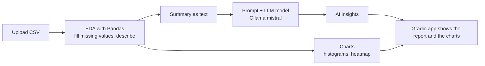

# EDA Integration to LLM

App: `C:\My-Drive\Learning\repositories\ai-learning\AI-Naresh-IT\EDA_LLM\app.py`

Topics:

1. EDA integration + LLM model
2. How an LLM model can integrate with a dataset to pull the insight
3. ChatGPT vs our app
4. A prompt in a Python function (prompt + LLM model)
5. The Gradio application
6. How to run it
7. Things to know about the app

## 1. EDA integration + LLM model

- **EDA** (exploratory data analysis) gives us the numbers and the charts of a dataset: summary statistics, missing values, distributions and correlation.
- An **LLM** (large language model) can read those numbers and explain them in plain words: "what is unusual, what should I check next".
- **EDA integration to LLM** means joining the two: Pandas does the EDA, the LLM writes the insights, and one app shows both.

## 2. How an LLM model can integrate with a dataset to pull the insight

An LLM cannot open your CSV by itself. We do the EDA in Python first, turn the result into **text**, and put that text inside the **prompt**.



| Step | What happens | Tool |
| ---- | ------------ | ---- |
| 1 | The user uploads a CSV file | Gradio |
| 2 | Fill the missing values (median for numbers, mode for text) | Pandas |
| 3 | `describe()` makes the summary, `isnull().sum()` counts the missing values | Pandas |
| 4 | The summary is placed in a prompt and sent to the LLM | Ollama (mistral) |
| 5 | The LLM replies with insights | Ollama |
| 6 | Histograms and a correlation heatmap are drawn | Matplotlib, Seaborn |
| 7 | The report and the charts are shown on the page | Gradio |

## 3. ChatGPT vs our app

| | ChatGPT | Our EDA + LLM app |
| - | ------- | ----------------- |
| Query | Any query | A question about **our dataset** |
| Where the answer comes from | Generated from the model's training and the internet | Generated from the **dataset summary** we put in the prompt |
| Runs | In the cloud | Locally with Ollama (no cloud API) |
| Knows your data? | No | Yes, only through the summary in the prompt |

The model is the same kind of LLM. The difference is the **prompt**: ChatGPT gets a general question, and our app gets the question together with the numbers of the dataset.

## 4. A prompt in a Python function (prompt + LLM model)

The function takes the dataset summary, builds the prompt, calls the model and returns its answer:

```python
import ollama

def generate_ai_insights(df_summary):
    prompt = f"Analyze the dataset summary and provide insights:\n\n{df_summary}"
    response = ollama.chat(model="mistral", messages=[{"role": "user", "content": prompt}])
    return response['message']['content']
```

| Line | Meaning |
| ---- | ------- |
| `df_summary` | The summary of the dataset as text (from `df.describe(include='all').to_string()`) |
| `prompt = f"..."` | **The prompt**: an instruction plus the data. The `{df_summary}` part is filled in by Python |
| `ollama.chat(model="mistral", ...)` | **The LLM model**: send the prompt to the `mistral` model running in Ollama |
| `messages=[{"role": "user", "content": prompt}]` | The prompt is sent as a message from the user |
| `response['message']['content']` | The text of the model's reply |

So the function fetches the data from the dataset (through the summary) and the model turns it into insights.

## 5. The Gradio application

Gradio builds a web page for a Python function. We create a Gradio application where you can **upload any dataset (a CSV file) and it pulls out the data**: the report, the AI insights and the charts.

The code in `EDA_LLM\app.py` has three functions and the Gradio page.

### Function 1: `eda_analysis(file_path)`

```python
def eda_analysis(file_path):
    df = pd.read_csv(file_path)

    # Fill missing values with median for numeric columns
    for col in df.select_dtypes(include=['number']).columns:
        df[col].fillna(df[col].median(), inplace=True)

    # Fill missing values with mode for categorical columns
    for col in df.select_dtypes(include=['object']).columns:
        df[col].fillna(df[col].mode()[0], inplace=True)

    summary = df.describe(include='all').to_string()
    missing_values = df.isnull().sum().to_string()
    insights = generate_ai_insights(summary)
    plot_paths = generate_visualizations(df)
    return f"...Summary...{summary}...Missing Values...{missing_values}...AI Insights...{insights}", plot_paths
```

- Reads the uploaded CSV into a DataFrame.
- **Missing value treatment** (EDA step 5): median for numerical columns, mode for categorical columns, as in your EDA notes.
- Makes the summary and the missing-value count as text.
- Calls the LLM function for the insights, and the chart function for the pictures.
- Returns the text report and the list of picture files.

### Function 2: `generate_ai_insights(df_summary)`

The prompt + LLM function from section 4.

### Function 3: `generate_visualizations(df)`

```python
def generate_visualizations(df):
    plot_paths = []
    for col in df.select_dtypes(include=['number']).columns:
        plt.figure(figsize=(6, 4))
        sns.histplot(df[col], bins=30, kde=True, color="blue")      # univariate analysis
        plt.title(f"Distribution of {col}")
        path = f"{col}_distribution.png"
        plt.savefig(path)
        plot_paths.append(path)
        plt.close()

    numeric_df = df.select_dtypes(include=['number'])
    if not numeric_df.empty:
        plt.figure(figsize=(8, 5))
        sns.heatmap(numeric_df.corr(), annot=True, cmap='coolwarm', fmt=".2f", linewidths=0.5)   # bivariate analysis
        plt.title("Correlation Heatmap")
        plt.savefig("correlation_heatmap.png")
        ...
    return plot_paths
```

- A **histogram** for every numerical column (univariate analysis).
- One **correlation heatmap** for all the numerical columns (bivariate analysis).
- The pictures are saved as `.png` files, and their paths are returned to show in Gradio.

### The Gradio page

```python
demo = gr.Interface(
    fn=eda_analysis,
    inputs=gr.File(type="filepath"),
    outputs=[gr.Textbox(label="EDA Report"), gr.Gallery(label="Data Visualizations")],
    title="📊 LLM-Powered Exploratory Data Analysis (EDA)",
    description="Upload any dataset CSV file and get automated EDA insights with AI-powered analysis and visualizations."
)
demo.launch(share=True)
```

| Part | Meaning |
| ---- | ------- |
| `fn=eda_analysis` | The function that runs when a file is uploaded |
| `inputs=gr.File(type="filepath")` | The upload box. The function gets the path of the file |
| `outputs=[Textbox, Gallery]` | The report as text, and the charts as a picture gallery |
| `demo.launch(share=True)` | Starts the app. `share=True` also makes a public link (see section 7) |

### Files in the `EDA_LLM` folder

| File | What it is |
| ---- | ---------- |
| `app.py` | The Gradio app |
| `titanic_ dataset_final.csv` | A sample dataset: 891 rows and 12 columns (`Age` has 177 empty cells, `Cabin` 687, `Embarked` 2) |
| `data.csv` | A sample dataset: 195 countries with `BirthRate`, `InternetUsers` and `IncomeGroup` |
| `*_distribution.png`, `correlation_heatmap.png` | The charts that the app saved |
| `code.ipynb`, `gradio_test.py` | Notebook and test files |

## 6. How to run it

**Install what the app needs** (once):

```bash
pip install gradio pandas matplotlib seaborn ollama
ollama pull mistral
```

- Ollama must be installed and running, because the app calls the `mistral` model.

**Run the app** from cmd or the VS Code terminal:

```bash
cd C:\My-Drive\Learning\repositories\ai-learning\AI-Naresh-IT\EDA_LLM
python app.py
```

- The terminal prints a local link, usually `http://127.0.0.1:7860`. Open it in the browser.
- Upload a CSV (for example `titanic_ dataset_final.csv`) and wait for the report, the AI insights and the charts.
- Stop the app with `Ctrl+C`.

## 7. Things to know about the app

I could not run the app here (Gradio and Ollama are not installed in my environment), but I tested its missing-value code on your `titanic_ dataset_final.csv`.

### 1. The missing-value fill does not work in Pandas 3

Your environment shows text columns as `str` in `df.info()`, which means Pandas 3. In Pandas 3, `df[col].fillna(..., inplace=True)` is a chained assignment, and it **does not change the DataFrame**. Python only warns (`ChainedAssignmentError`).

| Version of the fill | Empty cells left in the titanic data |
| ------------------- | ------------------------------------ |
| The app's code (`df[col].fillna(..., inplace=True)`) | **866** (nothing was filled) |
| Assign the result back (`df[col] = df[col].fillna(...)`) | **0** |

The effect: the "Missing Values" part of the report still shows the empty cells, and the summary given to the LLM still has the gaps. The safe version:

```python
for col in df.select_dtypes(include=['number']).columns:
    df[col] = df[col].fillna(df[col].median())

for col in df.select_dtypes(exclude=['number']).columns:
    df[col] = df[col].fillna(df[col].mode()[0])
```

- `exclude=['number']` also avoids the warning that `include=['object']` gives for `str` columns in Pandas 3.
- `mode()[0]` fails with an `IndexError` if a whole column is empty.

### 2. `share=True` makes a public link

`demo.launch(share=True)` gives a public `gradio.live` link while the app runs. Anyone with the link can open the app. Use `demo.launch()` (or `share=False`) when the dataset is private.

### 3. The charts are saved in the folder you run from

`plt.savefig(path)` writes the `.png` files in the current folder, and every upload overwrites the earlier files with the same name. That is why the pictures are in `EDA_LLM`.

### 4. The LLM sees the summary, not the rows

Only `df.describe(include='all')` is sent to the model, not the raw data. This keeps the prompt short and the data private, but the insights can only be as good as the summary.

## Quick reference

| Idea | In one line |
| ---- | ----------- |
| EDA integration to LLM | Pandas does the EDA, the LLM explains the result |
| Prompt + LLM model | A Python function builds a prompt from the dataset summary and sends it to the model |
| ChatGPT | Answers any query from its training and the internet |
| Our app | Answers about our own dataset, because the summary is in the prompt |
| Gradio | Makes the upload page for the function |
| Ollama + mistral | The LLM runs locally |
