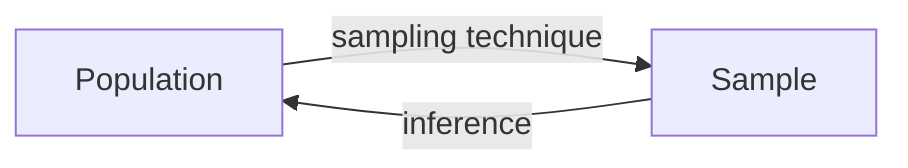

# Descriptive Statistics

Descriptive statistics describe a dataset with a few numbers: where the middle is, how spread out it is and what shape it has. This is the base of EDA (univariate analysis).

Topics:

1. Population and sample
2. Sampling technique and inference
3. Central tendency (mean, median, mode)
4. Skewness
5. Normal distribution
6. Variance and standard deviation
7. Kurtosis
8. Probability and distributions (the dice example)
9. Confidence interval

## 1. Population and sample

- **Population** -- the **whole** group you want to study (for example, all 195 countries).
- **Sample** -- a **part** of the population that you really measure (for example, 30 of the countries).
- We usually study a sample, because measuring the whole population is too slow or too costly.

| | Population | Sample |
| - | ---------- | ------ |
| Meaning | The whole group | A part of the group |
| Number of values | `N` | `n` |
| Mean | `μ` (mu) | `x̄` (x bar) |
| Variance | `σ²` (sigma squared) | `s²` |
| Standard deviation | `σ` (sigma) | `s` |

## 2. Sampling technique and inference



- **Sampling technique** -- from the population to the sample. It is the way you pick the sample.
- **Inference** -- from the sample to the population. You use the numbers of the sample to say something about the whole population.

Common sampling techniques:

| Technique | How the sample is picked |
| --------- | ------------------------ |
| Simple random | Every member has the same chance |
| Stratified | Divide the population into groups (strata), then pick from each group |
| Systematic | Pick every k-th member (every 10th row) |
| Cluster | Pick whole groups at random |

```python
import pandas as pd

df = pd.read_excel("countries_dummy.xlsx")        # the population: 195 countries
bw = df["BirthRate"]

# Simple random sample of 30 countries
sample = bw.sample(n=30, random_state=1)

# Stratified: 20% from each income group (random_state makes the sample repeatable)
strat = df.groupby("IncomeGroup", group_keys=False).sample(frac=0.2, random_state=1)
print(len(strat), strat["IncomeGroup"].value_counts().to_dict())
# 39 {'High income': 13, 'Lower middle income': 10, 'Upper middle income': 10, 'Low income': 6}

# Systematic: every 10th row
every10 = df.iloc[::10]
```

**Inference in action:** we measure the sample, then estimate the population.

```python
print(bw.mean())          # 21.09   population mean (μ), all 195 countries
print(sample.mean())      # 18.57   sample mean (x̄), only 30 countries
```

The sample mean (`18.57`) is close to the population mean (`21.09`), but not the same. A sample gives an estimate. A bigger or a better-picked sample is closer to the truth.

## 3. Central tendency (mean, median, mode)

Central tendency is the "middle" of the data.

| Measure | Meaning | Pandas |
| ------- | ------- | ------ |
| Mean | The average: the sum divided by the count | `s.mean()` |
| Median | The middle value after sorting | `s.median()` |
| Mode | The value that appears most often | `s.mode()` |

```python
s = pd.Series([2, 4, 4, 4, 5, 5, 7, 9])

print(s.mean())        # 5.0
print(s.median())      # 4.5   (the middle of 4 and 5)
print(s.mode()[0])     # 4     (appears 3 times)
```

- The **mean** is pulled by outliers. The **median** is not.
- A column can have more than one mode (or no useful mode), so `mode()` returns a Series.

### Mean, median and mode in detail

| | Mean | Median | Mode |
| - | ---- | ------ | ---- |
| What it is | The simple average of the data. The most widely used measure of central tendency | The midpoint of the ordered data | The value that occurs most often |
| Formula | `Σx / N` or `(x1 + x2 + ... + xN) / N` | The number at position `(n + 1) / 2` | The value with the highest frequency |
| Outliers | **Easily affected** by outliers | **Not affected**, so it is often used in academia and data science | Not affected |
| Excel | `=AVERAGE()` | `=MEDIAN()` | `=MODE.SNGL()` (one mode), `=MODE.MULT()` (all the modes) |

- **Median position:** sort the data first. If the position `(n + 1) / 2` is not a whole number, the median is the simple average of the two numbers closest to that position.
- **Mode:** a dataset can have **0 modes** (no value repeats), **1 mode** or **multiple modes**. In Excel, use `MODE.MULT()` when there is more than one mode. It returns an array with all the modes.

```python
s = pd.Series([2, 4, 4, 4, 5, 5, 7, 9])        # n = 8

print((len(s) + 1) / 2)      # 4.5   the position of the median: between the 4th and the 5th value
print(s.median())            # 4.5   the average of 4 and 5

print(pd.Series([3, 1, 2]).median())           # 2.0   n = 3, position 2: a whole number
print(pd.Series([1, 2, 3, 4]).median())        # 2.5   n = 4, position 2.5: average of 2 and 3

print(pd.Series([1, 2, 2, 3, 3, 4]).mode().tolist())    # [2, 3]   two modes
print(pd.Series([1, 2, 3]).mode().tolist())             # [1, 2, 3] no value repeats (Excel's MODE.SNGL gives an error)

o = pd.Series([2, 3, 4, 5, 100])                        # one outlier
print(o.mean(), o.median())                             # 22.8  4.0
```

## 4. Skewness

Skewness tells which way the data leans. Compare the mean, median and mode.

| | Positive (+ve) skew | Zero skew | Negative (-ve) skew |
| - | ------------------- | --------- | ------------------- |
| Order | mean > median > mode | mean = median = mode | mode > median > mean |
| Where the data is | At the **left** | In the middle | At the **right** |
| Where the outlier (the tail) is | At the **right** | Both sides equal | At the **left** |
| Also called | Right-skewed | Symmetric | Left-skewed |

The mean is the number that moves toward the outlier. So with a +ve skew the mean is the biggest of the three, and with a -ve skew it is the smallest.

```python
right = pd.Series([1, 2, 2, 3, 3, 3, 4, 10])       # an outlier on the right
print(right.mean(), right.median(), right.mode()[0], round(right.skew(), 2))
# 3.5  3.0  3  2.24        mean > median = mode  -> +ve skew

left = pd.Series([1, 7, 8, 8, 9, 9, 9, 10])        # an outlier on the left
print(round(left.mean(), 2), left.median(), left.mode()[0], round(left.skew(), 2))
# 7.62  8.5  9  -2.28      mode > median > mean  -> -ve skew

sym = pd.Series([1, 2, 3, 3, 3, 4, 5])
print(sym.mean(), sym.median(), sym.mode()[0], round(sym.skew(), 2))
# 3.0  3.0  3  0.0         mean = median = mode  -> zero skew
```

- `s.skew()` is positive for a +ve skew, negative for a -ve skew and about 0 for a symmetric shape.
- Example from our data: `BirthRate` has `skew = 1.21`, and its mean (`21.09`) is bigger than its median (`17.95`). So it has a +ve skew: most countries have a low birth rate, with a few high ones on the right.

### Skewness: class notes (as written)

```text
+ve skew == mean >median & Mode  ( data is at left  & Outlier is at right )

0 skew == (mean = median = mode)data is at center & no outlier )
    this graph is called (normal distribution == bell curve == gausian distribution = 0 symmetric)

-ve skew == mode > median > mean ( data is at right & outlier is at left)
normal distribution == gausian distribution == bell curve
```

### Sample skewness formula

```text
            (1/n) · Σ (xᵢ − x̄)³
skew  =  ─────────────────────────────────
         [ √( (1/(n − 1)) · Σ (xᵢ − x̄)² ) ]³
```

In words: **skewness = the average of the cubed distances from the mean, divided by the cube of the sample standard deviation.**

| Symbol | Meaning |
| ------ | ------- |
| `n` | The number of values in the sample |
| `xᵢ` | Each value (`x₁, x₂ ... xₙ`) |
| `x̄` | The sample mean |
| `Σ` (with `i = 1` to `n`) | Add up for every value |
| `xᵢ − x̄` | How far one value is from the mean (the **deviation**) |
| `√( (1/(n − 1)) · Σ (xᵢ − x̄)² )` | The **sample standard deviation** `s` (it divides by `n − 1`) |

**The formula in 4 steps:**

1. **Find the mean** `x̄`.
2. **Find each deviation** `xᵢ − x̄`.
3. **Top part (the numerator):** cube each deviation, add them up, and divide by `n`. Cubing keeps the **sign**: a value above the mean gives a positive number, a value below the mean gives a negative number. Far values count much more (`6³ = 216`, but `3³ = 27`), so one outlier decides the direction.
4. **Bottom part (the denominator):** find the sample standard deviation `s` and cube it. This makes the result **unit free**, so you can compare the skew of different columns (rupees, years, marks).

**Worked example:** the data is `1, 2, 3, 10` (`n = 4`).

| x | x − x̄ (mean = 4) | (x − x̄)² | (x − x̄)³ |
| - | ------------------ | --------- | --------- |
| 1 | −3 | 9 | −27 |
| 2 | −2 | 4 | −8 |
| 3 | −1 | 1 | −1 |
| 10 | 6 | 36 | 216 |
| **Sum** | 0 | **50** | **180** |

- Top part: `180 / 4 = 45`
- Sample variance: `50 / (4 − 1) = 16.667`, so `s = √16.667 = 4.0825`
- Bottom part: `s³ = 4.0825³ = 68.04`
- **skew = 45 / 68.04 = 0.661**

The result is positive, so this is a **+ve skew**: the outlier `10` is at the right and the mean (4) is above the median (2.5), as your class notes say.

**How to read the result:**

| Result | Meaning |
| ------ | ------- |
| Greater than 0 | +ve skew: the tail (outlier) is at the right, mean > median |
| About 0 | Symmetric: mean = median = mode (a normal bell curve) |
| Less than 0 | -ve skew: the tail (outlier) is at the left, mean < median |

- A common rule of thumb: a skew between -0.5 and 0.5 is nearly symmetric, between 0.5 and 1 (or -1 and -0.5) is moderately skewed, and beyond 1 (or below -1) is highly skewed.
- The skew does not change if you multiply the data by a number or add a number to it. `10, 20, 30, 100` gives the same `0.661`. If you mirror the data (change the sign), only the sign of the skew changes.

```python
import numpy as np
import pandas as pd

def sample_skew(x):
    x = np.asarray(x, dtype=float)
    n = len(x)
    mean = x.mean()
    top = np.sum((x - mean) ** 3) / n                      # (1/n) * sum of the cubed deviations
    s = np.sqrt(np.sum((x - mean) ** 2) / (n - 1))         # sample standard deviation
    return top / s ** 3

print(round(sample_skew([1, 2, 3, 10]), 3))                # 0.661
print(round(sample_skew([1, 2, 3, 3, 3, 4, 5]), 3))        # 0.0     symmetric
print(round(sample_skew([1, 7, 8, 8, 9, 9, 9, 10]), 3))    # -1.495  -ve skew
```

**Pandas `.skew()` gives a different number.** Pandas (and Excel's `SKEW()`) use an *adjusted* version of this formula, which corrects the bias in small samples. Both always have the same sign, but the size is different:

| Data | This formula | Pandas `.skew()` |
| ---- | ------------ | ---------------- |
| `1, 2, 3, 10` | 0.661 | 1.764 |
| `1, 2, 2, 3, 3, 3, 4, 10` | 1.470 | 2.240 |
| `1, 7, 8, 8, 9, 9, 9, 10` | -1.495 | -2.278 |
| `BirthRate` (195 countries) | 1.187 | 1.205 |

- The difference gets smaller as `n` gets bigger (`BirthRate` has 195 values, so 1.187 and 1.205 are close).
- Use one method for all your columns, so the numbers can be compared. In Pandas that is `s.skew()`.

## 5. Normal distribution

- **0 skew:** mean = median = mode.
- This shape is called the **normal distribution**, the **Gaussian distribution** or the **bell curve**.
- The two halves are mirror images of each other, around the mean.
- About 68% of the values are within 1 standard deviation of the mean, and about 95% are within 2.

### The standard normal distribution (standardization)

Standardization changes any dataset so that its **mean is 0** and its **standard deviation is 1**. The result is the **standard normal distribution**, written `N(0, 1)`. It takes two steps.

**The data:** `1, 2, 2, 3, 3, 3, 4, 4, 5` (9 values, mean = 3, standard deviation = 1.22).

| Original dataset `x` | Subtract the mean `x − μ` | Divide by the standard deviation `(x − μ) / σ` |
| -------------------- | ------------------------- | ---------------------------------------------- |
| 1 | −2 | −1.63 |
| 2 | −1 | −0.82 |
| 2 | −1 | −0.82 |
| 3 | 0 | 0.00 |
| 3 | 0 | 0.00 |
| 3 | 0 | 0.00 |
| 4 | 1 | 0.82 |
| 4 | 1 | 0.82 |
| 5 | 2 | 1.63 |
| **Mean** | **3** → **0** | **0.00** |
| **St. dev** | **1.22** → **1.22** | **1.00** |

| Step | Formula | Mean | Standard deviation | Distribution |
| ---- | ------- | ---- | ------------------ | ------------ |
| Original data | `x` | 3 | 1.22 | `N(3, 1.22)` |
| 1. Subtract the mean | `x − μ` | 0 | 1.22 | `N(0, 1.22)` |
| 2. Divide by the standard deviation | `(x − μ) / σ` | 0 | **1** | **`N(0, 1)`** |

- **Subtracting the mean** moves the whole distribution so that it is centred on 0. It does not change the spread.
- **Dividing by the standard deviation** shrinks or stretches the spread to 1. Now one unit means "one standard deviation".
- The new value `z = (x − μ) / σ` is called the **z-score**. It tells how many standard deviations a value is from the mean. For example, `5` is `+1.63` standard deviations above the mean, and `1` is `−1.63` below it.
- This is the distribution behind the **z-table** (see the confidence interval example): the table gives the area to the left of a z-score.

**Standardization in one line**

```text
N ~ (μ, σ²)   ──── standardize ────▶   N ~ (0, 1)

standardized variable  =  (original variable − mean) / standard deviation

z-score  =  (x − μ) / σ
```

| Part | Meaning |
| ---- | ------- |
| `N ~ (μ, σ²)` | **Any** normal distribution: it has mean `μ` and variance `σ²` |
| `N ~ (0, 1)` | The **standard normal distribution**: mean 0 and variance 1 (so also standard deviation 1) |
| `x` | The original value (the original variable) |
| `μ` | The mean |
| `σ` | The standard deviation |
| `z` | The standardized variable, called the **z-score** |

- Standardizing turns any normal distribution into `N ~ (0, 1)`. After that, all values are on the same scale, so you can compare them and look them up in one z-table.
- To go back, use the reverse formula `x = μ + z · σ`. In the example above, `z = 1.63` gives `x = 3 + 1.63 × 1.22 ≈ 5`.

**A note on the notation.** `N ~ (μ, σ²)` has the **variance** `σ²` as the second number. In the example table above, the class notes write `N ~ (3, 1.22)` with the **standard deviation** (1.22) as the second number. As a variance it would be `1.22² = 1.5`, so the same distribution is `N ~ (3, 1.5)`. For `N ~ (0, 1)` there is no difference, because `1² = 1`.

```python
import pandas as pd

x = pd.Series([1, 2, 2, 3, 3, 3, 4, 4, 5])

print(x.mean(), round(x.std(), 2))          # 3.0  1.22

sub = x - x.mean()                          # step 1: subtract the mean
print(sub.tolist())                         # [-2.0, -1.0, -1.0, 0.0, 0.0, 0.0, 1.0, 1.0, 2.0]
print(sub.mean(), round(sub.std(), 2))      # 0.0  1.22

z = sub / x.std()                           # step 2: divide by the standard deviation
print(z.round(2).tolist())                  # [-1.63, -0.82, -0.82, 0.0, 0.0, 0.0, 0.82, 0.82, 1.63]
print(round(z.mean(), 2), round(z.std(), 2))   # 0.0  1.0
```

**Which standard deviation?** The `1.22` in this example is the **sample** standard deviation (`n − 1`): `√(12 / 8) = 1.2247`. If you divide by the **population** standard deviation (`N`), `√(12 / 9) = 1.1547`, the z-scores are a little bigger (`−1.73`, `−0.87`, `0.87`, `1.73`). SciPy's `stats.zscore()` and scikit-learn's `StandardScaler` use the population version, so their numbers differ slightly from the table above. Both give a mean of 0.

### z-score, z-table and z-test (class notes)

```text
z-score == standardize technique to convert mean - 0 & standard deviation 1
           machine learning this concept we called as STANDARDIZATION ( FEATURE SCALING)
           time series model this concept we called as (WHITE NOISE)

z-table == statistic table which help statistician to compute z-test or z-statistic test

z-test == z-test is one of the testing which apply to population data to find
          confidence interval for 95% & 99%
```

| Term | What it is |
| ---- | ---------- |
| **z-score** | A standardizing technique: it converts the data to **mean 0 and standard deviation 1** with `z = (x − μ) / σ` |
| **z-table** | A statistics table that helps a statistician **compute the z-test** (the z-statistic test). It gives the area to the left of a z value |
| **z-test** | A test used with **population data** (the population standard deviation `σ` is known). It is used to find the **confidence interval for 95% and 99%** |

**The z-score has different names in different fields:**

| Field | Name of the concept |
| ----- | ------------------- |
| Statistics | z-score |
| Machine learning | **Standardization** (also called **feature scaling**) |
| Time series | **White noise** (see the note below) |

**Machine learning: standardization (feature scaling).** Features with different scales (age in years, salary in rupees) are converted to mean 0 and standard deviation 1, so that no feature dominates only because its numbers are big.

```python
import pandas as pd
from sklearn.preprocessing import StandardScaler

df = pd.DataFrame({"age": [22, 35, 58, 41, 29], "salary": [30000, 52000, 90000, 61000, 40000]})
scaled = StandardScaler().fit_transform(df)

print(scaled.round(2))
# [[-1.22 -1.19]
#  [-0.16 -0.13]
#  [ 1.71  1.72]
#  [ 0.33  0.31]
#  [-0.65 -0.71]]
print(scaled.mean(axis=0).round(2), scaled.std(axis=0).round(2))     # [-0. -0.]  [1. 1.]
```

**Time series: white noise.** A white noise series has a mean of 0, a constant spread and **no relation between one value and the next**. A standard white noise is `N ~ (0, 1)`: its values look like standardized data.

- A series that only has mean 0 and standard deviation 1 is not always white noise. The values must also be unrelated to each other (no autocorrelation).

```python
import numpy as np
import pandas as pd

rng = np.random.default_rng(0)
noise = pd.Series(rng.normal(0, 1, 5000))
print(round(noise.mean(), 2), round(noise.std(), 2))     # about 0 and 1
print(round(noise.autocorr(1), 2))                       # about 0: no relation to the previous value

walk = noise.cumsum()                                    # a random walk: not white noise
print(round(walk.autocorr(1), 2))                        # about 1: each value depends on the previous one
```

**z-test with the z-table: an example.** The salary example: `n = 30`, sample mean `x̄ = $100,200`, population standard deviation `σ = $15,000`. Test the claim that the true mean salary is `$95,000`.

| Step | Value |
| ---- | ----- |
| H0 | `μ = 95,000` |
| H1 | `μ ≠ 95,000` |
| Standard error | `σ / √n = 15000 / √30 = 2739` |
| z-statistic | `z = (x̄ − μ0) / (σ / √n) = (100,200 − 95,000) / 2739 = 1.90` |
| Area to the left of 1.90 (z-table, row 1.9, column 0.00) | 0.9713 |
| p-value (two sides) | `2 × (1 − 0.9713) = 0.0574` |
| Decision at 95% (critical z = 1.96) | `1.90 < 1.96`, so **do not reject H0** |

- The z-test uses the z-table the same way as the confidence interval: to turn a z value into an area (a probability).
- At 99% the critical z is 2.576, so the decision is the same here.

```python
import numpy as np
from scipy import stats

n, xbar, sigma, mu0 = 30, 100200, 15000, 95000
z = (xbar - mu0) / (sigma / np.sqrt(n))
p = 2 * (1 - stats.norm.cdf(z))

print(round(z, 2))                    # 1.9
print(round(p, 4))                    # 0.0576   (0.0574 when z is rounded to 1.90 and read from the table)
print(abs(z) > stats.norm.ppf(0.975)) # False: 1.9 is smaller than 1.96, so we do not reject H0 at 95%
```

## 6. Variance and standard deviation

- **Variance** -- the spread of the data around the mean. It is the average of the squared distances from the mean.
- **Standard deviation (sd)** -- the **square root of the variance**. It is in the same unit as the data, so it is easier to read.
- A small variance or sd means the values are close to the mean. A big one means they are spread out.

| | Population | Sample |
| - | ---------- | ------ |
| Mean | `μ = Σx / N` | `x̄ = Σx / n` |
| Variance | `σ² = Σ(x − μ)² / N` | `s² = Σ(x − x̄)² / (n − 1)` |
| Standard deviation | `σ = √σ²` | `s = √s²` |

- Population sd is the root of `σ²`. Sample sd is the root of `s²`.
- The sample formula divides by `n − 1` (not `n`), because a sample usually shows less spread than the whole population.

```python
import numpy as np

d = pd.Series([2, 4, 4, 4, 5, 5, 7, 9])        # mean = 5

# Population (divide by N)
print(np.var(d))                # 4.0     σ²
print(np.std(d))                # 2.0     σ

# Sample (divide by n - 1)
print(d.var())                  # 4.571   s²
print(d.std())                  # 2.138   s
```

How the numbers come out: the squared distances from the mean `5` add up to `32`.

- Population variance = `32 / 8 = 4`, sd = `√4 = 2`
- Sample variance = `32 / 7 = 4.571`, sd = `√4.571 = 2.138`

### Variance: population vs sample (the USA and California)

Think of a map. If you measure **every state of the USA**, you have the **population**. If you measure **only California**, you have a **sample** (a part of the USA).

```text
Population variance                      Sample variance

        Σ (xᵢ − μ)²                              Σ (xᵢ − x̄)²
σ²  =  ─────────────                    s²  =  ─────────────
            N                                       n − 1
   (i = 1 to N)                              (i = 1 to n)
```

| | Population variance | Sample variance |
| - | ------------------- | --------------- |
| In the picture | All of the USA | California, a part of the USA |
| Symbol | `σ²` | `s²` |
| Formula | `σ² = Σ(xᵢ − μ)² / N` | `s² = Σ(xᵢ − x̄)² / (n − 1)` |
| Adds up the values | from `i = 1` to `N` | from `i = 1` to `n` |
| Distance is measured from | `μ`, the population mean | `x̄`, the sample mean |
| Divide by | `N`, the population size | `n − 1`, the sample size minus 1 |

- The two formulas look the same. The differences are the **mean** (`μ` or `x̄`) and the **divisor** (`N` or `n − 1`).
- Use the population formula when you have **all** the data. Use the sample formula when you have only a part and want to estimate the variance of the whole group.

### Worked example: population variance

The population is `1, 2, 3, 4, 5`. It has **5 values**, so the **population size** is `N = 5`.

**Step 1: the mean**

```text
μ = (1 + 2 + 3 + 4 + 5) / 5 = 15 / 5 = 3.00
```

**Step 2: the formula**

```text
          Σ (xᵢ − μ)²       (1 − 3)² + (2 − 3)² + (3 − 3)² + (4 − 3)² + (5 − 3)²
σ²  =  ────────────────  =  ───────────────────────────────────────────────────────
              N                                        5
```

| Part | Meaning | In this example |
| ---- | ------- | --------------- |
| `xᵢ` | An **observation** (one value of the population) | `1`, `2`, `3`, `4`, `5`. In `(3 − 3)²` the first `3` is the observation |
| `μ` | The **mean** of the population | `3`. In `(3 − 3)²` the second `3` is the mean |
| `N` | The **population size** | `5` |

**Step 3: the table**

| x | x − μ | (x − μ)² |
| - | ----- | -------- |
| 1 | −2 | 4 |
| 2 | −1 | 1 |
| 3 | 0 | 0 |
| 4 | 1 | 1 |
| 5 | 2 | 4 |
| **Sum** | 0 | **10** |

**Step 4: the result**

```text
σ² = (4 + 1 + 0 + 1 + 4) / 5 = 10 / 5 = 2.00
σ  = √2 = 1.414
```

The **population variance is 2.00** and the population standard deviation is `√2 = 1.414`.

- The deviations (`x − μ`) always add up to 0, so we square them first. Squaring also makes a far value count more.
- If the same five values were a **sample**, the formula divides by `n − 1 = 4`: `s² = 10 / 4 = 2.5` and `s = 1.581`.

```python
import numpy as np
import pandas as pd

x = pd.Series([1, 2, 3, 4, 5])
mu = x.mean()                          # 3.0
print(((x - mu) ** 2).sum())           # 10.0     the sum of the squared deviations
print(((x - mu) ** 2).sum() / len(x))  # 2.0      population variance = 10 / 5

print(np.var(x), round(np.std(x), 3))  # 2.0  1.414    population (divide by N)
print(x.var(), round(x.std(), 3))      # 2.5  1.581    sample (divide by n - 1)
```

In Excel: `=VAR.P()` gives the population variance (2) and `=VAR.S()` gives the sample variance (2.5).

### Worked example: sample variance

Now take the same values `1, 2, 3, 4, 5`, but treat them as a **sample** (a part of a bigger group). The sample has `n = 5` values, and the sample mean is `x̄ = 3`.

```text
          Σ (xᵢ − x̄)²       (1 − 3)² + (2 − 3)² + (3 − 3)² + (4 − 3)² + (5 − 3)²
s²  =  ────────────────  =  ───────────────────────────────────────────────────────
           n − 1                                    4
```

- The top part is the same as before: `4 + 1 + 0 + 1 + 4 = 10`.
- The bottom part is different: we divide by **`n − 1 = 5 − 1 = 4`** (the circled part in the class image), not by `n = 5`.

```text
s² = 10 / 4 = 2.5
s  = √2.5 = 1.581
```

| | Population variance | Sample variance |
| - | ------------------- | --------------- |
| Symbol | `σ²` | `s²` |
| Mean used | `μ` (the population mean) | `x̄` (the sample mean) |
| Divide by | `N = 5` | `n − 1 = 4` |
| Result for `1, 2, 3, 4, 5` | `10 / 5 = 2.00` | `10 / 4 = 2.5` |

The sample variance (2.5) is a little **bigger** than the population variance (2.00), because we divide by a smaller number.

**Why `n − 1`?**

- A sample is closer to **its own** mean `x̄` than to the true mean `μ` of the population, so the squared distances come out too small. If we divided by `n`, the sample variance would usually be **too low**.
- Dividing by `n − 1` corrects this. It is called **Bessel's correction**.
- Another way to see it (degrees of freedom): the deviations `xᵢ − x̄` always add up to 0, so once `n − 1` of them are known, the last one is fixed. Only `n − 1` values are free.

You can see the correction work with a simulation: take many samples of 5 values from a population whose true variance is 100.

```python
import numpy as np
import pandas as pd

x = pd.Series([1, 2, 3, 4, 5])
print(((x - x.mean()) ** 2).sum())     # 10.0   the sum of the squared deviations
print(x.var())                         # 2.5    sample variance: 10 / 4  (Pandas divides by n - 1)
print(round(x.std(), 3))               # 1.581
print(x.var(ddof=0))                   # 2.0    divide by n: the population formula

rng = np.random.default_rng(0)
samples = rng.normal(50, 10, size=(200000, 5))      # 200,000 samples of n = 5, true variance = 100
print(samples.var(axis=1, ddof=0).mean())           # about 80   divide by n: too low
print(samples.var(axis=1, ddof=1).mean())           # about 100  divide by n - 1: correct on average
```

In Excel: `=VAR.S()` gives the sample variance (2.5) and `=STDEV.S()` gives the sample standard deviation (1.581).

### Standard deviation formulas

The standard deviation is the **square root of the variance**. There is one formula for the population and one for the sample.

```text
Population standard deviation          Sample standard deviation

   σ  =  √σ²                              s  =  √s²
```

| | Population standard deviation | Sample standard deviation |
| - | ----------------------------- | ------------------------- |
| Symbol | `σ` (sigma) | `s` |
| Formula | `σ = √σ²` | `s = √s²` |
| In full | `σ = √( Σ(xᵢ − μ)² / N )` | `s = √( Σ(xᵢ − x̄)² / (n − 1) )` |
| Starts from | The population variance `σ²` | The sample variance `s²` |
| For `1, 2, 3, 4, 5` | `σ = √2 = 1.414` | `s = √2.5 = 1.581` |

- **Why take the square root?** The variance is in **squared units** (if the data is in years, the variance is in years²). The square root brings it back to the **same unit as the data**, so it is easier to read and to compare with the mean.
- The sample standard deviation is bigger than the population one for the same numbers, because the sample variance divides by `n − 1`.

```python
import numpy as np
import pandas as pd

x = pd.Series([1, 2, 3, 4, 5])

print(np.sqrt(2.0), np.std(x))          # 1.4142...  1.4142...   σ = √σ²   (population, divide by N)
print(np.sqrt(2.5), x.std())            # 1.5811...  1.5811...   s = √s²   (sample, divide by n - 1)
```

In Excel: `=STDEV.P()` gives the population standard deviation and `=STDEV.S()` gives the sample standard deviation.

Watch out: NumPy and Pandas use different defaults.

| | `np.var` / `np.std` | `Series.var` / `Series.std` |
| - | ------------------- | --------------------------- |
| Default | Population (`ddof=0`) | Sample (`ddof=1`) |
| Change it | `np.std(d, ddof=1)` | `d.std(ddof=0)` |

## 7. Kurtosis

Kurtosis tells how **peaked** the curve is and how heavy its tails are, compared with the normal bell curve. The value Pandas gives (`s.kurt()`) is the **excess kurtosis**: 0 means the same as the normal distribution.

| Kurtosis | Name | Shape |
| -------- | ---- | ----- |
| 0 | **Mesokurtic** | Like the normal bell curve |
| Positive (+ve) | **Leptokurtic** | A sharp peak and heavy tails (more extreme values) |
| Negative (-ve) | **Platykurtic** | A flat top and light tails |

```python
rng = np.random.default_rng(0)

normal = pd.Series(rng.normal(0, 1, 100000))
flat = pd.Series(rng.uniform(0, 1, 100000))
heavy = pd.Series(rng.laplace(0, 1, 100000))

print(round(normal.kurt(), 2))     # -0.01   about 0   -> mesokurtic
print(round(flat.kurt(), 2))       # -1.2    negative  -> platykurtic
print(round(heavy.kurt(), 2))      # 3.11    positive  -> leptokurtic
```

> **Check this against your class notes.** Your notes say "+ve kurtosis = platykurtic" and "-ve kurtosis = leptokurtic". The usual definition is the other way round, and the code above confirms it: positive kurtosis gives a sharp peak with heavy tails (**leptokurtic**), and negative kurtosis gives a flat shape (**platykurtic**). Your notes also say "0 skew = mesokurtic". The matching value is **0 kurtosis**, which is the normal bell curve.

### Kurtosis: class notes (as written)

```text
+ve skew = +ve kurtois  == platykurtic
-ve skew = -ve kurtosi == leptokurtic
0skew == normal distribution == mesokurtic
```

**Read this together with the kurtosis table above.** Skewness and kurtosis are **two different measures**:

| Measure | What it tells | Positive means | Negative means |
| ------- | ------------- | -------------- | -------------- |
| **Skewness** | Which way the data leans | Tail at the right | Tail at the left |
| **Kurtosis** | How peaked the curve is and how heavy its tails are | Sharp peak, heavy tails: **leptokurtic** | Flat top, light tails: **platykurtic** |

- In the class notes the pairs are "+ve skew with platykurtic" and "-ve skew with leptokurtic". The standard names are the other way round: a **positive kurtosis is leptokurtic** and a **negative kurtosis is platykurtic**.
- The normal distribution has 0 skew **and** 0 kurtosis, and it is called **mesokurtic**. That part of the class notes is the same as the standard definition.
- A positive skew does not always come with a positive kurtosis. The data below shows that the two numbers can be different:

| Data (random, 200,000 values) | Skew (about) | Kurtosis (about) | Name |
| ---- | ---- | -------- | ---- |
| Exponential | +1.98 | +5.79 | Right tail, heavy tails (leptokurtic) |
| Beta(2, 5) | +0.60 | -0.13 | Right tail, light tails (slightly platykurtic) |
| Uniform (flat) | 0.0 | -1.20 | Symmetric, flat (platykurtic) |
| Laplace (sharp peak) | 0.0 | +3.02 | Symmetric, sharp peak (leptokurtic) |
| Normal | 0.0 | 0.0 | Symmetric bell curve (mesokurtic) |
| Mirrored exponential | -1.97 | +5.71 | Left tail, heavy tails (leptokurtic) |

```python
import numpy as np
import pandas as pd

rng = np.random.default_rng(1)
beta = pd.Series(rng.beta(2, 5, 200000))          # a right tail with light tails
print(round(beta.skew(), 2), round(beta.kurt(), 2))      # 0.59  -0.14   positive skew, negative kurtosis

laplace = pd.Series(rng.laplace(0, 1, 200000))    # symmetric with a sharp peak
print(round(laplace.skew(), 2), round(laplace.kurt(), 2))  # -0.02  2.85   about zero skew, positive kurtosis
```

(The data is random, so the numbers in the table and in the code differ a little each time. The pattern does not change.)

## 8. Probability and distributions: the dice example

The distribution concept is born from **probability**. A distribution shows how likely each value is.


### How many sides do 2 dice have?

- Each die has 6 sides (faces), so 2 dice have **12 sides** in total.
- When you roll 2 dice, there are `6 x 6 = 36` possible results (outcomes), because each side of the first die can come with each side of the second die.
- The **total** of the two dice can be any number from 2 to 12.

### What is the probability of getting a 1?

It depends on what "getting 1" means:

| Question | Count | Probability |
| -------- | ----- | ----------- |
| The **total** of the 2 dice is 1 | 0 of 36 (the smallest total is 1 + 1 = 2) | `0` (impossible) |
| **Both** dice show 1 (total 2) | 1 of 36 | `1/36` = 2.8% |
| **At least one** die shows 1 | 11 of 36 | `11/36` = 30.6% |
| **One die** (1 die rolled) shows 1 | 1 of 6 | `1/6` = 16.7% |

```python
import itertools
import collections

pairs = list(itertools.product(range(1, 7), repeat=2))     # all 36 results of 2 dice
print(len(pairs))                                           # 36

print(sum(1 for a, b in pairs if a + b == 1))               # 0   total is 1: impossible
print(sum(1 for a, b in pairs if a == 1 and b == 1))        # 1   both dice show 1
print(sum(1 for a, b in pairs if a == 1 or b == 1))         # 11  at least one die shows 1
```

### Roll of 1 die: uniform distribution

Every side has the same chance, `1/6` (16.7%). This flat shape is a **uniform distribution**.

| Side | 1 | 2 | 3 | 4 | 5 | 6 |
| ---- | - | - | - | - | - | - |
| Probability | 1/6 | 1/6 | 1/6 | 1/6 | 1/6 | 1/6 |

### Roll of 2 dice: a bell shape (normal / Gaussian distribution)

The totals are **not** equally likely. The middle total, 7, can be made in the most ways (1+6, 2+5, 3+4, 4+3, 5+2, 6+1), while 2 and 12 can be made in only one way.

```python
counts = collections.Counter(a + b for a, b in pairs)
print(sorted(counts.items()))
# [(2, 1), (3, 2), (4, 3), (5, 4), (6, 5), (7, 6), (8, 5), (9, 4), (10, 3), (11, 2), (12, 1)]
```

| Total | 2 | 3 | 4 | 5 | 6 | 7 | 8 | 9 | 10 | 11 | 12 |
| ----- | - | - | - | - | - | - | - | - | -- | -- | -- |
| Ways (of 36) | 1 | 2 | 3 | 4 | 5 | 6 | 5 | 4 | 3 | 2 | 1 |
| Probability | 2.8% | 5.6% | 8.3% | 11.1% | 13.9% | 16.7% | 13.9% | 11.1% | 8.3% | 5.6% | 2.8% |

The shape is a **bell**: low at both ends, high in the middle, and the same on both sides. For a bell curve:

- **mean = median = mode** (here all three are **7**).
- The skew is 0, so the two sides are mirror images.

```python
import pandas as pd

totals = pd.Series([a + b for a, b in pairs])
print(totals.mean(), totals.median(), totals.mode()[0])    # 7.0  7.0  7
print(round(totals.skew(), 2))                             # 0.0
```

### What the pictures show

| Rolling | Shape | Name |
| ------- | ----- | ---- |
| 1 die | Flat | Uniform distribution |
| 2 dice | Bell-like, peak at 7 | Normal = Gaussian distribution (mean = median = mode) |
| 5 dice | Very close to a smooth bell | Normal distribution |

- With **2 dice** the shape is a triangle with a peak at 7, not yet a perfect smooth bell, but it is the beginning of the normal shape.
- The more dice you add up, the closer the shape comes to the smooth normal (bell) curve. You can see this in the 5-dice picture. This is an important idea in statistics (the **central limit theorem**: sums and averages of many random values follow a normal distribution).
- That is why many real measurements (height, marks, errors) have a bell shape.

## 9. Confidence interval

A confidence interval is a **range** that we believe contains the true value, together with **how sure** we are (the confidence level, like 95% or 99%). It is part of inference: from a sample, we say something about the population.

### The exam example

A kid has just written the 10th class board exam, and the exam went well.

1. The kid goes home and says: "I am **95% confident** that my score will be between **80 and 90**."
2. After the result, the kid got **85**. The score is inside 80 to 90, so we **accept the confidence**.
3. Another statement: "I am **99% confident** that my score will be between **90 and 98**." If the result falls inside 90 to 98, we accept this confidence too.

| Part | In the example |
| ---- | -------------- |
| Confidence level | 95% (or 99%) |
| Confidence interval (the range) | 80 to 90 (or 90 to 98) |
| The real value, known later | The result: 85 |
| Accept the confidence? | Yes, if the real value is inside the range |

```python
def check(low, high, score):
    return "accept" if low <= score <= high else "reject"

print(check(80, 90, 85))     # accept   (85 is inside 80 to 90)
print(check(80, 90, 92))     # reject   (92 is outside)
print(check(90, 98, 94))     # accept
print(check(90, 98, 85))     # reject
```

### How it is calculated

For the mean of a sample:

```text
confidence interval = sample mean  ±  margin of error
margin of error     = z × (s / √n)
```

- `s / √n` is the **standard error** (how much the sample mean can move).
- `z` depends on the confidence level: **1.96** for 95% and **2.576** for 99%.
- For a small sample (like 30 values) the `t` value (about 2.045 for 95%) is used instead of `z`. It gives a slightly wider range.

```python
import numpy as np
import pandas as pd

bw = pd.read_excel("countries_dummy.xlsx")["BirthRate"]      # the population: 195 countries
sample = bw.sample(n=30, random_state=1)                      # a sample of 30

m, s, n = sample.mean(), sample.std(), len(sample)
se = s / np.sqrt(n)
print(round(m, 2), round(s, 2), round(se, 3))                 # 18.57  9.22  1.684

# 95% confidence: z = 1.96
print(m - 1.96 * se, m + 1.96 * se)                           # 15.27  21.87

# 99% confidence: z = 2.576
print(m - 2.576 * se, m + 2.576 * se)                         # 14.24  22.91
```

- We are 95% confident that the true mean birth rate of all countries is between **15.27 and 21.87**.
- The true (population) mean is `21.09`. It is inside both ranges, so we **accept the confidence**.

With the `t` distribution (needs `scipy`):

```python
from scipy import stats

print(stats.t.interval(0.95, df=n - 1, loc=m, scale=se))     # (15.13, 22.02)
print(stats.t.interval(0.99, df=n - 1, loc=m, scale=se))     # (13.93, 23.22)
```

### Higher confidence means a wider range

| Confidence | Range for our sample (z) | Width |
| ---------- | ------------------------ | ----- |
| 95% | 15.27 to 21.87 | 6.6 |
| 99% | 14.24 to 22.91 | 8.7 |

- To be **more sure** (99% instead of 95%), you need a **wider** range. A narrow range with high confidence is only possible with a bigger sample.
- In your exam example, the 99% range (90 to 98) is a different statement from the 95% range (80 to 90). For the **same** data, the 99% range would always be wider than the 95% range.

### What "95% confident" really means

If you repeat the sampling many times and build an interval each time, about **95 out of 100 intervals contain the true value**. It does not say the true value is inside one particular interval with 95% probability.

```python
from scipy import stats

rng = np.random.default_rng(0)
mu = bw.mean()
hits = 0
for _ in range(5000):
    x = bw.sample(n=30, random_state=int(rng.integers(1_000_000_000)))
    lo, hi = stats.t.interval(0.95, df=29, loc=x.mean(), scale=x.std() / np.sqrt(30))
    hits += lo <= mu <= hi

print(hits / 5000 * 100)       # 95.7   about 95% of the intervals contain the population mean
```

The result is a little above 95% here because our population has only 195 countries and we sample 30 of them without putting them back.

### Confidence interval when the population standard deviation is known (z-score)

**Example: data scientist salary.** We have a sample of `n = 30` data scientist salaries. The values start like this: `$117,313`, `$104,002`, `$113,038`, `$101,936`, `$84,560`, `$113,136` ...

| Known | Value |
| ----- | ----- |
| Sample size `n` | 30 |
| Sample mean `x̄` | **$100,200** |
| Population standard deviation `σ` | **$15,000** (known) |

When the **population** standard deviation `σ` is **known**, we use the **z-score**. (When it is not known, we use the `t` distribution, as in the earlier example with `s`.)

**The formula**

```text
[  x̄ − z(α/2) · σ/√n  ,  x̄ + z(α/2) · σ/√n  ]
```

| Part | Meaning |
| ---- | ------- |
| `x̄` | The **sample mean** (the centre of the interval) |
| `σ / √n` | The **standard error** |
| `z(α/2)` | The z value for the confidence level (from the z-table) |
| `z(α/2) · σ/√n` | The **margin of error**: how far we go to the left and to the right of `x̄` |

**Step 1: the standard error**

```text
standard error = σ / √n = 15000 / √30 = 2739
```

**Step 2: common confidence levels, α and z**

`α` (alpha) is the chance that the interval misses the true value. For a two-sided interval it is split in two equal tails, `α/2` on each side.

| Confidence level | α | α/2 | Area to the left of z (1 − α/2) | z |
| ---------------- | - | --- | ------------------------------- | - |
| 90% | 10% (0.1) | 0.05 | 0.95 | 1.645 |
| **95%** | **5% (0.05)** | **0.025** | **0.975** | **1.96** |
| 99% | 1% (0.01) | 0.005 | 0.995 | 2.576 |

**Step 3: read z from the z-table (standard normal distribution)**

The z-table gives the **area to the left** of `z`. For 95%: `α = 0.05`, so `α/2 = 0.025` and `z(0.025)` is the z with an area of `1 − 0.025 = 0.975` to its left. Find `0.9750` in the table: the row is **1.9** and the column is **0.06**, so `z = 1.9 + 0.06 =` **1.96**.

| z | 0.04 | 0.05 | 0.06 | 0.07 | 0.08 | 0.09 |
| - | ---- | ---- | ---- | ---- | ---- | ---- |
| 1.8 | 0.9671 | 0.9678 | 0.9686 | 0.9693 | 0.9699 | 0.9706 |
| **1.9** | 0.9738 | 0.9744 | **0.9750** | 0.9756 | 0.9761 | 0.9767 |
| 2.0 | 0.9793 | 0.9798 | 0.9803 | 0.9808 | 0.9812 | 0.9817 |

**Step 4: the interval**

```text
margin of error = 1.96 × 2739 = 5368
95% interval    = [100,200 − 5,368 , 100,200 + 5,368] = [94,832 , 105,568]
```

We are 95% confident that the true mean salary of all data scientists is between **$94,832 and $105,568**.

| Confidence | z | Margin of error | Interval |
| ---------- | - | --------------- | -------- |
| 90% | 1.645 | 4,505 | $95,695 to $104,705 |
| 95% | 1.96 | 5,368 | $94,832 to $105,568 |
| 99% | 2.576 | 7,054 | $93,146 to $107,254 |

A higher confidence gives a **wider** interval.

**What it means (class notes):** a 95% confidence interval means you are sure that in 95% of the cases, the true population parameter would fall into the specified interval.

```python
import numpy as np
from scipy import stats

n, xbar, sigma = 30, 100200, 15000

se = sigma / np.sqrt(n)
print(round(se))                              # 2739   the standard error

z = stats.norm.ppf(1 - 0.05 / 2)              # the z-table lookup: area 0.975 to the left
print(round(z, 2))                            # 1.96

print(xbar - z * se, xbar + z * se)           # 94832.4  105567.6

print(stats.norm.interval(0.95, loc=xbar, scale=se))     # the same interval in one line
print(round(stats.norm.cdf(1.96), 4))                    # 0.975   the area to the left of 1.96 (the table value 0.9750)
```

### Confidence interval when the population standard deviation is unknown (t-score)

**Example: data scientist salary.** We have a sample of `n = 9` salaries, and we do **not** know the population standard deviation. So we use the **sample** standard deviation `s` and the **t-score**.

| Dataset (salary) |
| ---------------- |
| $78,000 |
| $90,000 |
| $75,000 |
| $117,000 |
| $105,000 |
| $96,000 |
| $89,500 |
| $102,300 |
| $80,000 |

| Value | Result |
| ----- | ------ |
| Sample mean `x̄` | **$92,533** |
| Sample standard deviation `s` | **$13,932** |
| Standard error `s / √n` | `13,932 / √9 = 13,932 / 3 =` **$4,644** |

**The two formulas** (the circled `s` and `σ` in the class image are the difference):

| Population variance **unknown** | Population variance **known** |
| ------------------------------- | ----------------------------- |
| `x̄ ± t(n−1, α/2) · s / √n` | `x̄ ± z(α/2) · σ / √n` |
| Uses the sample standard deviation **`s`** | Uses the population standard deviation **`σ`** |
| Uses the **t-score** with `n − 1` degrees of freedom | Uses the **z-score** |

- `n − 1` is the **degrees of freedom** (here `9 − 1 = 8`). The `t` value depends on it.
- The t distribution looks like the normal curve but with **heavier tails**, because `s` is only an estimate of `σ`. So the t-score is **bigger** than the z-score, and the interval is **wider**.
- When `n` is big, `t` gets very close to `z`.

| Degrees of freedom | 2 | 5 | 8 | 10 | 30 | 100 | 1000 | z (infinity) |
| ------------------ | - | - | - | -- | -- | --- | ---- | ------------ |
| t for 95% | 4.303 | 2.571 | **2.306** | 2.228 | 2.042 | 1.984 | 1.962 | 1.960 |

**The 95% interval for the salary example**

```text
t(8, 0.025) = 2.306                      (from the t-table, df = 8, 95%)
margin      = 2.306 × 4,644 = 10,709
interval    = 92,533 ± 10,709 = [81,824 , 103,242]
```

We are 95% confident that the true mean salary is between **$81,824 and $103,242**.

| Confidence | t (df = 8) | Margin | t interval | If we wrongly used z | z interval |
| ---------- | ---------- | ------ | ---------- | -------------------- | ---------- |
| 90% | 1.860 | 8,636 | $83,898 to $101,169 | 1.645 | $84,895 to $100,172 |
| 95% | 2.306 | 10,709 | $81,824 to $103,242 | 1.960 | $83,431 to $101,635 |
| 99% | 3.355 | 15,582 | $76,951 to $108,116 | 2.576 | $80,571 to $104,495 |

The t intervals are wider. Using `z` with a small sample would make the interval look **too narrow** and too sure.

```python
import numpy as np
from scipy import stats

salary = np.array([78000, 90000, 75000, 117000, 105000, 96000, 89500, 102300, 80000])

n = len(salary)
mean = salary.mean()                      # 92533.33
s = salary.std(ddof=1)                    # 13931.89   sample standard deviation (n - 1)
se = s / np.sqrt(n)                       # 4643.96    standard error

t = stats.t.ppf(1 - 0.05 / 2, df=n - 1)   # 2.306      the t-score for 95% and df = 8
print(round(t, 3))

print(mean - t * se, mean + t * se)       # 81824  103242  (rounded)
print(stats.t.interval(0.95, df=n - 1, loc=mean, scale=se))     # the same interval in one line
```

**Which one to use?**

| Situation | Use |
| --------- | --- |
| Population standard deviation `σ` is **known** | z-score: `x̄ ± z(α/2) · σ / √n` |
| `σ` is **unknown** (you only have the sample) | t-score: `x̄ ± t(n−1, α/2) · s / √n` |

In real projects `σ` is almost never known, so the t-score is the one you use most.

### Margin of error (ME)

Both confidence interval formulas have the same shape: **sample mean ± margin of error**.

```text
Population variance known                 Population variance unknown

   x̄ ± z(α/2) · σ/√n                         x̄ ± t(n−1, α/2) · s/√n
      └─────────────┘                           └────────────────┘
       margin of error                            margin of error

                          x̄ ± ME
```

| | Population variance **known** | Population variance **unknown** |
| - | ----------------------------- | ------------------------------- |
| Margin of error `ME` | `z(α/2) · σ / √n` | `t(n−1, α/2) · s / √n` |
| Confidence interval | `x̄ ± ME` | `x̄ ± ME` |
| Salary example | `ME = 1.96 × 2,739 =` **5,368** | `ME = 2.306 × 4,644 =` **10,709** |
| Interval | `100,200 ± 5,368 = [94,832 , 105,568]` | `92,533 ± 10,709 = [81,824 , 103,242]` |

- The **margin of error** is how far we go to the left and to the right of the sample mean. It is **half the width** of the interval: `(105,568 − 94,832) / 2 = 5,368`.
- The interval is `x̄ − ME` to `x̄ + ME`.

**What makes the margin of error bigger or smaller?**

| If this goes up | The margin of error | Example (known `σ = 15,000`, 95%) |
| --------------- | ------------------- | ---------------------------------- |
| Confidence level (90% to 95% to 99%) | Gets **bigger** (a wider net is needed to be more sure) | n = 30: ME = 4,505 (90%), 5,368 (95%), 7,054 (99%) |
| Sample size `n` | Gets **smaller** (more data, a better estimate) | 95%: n = 30 gives 5,368. n = 120 (4 times the data) gives 2,684, half |
| Spread of the data (`σ` or `s`) | Gets **bigger** (more spread, less certainty) | σ = 7,500 at n = 30 gives 2,684 against 5,368 for σ = 15,000 |

- To get a **narrower** interval with the same confidence, you need a **bigger sample**. Because `n` is under a square root, you need **4 times** the data to halve the margin of error.

```python
import numpy as np
from scipy import stats

sigma = 15000
z = stats.norm.ppf(0.975)                               # 1.96

for n in (30, 60, 120, 480):
    print(n, round(z * sigma / np.sqrt(n)))
# 30   5368
# 60   3796
# 120  2684     4 times the data of 30: half the margin of error
# 480  1342
```

### The t-table

**In simple words:** the t-table is a ready-made list of cut-off values. You do not have to work out the cut-off yourself. Look up your degrees of freedom and your confidence level, and you get the number that your `t` must beat. If your `t` is bigger than the cut-off, the result is real. If it is smaller, it can be just luck.

The **t-table** lists the **critical t values**. You read it with two things: the **degrees of freedom** (`df = n − 1`) and the **confidence level**.

| df | 90% (α = 0.10) | 95% (α = 0.05) | 99% (α = 0.01) |
| -- | -------------- | -------------- | -------------- |
| 1 | 6.314 | 12.706 | 63.657 |
| 2 | 2.920 | 4.303 | 9.925 |
| 5 | 2.015 | 2.571 | 4.032 |
| **8** | 1.860 | **2.306** | 3.355 |
| 10 | 1.812 | 2.228 | 3.169 |
| 20 | 1.725 | 2.086 | 2.845 |
| 30 | 1.697 | 2.042 | 2.750 |
| 100 | 1.660 | 1.984 | 2.626 |
| ∞ (like z) | 1.645 | 1.960 | 2.576 |

**How to read it (salary example, `n = 9`, 95%)**

1. Degrees of freedom: `df = n − 1 = 9 − 1 = 8`.
2. Confidence 95%: `α = 0.05`, so `α/2 = 0.025` in each tail.
3. Go to the row `df = 8` and the 95% column: **t = 2.306**.

- The z-table gives the **area** for a z value. The t-table gives the **t value** for a confidence level, and it changes with `df`.
- Some t-tables label the columns with the one-tail area (0.05, 0.025, 0.005). The 95% column is the one for `0.025`, so `t(8, 0.025) = 2.306`.
- A small sample has a big t (`df = 1` gives 12.706). As `df` grows, `t` gets close to `z` (the last row is the z value).

```python
from scipy import stats

print(round(stats.t.ppf(1 - 0.05 / 2, df=8), 3))     # 2.306   the t-table value for df = 8, 95%
print(round(stats.t.ppf(1 - 0.01 / 2, df=8), 3))     # 3.355   99%
print(round(stats.t.ppf(1 - 0.05 / 2, df=1000), 3))  # 1.962   a big df is close to z = 1.96
```

### The t-test

**In simple words:** a t-test checks whether a difference is **real** or just **luck** in the sample.

- Example: our 9 salaries have an average of 92,533. Is the true average really 95,000?
- The test gives a number `t`: **how many standard errors** the sample mean is away from the claim.
- `t` close to **0**: the sample agrees with the claim, so the claim is fine.
- `t` **far from 0** (beyond the cut-off in the t-table): the sample does not agree with the claim, so the claim is probably wrong.
- The t-test is the tool you use every day, because you almost never know the population standard deviation.

The **t-test** checks whether a mean (or the difference of two means) is real, or only luck in the sample. Use it when the **population standard deviation is unknown** and you have only the sample (`s`). With a **known** `σ` use the z-test.

| Type | What it compares | Example |
| ---- | ---------------- | ------- |
| **One-sample** t-test | The mean of one sample with a given number | Is the mean salary $95,000? |
| **Two-sample** (independent) t-test | The means of two separate groups | Birth rate of high income vs low income countries |
| **Paired** t-test | The same group measured twice (before and after) | Marks before and after a training |

| Test | t-statistic | df |
| ---- | ----------- | -- |
| One-sample | `t = (x̄ − μ0) / (s / √n)` | `n − 1` |
| Two-sample (Welch) | `t = (x̄1 − x̄2) / √(s1²/n1 + s2²/n2)` | Worked out from the two samples |
| Paired | `t = d̄ / (s_d / √n)`, where `d` is the difference of each pair | `n − 1` |

**The steps**

1. Write `H0` and `H1`.
2. Calculate the t-statistic.
3. Find the critical t in the **t-table** (with `df` and the confidence level), or the **p-value**.
4. Decide: if `|t|` is bigger than the critical t (or `p < 0.05`), **reject `H0`**. Otherwise **fail to reject `H0`**.

**Example 1: one-sample t-test (the 9 salaries).** `n = 9`, `x̄ = 92,533`, `s = 13,932`, standard error `= 4,644`, `df = 8`, critical t = **2.306** (95%).

| Claim | t-statistic | Compare with 2.306 | p-value | Decision |
| ----- | ----------- | ------------------ | ------- | -------- |
| `H0: μ = 95,000` | `(92,533 − 95,000) / 4,644 =` **−0.53** | `|−0.53| < 2.306` | 0.610 | **Fail to reject `H0`** |
| `H0: μ = 80,000` | `(92,533 − 80,000) / 4,644 =` **2.70** | `2.70 > 2.306` | 0.027 | **Reject `H0`** |

- This matches the 95% confidence interval `[81,824 , 103,242]` from before: it **contains** 95,000 (we cannot reject it) and **does not contain** 80,000 (we reject it).

```python
import numpy as np
from scipy import stats

salary = np.array([78000, 90000, 75000, 117000, 105000, 96000, 89500, 102300, 80000])

t, p = stats.ttest_1samp(salary, 95000)
print(round(t, 3), round(p, 4))      # -0.531  0.6097    p > 0.05: fail to reject H0

t, p = stats.ttest_1samp(salary, 80000)
print(round(t, 3), round(p, 4))      # 2.699   0.0271    p < 0.05: reject H0
```

**Class code: a t-test in Python (units sold).** The class code, as written:

```python
# Hypothesis Testing (t-test)
# Null hypothesis: Mean units sold is equal to 20
# Alternative hypothesis: Mean units sold is not equal to 20

t_statistic, p_value = stats.ttest_1samp(sales_data['units_sold'], 20)

print("\nHypothesis Testing (t-test)")
print(f"t-statistic: {t_statistic}")
print(f"p-value: {p_value}")

# Conclusion
if p_value < 0.05:
    print("Reject the null hypothesis: Mean units sold is significantly different from 20")
else:
    print("Fail to reject the null hypothesis: Mean units sold is not significantly different from 20")
```

| Part | Meaning |
| ---- | ------- |
| `H0` | The mean units sold is equal to 20 (`μ = 20`) |
| `H1` | The mean units sold is **not** equal to 20 (`μ ≠ 20`), a two-sided test |
| `stats.ttest_1samp(data, 20)` | The **one-sample t-test**: compares the mean of the data with the number `20`. It returns two values |
| `t_statistic` | `(x̄ − 20) / (s / √n)`: how many standard errors the sample mean is from 20 |
| `p_value` | The chance of seeing a sample like this if `H0` were true |
| `p_value < 0.05` | The limit `α = 0.05`: below it we **reject `H0`**, otherwise we **fail to reject `H0`** |

The class code needs two things that are not in the snippet: the import `from scipy import stats`, and the data `sales_data` (a DataFrame with a column `units_sold`). A complete example that runs, with made-up sales:

```python
import pandas as pd
from scipy import stats

sales_data = pd.DataFrame({"units_sold": [18, 25, 22, 30, 19, 24, 27, 21, 23, 26, 20, 28]})

t_statistic, p_value = stats.ttest_1samp(sales_data["units_sold"], 20)

print(f"t-statistic: {t_statistic}")     # 3.3077
print(f"p-value: {p_value}")             # 0.00698

if p_value < 0.05:
    print("Reject the null hypothesis: Mean units sold is significantly different from 20")
else:
    print("Fail to reject the null hypothesis: Mean units sold is not significantly different from 20")
# Reject the null hypothesis: Mean units sold is significantly different from 20
```

- The 12 days have a mean of `23.58` units. `t = (23.58 − 20) / 1.083 = 3.31` with `df = 11`, which is beyond the critical value `±2.201`. The p-value `0.007` is below `0.05`, so we **reject `H0`**.
- With sales close to 20 (`18, 22, 19, 21, 20, 23, 17, 21, 19, 22, 24, 18`, mean `20.33`) the same code gives `t = 0.53` and `p = 0.608`, so we **fail to reject `H0`**.
- `ttest_1samp` is two-sided by default (`H1: μ ≠ 20`). For `H1: μ > 20` write `stats.ttest_1samp(data, 20, alternative="greater")`. For `H1: μ < 20` use `alternative="less"`. The one-sided p-value here is `0.0035`, half of the two-sided one.

**Example 2: two-sample t-test.** Do high income and low income countries have the same mean birth rate? (`countries_dummy.xlsx`)

```python
import pandas as pd
from scipy import stats

df = pd.read_excel("countries_dummy.xlsx")
high = df[df["IncomeGroup"] == "High income"]["BirthRate"]      # 66 countries, mean 13.2
low = df[df["IncomeGroup"] == "Low income"]["BirthRate"]        # 28 countries, mean 41.3

t, p = stats.ttest_ind(high, low, equal_var=False)              # Welch's t-test
print(round(t, 1), p)       # -21.5  1.8e-20     p is far below 0.05: reject H0, the means are different
```

**Example 3: paired t-test.** The marks of 5 students before and after a training (made-up numbers).

| Student | 1 | 2 | 3 | 4 | 5 |
| ------- | - | - | - | - | - |
| Before | 60 | 65 | 70 | 55 | 80 |
| After | 66 | 70 | 74 | 60 | 85 |
| Difference | 6 | 5 | 4 | 5 | 5 |

- The differences have mean `d̄ = 5`, standard deviation `s_d = 0.707` and standard error `0.707 / √5 = 0.316`.
- `t = 5 / 0.316 = 15.8`, `df = 4`, critical t = 2.776, so we **reject `H0`**: the training changed the marks.

```python
import numpy as np
from scipy import stats

before = np.array([60, 65, 70, 55, 80])
after = np.array([66, 70, 74, 60, 85])

t, p = stats.ttest_rel(after, before)
print(round(t, 2), round(p, 5))      # 15.81  0.00009     p < 0.05: reject H0
```

**z-test or t-test?**

| | z-test | t-test |
| - | ------ | ------ |
| Population standard deviation `σ` | **Known** | **Unknown** (use the sample `s`) |
| Distribution | Standard normal (z-table) | t distribution (t-table) with `df = n − 1` |
| Typical use | Textbook problems and very large samples | Real projects: the common choice |

## All together on real data

```python
bw = pd.read_excel("countries_dummy.xlsx")["BirthRate"]

print(bw.describe().round(2).to_dict())
# {'count': 195.0, 'mean': 21.09, 'std': 10.34, 'min': 8.08, '25%': 13.65, '50%': 17.95, '75%': 24.88, 'max': 49.76}

print(bw.mean(), bw.median())        # 21.09  17.95    mean > median
print(round(bw.skew(), 2))           # 1.21             +ve skew
print(round(bw.kurt(), 2))           # 0.75             slightly leptokurtic
print(round(bw.std(), 2))            # 10.34            sample sd
```

## Quick reference

| Term | Meaning |
| ---- | ------- |
| Population (`N`, `μ`, `σ²`, `σ`) | The whole group |
| Sample (`n`, `x̄`, `s²`, `s`) | A part of the group |
| Sampling technique | Population to sample |
| Inference | Sample to population |
| Mean / median / mode | Central tendency |
| +ve skew | mean > median > mode, tail on the right |
| -ve skew | mode > median > mean, tail on the left |
| 0 skew | mean = median = mode, normal (Gaussian, bell curve) |
| Variance | Spread around the mean |
| Standard deviation | Square root of the variance |
| Mesokurtic / leptokurtic / platykurtic | Kurtosis 0 / positive / negative |
