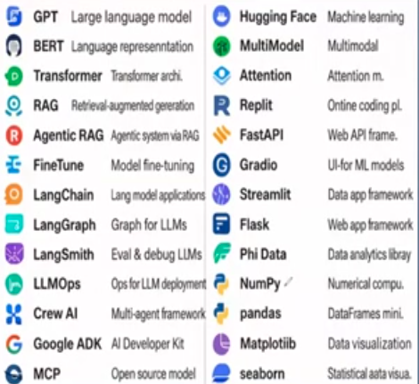
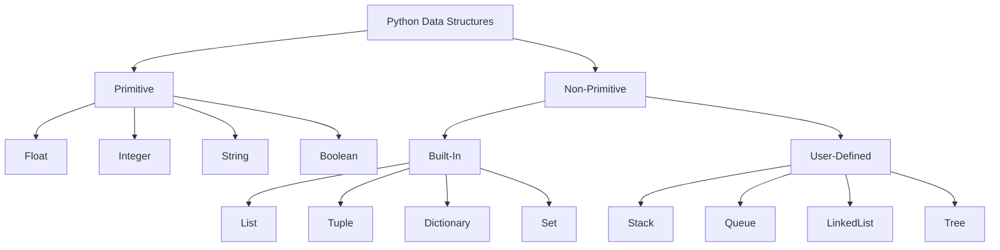
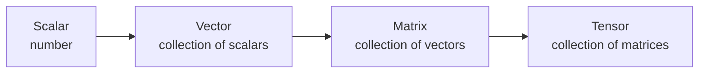
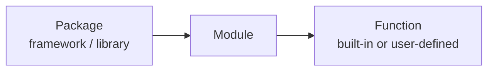

 



# Generative AI vs Agentic AI

## Generative AI

- AI generates code, text, image, video, audio.
- User needs to take the code and work in VS Code or any IDE to build the app for the project.

## Agentic AI

- Virtual developer or virtual agent writes the code, debugs, compiles the code, and installs frameworks.
- Everything is done by the virtual agent, which gives the app for your project.

## Organization

- An organization that needs 10 developers may require only 3-4 developers with an agentic AI framework.
- Because of this, companies get cost saving and automation, and more layoffs are going on.

## Language, ML, AI, Gen AI and Agentic AI

### Language and LLM

- Language == text.
- When the text is large (the whole internet), we need an ecosystem to create or handle that text, such as OpenAI or Gemini. These are called large language models (LLM).

### Machine learning vs AI

- If you work with data (data is Excel) -- machine learning.
- If the data is image, text, video, audio -- artificial intelligence.
- AI -- the user or developer trains the model on some text/data -- AI project.

### Gen AI

- The model is trained automatically by the provider (e.g. OpenAI). The user doesn't need to feed text or images to the model.
- The user only needs to write the prompt -- Gen AI project.

### Agentic AI

- LLM + virtual agent == instead of the user writing the code, the agent writes the code -- agentic AI.

### Data is 2 types

**1. Structured data** == labeled data = supervised learning ==== **Machine Learning**

- Excel sheet
- CSV
- Data that is in table format

**2. Unstructured data** == unlabeled data = unsupervised learning === **AI, Gen AI, Agentic AI**

- PDF
- Image
- Voice
- XML
- Video
- Audio
- JSON
- BSON
- Website

| | Structured | Unstructured |
| - | ---------- | ------------ |
| Also called | Labeled data | Unlabeled data |
| Learning type | Supervised learning | Unsupervised learning |
| Used in | Machine learning | AI, Gen AI, Agentic AI |
| Examples | Excel, CSV, tables | PDF, image, voice, XML, video, audio, JSON, BSON, website |

## BODMAS Rule

BODMAS gives the order in which to solve a math expression.

| Letter      | Meaning                   | Example                   |
| ----------- | ------------------------- | ------------------------- |
| **B** | Brackets                  | `( )`, `{ }`, `[ ]` |
| **O** | Orders (powers and roots) | `2²`, `√9`          |
| **D** | Division                  | `÷`                    |
| **M** | Multiplication            | `×`                    |
| **A** | Addition                  | `+`                     |
| **S** | Subtraction               | `−`                    |

- Solve in the order B → O → D/M → A/S.
- Division and multiplication have equal priority, so solve them left to right.
- Addition and subtraction have equal priority, so solve them left to right.

Example: `6 + 2 × (5 − 3)² ÷ 4`

1. Brackets: `(5 − 3) = 2` → `6 + 2 × 2² ÷ 4`
2. Orders: `2² = 4` → `6 + 2 × 4 ÷ 4`
3. Multiplication/Division, left to right: `2 × 4 = 8`, then `8 ÷ 4 = 2` → `6 + 2`
4. Addition: `6 + 2 = 8`

Answer: **8**

## Rules to Define a Variable (Python)

1. Variables are case sensitive.
   - `nit = 5` and `NIT` are different names, so using `NIT` to read `nit` is wrong.
2. A variable name cannot start with a digit, but it can end with a digit.
   - `nit1` is valid, `1nit` is not.
3. Special characters are not allowed except `_` (underscore).
4. Keywords cannot be used as variable names.
   - A keyword is a reserved word (like a reserved hotel room), e.g. `if`, `for`, `class`.

### How to find reserved words

```python
import keyword

print(keyword.kwlist)              # list of all reserved words
print(len(keyword.kwlist))         # how many there are
print(keyword.iskeyword("class"))  # True
print(keyword.iskeyword("nit"))    # False
```

- `help("keywords")` also lists them in Python's interactive help.
- The list changes a little between Python versions.
- Common ones: `if`, `else`, `for`, `while`, `class`, `def`, `return`, `import`, `True`, `False`, `None`.

### Calling a function

- In Python, a function is called with a `.` (dot) after the object, e.g. `name.upper()`.
- Functions always end with `()`.

## Variable and Function

- Values are assigned to a variable.
- A function always ends with `()`.

### Arguments / parameters

- `family1(d, m)` → `family1` is a function with 2 arguments (2 parameters).
- `family2(d, m, s, d)` → `family2` is a function with 4 arguments (4 parameters).

### Function vs method

- A function written inside a class is called a method.

```python
class man():
    family1(d, m)
```

- `family1(d, m)` here is a `family1` method with 2 arguments.

### Why GPU for AI models

- The ChatGPT model is trained with billions of parameters.
- CPU machines cannot handle this, so a GPU machine is used (e.g. Google Colab).

## Complex Data Type (Python)

- The `complex` data type is built into Python. Most other programming languages don't have it.
- Syntax: `a + bj`
  - `a` - real part
  - `b` - imaginary part
  - `j` - square root of -1
- Only the letter `j` is allowed. No other letter works.

```python
x = 3 + 4j
print(type(x))   # <class 'complex'>
print(x.real)    # 3.0
print(x.imag)    # 4.0
```

## String Indexing (Python)

- A string is a sequence of characters. Each character has a position called an index.
- Indexing uses square brackets: `string[index]`.
- Forward indexing starts at `0`. Backward (negative) indexing starts at `-1` from the last character.

| Character | P  | y  | t  | h  | o  | n  |
| --------- | -- | -- | -- | -- | -- | -- |
| Index     | 0  | 1  | 2  | 3  | 4  | 5  |
| Negative  | -6 | -5 | -4 | -3 | -2 | -1 |

```python
s = "Python"
print(s[0])    # P
print(s[3])    # h
print(s[-1])   # n  (last character)
print(s[-6])   # P  (first character)
print(s[6])    # IndexError: string index out of range
```

- Spaces and special characters also count as characters and have an index.
- Strings are immutable, so `s[0] = "J"` gives a `TypeError`.
- `len(s)` gives the length. The last valid index is `len(s) - 1`.

### String slicing: `s[start:stop:step]`

- `start` - index to begin from (included). Default is `0`.
- `stop` - index to stop at (not included). Default is the end of the string.
- `step` - how many characters to move each time. Default is `1`. A negative step goes backward.
- `s[::]` has no values, so all defaults apply and it returns the whole string.

Slicing patterns:

- `:` - prints all elements.
- `2:` - prints elements from index 2 to the end.
- `:5` - prints elements from the start index till `n-1`, here index 4 (`n` = 5).
- The `n-1` formula is always applied to the right index (the stop value), because the stop index is not included.

```python
s = "Python"
print(s[::])      # Python   (whole string)
print(s[:])       # Python   (same as s[::])
print(s[0:3])     # Pyt      (index 0 to 2)
print(s[2:])      # thon     (index 2 to end)
print(s[:4])      # Pyth     (start to index 3)
print(s[::2])     # Pto      (every 2nd character)
print(s[1::2])    # yhn      (from index 1, every 2nd)
print(s[::-1])    # nohtyP   (reversed string)
print(s[-3:])     # hon      (last 3 characters)
```

- `s[::-1]` is the common way to reverse a string.
- Slicing never raises `IndexError`. An out-of-range stop is just cut off, e.g. `s[0:100]` returns `Python`.

## Data Type vs Data Structure (Python)

### Data type

- The user defines only 1 value.

```python
a = 5          # int
b = 5.5        # float
c = 'nit'      # str
```

### Data structure

- The user defines more than 1 value.

```python
a1 = [1, 2, 3]            # list
b1 = ('a', 'b', 3.5)      # tuple
```

- Matrix -- array (1D, 2D, nD).
- DataFrame -- a table (rows * columns).

## Python Data Structures Classification



### Primitive

- Hold a single basic value.
- Types: `float`, `int`, `str`, `bool`.

```python
a = 5.5       # float
b = 5         # int
c = 'nit'     # str
d = True      # bool
```

### Non-Primitive

Hold a collection of values. They are of two kinds.

**Built-In** -- ready to use in Python.

| Type       | Syntax              | Notes                    |
| ---------- | ------------------- | ------------------------ |
| List       | `[1, 2, 3]`       | Ordered, changeable      |
| Tuple      | `('a', 'b', 3.5)` | Ordered, not changeable  |
| Dictionary | `{'name': 'nit'}` | Key-value pairs          |
| Set        | `{1, 2, 3}`       | Unordered, no duplicates |

**User-Defined** -- the developer builds them (using classes, lists, etc.).

| Type       | Idea                                       |
| ---------- | ------------------------------------------ |
| Stack      | Last in, first out (LIFO)                  |
| Queue      | First in, first out (FIFO)                 |
| LinkedList | Nodes linked to each other by references   |
| Tree       | Nodes arranged in a parent-child hierarchy |

## Scalar, Vector, Matrix and Tensor

| Name   | Meaning                  | Example                                  |
| ------ | ------------------------ | ---------------------------------------- |
| Scalar | A single number          | `5`                                    |
| Vector | A collection of scalars  | `[1, 2, 3]`                            |
| Matrix | A collection of vectors  | `[[1, 2], [3, 4]]`                     |
| Tensor | A collection of matrices | `[[[1, 2], [3, 4]], [[5, 6], [7, 8]]]` |



- Scalar is 0D, vector is 1D, matrix is 2D, and tensor is 3D or more (nD).

## Package vs Module vs Function (Python)

- Package == framework == library -- a collection of modules.
- Module -- a collection of functions.
- Function -- either built-in `inbuild()` or user-defined `user_define()`.



Example:

```python
from dmart_store.cloting import jeans
```

| Part            | Name     | Type     |
| --------------- | -------- | -------- |
| `dmart_store` | dmart    | package  |
| `cloting`     | clothing | module   |
| `jeans`       | jeans    | function |

- Examples of packages: `numpy`, `pandas`.

## List Methods: pop(), remove() and sort()

- `pop()` -- removes an element by index (index level).
- `remove()` -- removes an element by value (value based, element wise).
- Mutable -- a list can be changed after it is created.

```python
a = [10, 20, 30, 40]
a.pop(1)       # removes index 1 -> [10, 30, 40]
a.remove(40)   # removes value 40 -> [10, 30]
```

### Sorting

- Sorting is not possible when the user declares multiple data types in one list.
- Sorting is possible only when the user declares similar data types.

```python
[3, 1, 2].sort()          # works -> [1, 2, 3]
[3, 'a', 2.5].sort()      # TypeError: can't compare str and int
```

## Parameter Tuning vs Hyperparameter Tuning

- Parameter tuning -- the system gives its own parameter.
- Hyperparameter tuning -- the user changes the system parameter.

Example:

- Laptop - 11 OS (parameter): the system comes with it.
- Laptop - 10 OS (hyperparameter): the user chooses or changes it.

## Python List: Features and Methods

### Features

1. Defined with `[]`.
2. Can hold multiple data types in one list (heterogeneous).
3. Duplication is allowed.
4. A list is growable (it can grow or shrink).

```python
a = [1, 'nit', 5.5, 1]   # mixed types, duplicate 1
```

### Methods

| # | Method        | What it does                                                                               |
| - | ------------- | ------------------------------------------------------------------------------------------ |
| 1 | `append()`  | Adds the value at the end of the list                                                      |
| 2 | `copy()`    | Copies one list to another list                                                            |
| 3 | `clear()`   | Removes all values from the list                                                           |
| 4 | `insert()`  | Inserts the value before the given index                                                   |
| 5 | `pop()`     | Removes the value by index. If no argument is passed, it removes the last value by default |
| 6 | `remove()`  | Removes the given value from the list                                                      |
| 7 | `reverse()` | Reverses the list                                                                          |
| 8 | `extend()`  | Extends one list with another (merging)                                                    |
| 9 | `sort()`    | Sorts ascending or descending, only when the list has similar data types                   |

- Using the `del` keyword we can delete the variable (or an item by index).

```python
a = [10, 20, 30]
a.append(40)          # [10, 20, 30, 40]
b = a.copy()          # b = [10, 20, 30, 40]
a.insert(1, 15)       # [10, 15, 20, 30, 40]
a.pop()               # removes 40 -> [10, 15, 20, 30]
a.pop(0)              # removes index 0 -> [15, 20, 30]
a.remove(20)          # removes value 20 -> [15, 30]
a.reverse()           # [30, 15]
a.extend([1, 2])      # [30, 15, 1, 2]
a.sort()              # [1, 2, 15, 30]
a.sort(reverse=True)  # [30, 15, 2, 1]
a.clear()             # []
del a                 # deletes the variable a itself
```

## Revision Topics

- [X] Data type
- [X] Data structure
- [X] Matrix
- [X] Table (DataFrame)
- [X] Scalar
- [X] Vector
- [X] Tensor
- [X] `append()` vs `add()`
- [X] `list()` vs `set()`
- [X] `discard()` & `remove()`

## list() vs set()

| Feature     | `list()`    | `set()`     |
| ----------- | ------------- | ------------- |
| Syntax      | `[1, 2, 3]` | `{1, 2, 3}` |
| Order       | Ordered       | Unordered     |
| Duplicates  | Allowed       | Not allowed   |
| Indexing    | Yes, `a[0]` | No            |
| Add a value | `append()`  | `add()`     |

```python
l = list([1, 2, 2, 3])   # [1, 2, 2, 3]
s = set([1, 2, 2, 3])    # {1, 2, 3}  (duplicate removed)
```

## append() vs add()

- `append()` -- list method. Adds the value at the end of the list.
- `add()` -- set method. Adds the value to the set (no position, duplicates are ignored).

```python
l = [1, 2]
l.append(3)     # [1, 2, 3]

s = {1, 2}
s.add(3)        # {1, 2, 3}
s.add(3)        # no change, 3 is already there
```

## discard() vs remove()

Both remove a value from a set.

- `remove()` -- raises a `KeyError` if the value is not found.
- `discard()` -- does nothing if the value is not found.

```python
s = {1, 2, 3}
s.remove(2)       # {1, 3}
s.discard(3)      # {1}
s.discard(10)     # no error
s.remove(10)      # KeyError: 10
```

- For a list, `remove()` raises a `ValueError` if the value is missing. A list has no `discard()`.

## Set Operations

- `discard()` -- never throws an error if the element is not a member of the set.
- `remove()` -- throws an error if the element is not a member of the set.

| Operation            | Operator | Method                     | What it does                                                                                                    |
| -------------------- | -------- | -------------------------- | --------------------------------------------------------------------------------------------------------------- |
| Union                | `\|`    | `union()`                | Merges both sets                                                                                                |
| Intersection         | `&`    | `intersection()`         | Common elements only                                                                                            |
| Difference           | `-`    | `difference()`           | Removes the common elements and shows only the elements of the 1st set. Elements of the 2nd set are not printed |
| Symmetric difference | `^`    | `symmetric_difference()` | Skips the common elements and prints the elements of both sets                                                  |

```python
a = {1, 2, 3, 4}
b = {3, 4, 5, 6}

print(a | b)    # {1, 2, 3, 4, 5, 6}  union
print(a & b)    # {3, 4}              intersection
print(a - b)    # {1, 2}              difference (only from a)
print(b - a)    # {5, 6}              difference (only from b)
print(a ^ b)    # {1, 2, 5, 6}        symmetric difference
```

- The order of sets in `-` matters: `a - b` and `b - a` give different results.
- Printed set order may vary, since sets are unordered.

### symmetric_difference_update()

- Works like symmetric difference (`^`), but it updates the original set instead of returning a new one.
- The set keeps the elements that are in either set but not in both. Common elements are removed.
- It returns `None`.

```python
a = {1, 2, 3, 4}
b = {3, 4, 5, 6}

a.symmetric_difference_update(b)
print(a)    # {1, 2, 5, 6}  (a is changed)
print(b)    # {3, 4, 5, 6}  (b is unchanged)
```

| Method                                    | Changes the original set? |
| ----------------------------------------- | ------------------------- |
| `a ^ b` / `a.symmetric_difference(b)` | No, returns a new set     |
| `a.symmetric_difference_update(b)`      | Yes, updates `a`        |

### issubset(), issuperset() and isdisjoint()

These methods compare two sets and return `True` or `False`.

| Method              | Returns `True` when                  | Operator   |
| ------------------- | -------------------------------------- | ---------- |
| `a.issubset(b)`   | Every element of `a` is in `b`     | `a <= b` |
| `a.issuperset(b)` | `a` contains every element of `b`  | `a >= b` |
| `a.isdisjoint(b)` | `a` and `b` have no common element | -          |

```python
a = {1, 2}
b = {1, 2, 3, 4}
c = {7, 8}

print(a.issubset(b))      # True   (a is inside b)
print(b.issuperset(a))    # True   (b contains all of a)
print(b.issubset(a))      # False
print(a.isdisjoint(c))    # True   (nothing in common)
print(a.isdisjoint(b))    # False  (1 and 2 are common)
```

- Subset and superset are opposites: `a.issubset(b)` is the same as `b.issuperset(a)`.
- A set is a subset and a superset of itself.
- An empty set is a subset of every set, and is disjoint with every set.

## range() (Python)

- `range()` generates a sequence of numbers.
- `range()` takes a maximum of 3 arguments. The user can define only 3.
- Syntax: `range(start, stop, step)`
  - 1st argument - `start` - number to begin from (included). Default is `0`.
  - 2nd argument - `stop` - number to stop at (not included). The `n-1` rule applies, same as slicing.
  - 3rd argument - `step` - the gap between numbers. Default is `1`. A negative step counts backward.
- Passing more than 3 arguments gives a `TypeError`.
- It works only with integers.
- It does not print the numbers directly. Convert it with `list()` or loop over it.

```python
print(list(range(5)))          # [0, 1, 2, 3, 4]
print(list(range(2, 6)))       # [2, 3, 4, 5]
print(list(range(0, 10, 2)))   # [0, 2, 4, 6, 8]
print(list(range(10, 0, -2)))  # [10, 8, 6, 4, 2]

for i in range(3):
    print(i)                   # 0 1 2
```

| Form                         | Meaning                                               |
| ---------------------------- | ----------------------------------------------------- |
| `range(stop)`              | From 0 up to `stop - 1`                             |
| `range(start, stop)`       | From `start` up to `stop - 1`                     |
| `range(start, stop, step)` | From `start` up to `stop - 1`, moving by `step` |

- `range(5)` is not a list. It is a `range` object that creates numbers one by one, which saves memory.

## Python Operators

1. Arithmetic operator
2. Assignment operator
3. Relational operator
4. Logical operator
5. Unary operator

### 1. Arithmetic operator

| Operator | Name                              | Example    | Result  |
| -------- | --------------------------------- | ---------- | ------- |
| `+`    | Addition                          | `7 + 2`  | `9`   |
| `-`    | Subtraction                       | `7 - 2`  | `5`   |
| `*`    | Multiplication                    | `7 * 2`  | `14`  |
| `/`    | Division                          | `7 / 2`  | `3.5` |
| `%`    | Modulus (remainder)               | `7 % 2`  | `1`   |
| `//`   | Floor division                    | `7 // 2` | `3`   |
| `**`   | Power (exponent)                  | `7 ** 2` | `49`  |
| `^`    | Bitwise XOR (not power in Python) | `7 ^ 2`  | `5`   |

### 2. Assignment operator

- `=` assigns the value on the right to the variable on the left.

```python
a = 5
```

### 3. Relational operator

- Compares two values and returns `True` or `False`: `==`, `!=`, `>`, `<`, `>=`, `<=`.

### 4. Logical operator

- Combines conditions: `and`, `or`, `not`.

Truth table: `0` = False, `1` = True. `x` and `y` are the inputs, `c` is the output.

**`and` truth table** -- the output is True (1) only when both inputs are 1.

| x | y | c        |
| - | - | -------- |
| 0 | 0 | 0        |
| 0 | 1 | 0        |
| 1 | 0 | 0        |
| 1 | 1 | 1 (True) |

**`or` truth table** -- the output is True (1) when at least one input is 1.

| x | y | c |
| - | - | - |
| 0 | 0 | 0 |
| 0 | 1 | 1 |
| 1 | 0 | 1 |
| 1 | 1 | 1 |

**`not` truth table** -- reverses the value.

| A     | `not A` |
| ----- | --------- |
| True  | False     |
| False | True      |

```python
print(True and False)   # False
print(True or False)    # True
print(not True)         # False
```

### 5. Unary operator

- Works on a single value (operand), e.g. `-a`, `+a`, `not a`, `~a`.

## Number System

| System      | Base | Digits used  | Python prefix |
| ----------- | ---- | ------------ | ------------- |
| Binary      | 2    | `0, 1`     | `0b`        |
| Octal       | 8    | `0-7`      | `0o`        |
| Decimal     | 10   | `0-9`      | none          |
| Hexadecimal | 16   | `0-9, A-F` | `0x`        |

```python
print(0b1010)    # 10  (binary)
print(0o12)      # 10  (octal)
print(10)        # 10  (decimal)
print(0xA)       # 10  (hexadecimal)

print(bin(10))   # 0b1010
print(oct(10))   # 0o12
print(hex(10))   # 0xa
print(int("1010", 2))   # 10  (binary string to decimal)
```

- Base means how many digits the system uses.
- In hexadecimal, `A` to `F` stand for 10 to 15.

### How to calculate (convert) number systems

**1. Decimal to other base** -- divide by the base again and again, and write the remainders from bottom to top.

Decimal `10` to binary (base 2):

| Divide | Quotient | Remainder |
| ------ | -------- | --------- |
| 10 / 2 | 5        | 0         |
| 5 / 2  | 2        | 1         |
| 2 / 2  | 1        | 0         |
| 1 / 2  | 0        | 1         |

Read the remainders from bottom to top: `1010`.

- Decimal `100` to octal (divide by 8): remainders `4, 4, 1` -> read bottom to top -> `144`.
- Decimal `255` to hexadecimal (divide by 16): remainders `15 (F), 15 (F)` -> `FF`.

**2. Other base to decimal** -- multiply each digit by the base raised to its position (starting from 0 on the right), then add.

- Binary `1010` = (1 x 2^3) + (0 x 2^2) + (1 x 2^1) + (0 x 2^0) = 8 + 0 + 2 + 0 = `10`
- Octal `144` = (1 x 8^2) + (4 x 8^1) + (4 x 8^0) = 64 + 32 + 4 = `100`
- Hexadecimal `2F` = (2 x 16^1) + (15 x 16^0) = 32 + 15 = `47`

**3. Binary shortcuts**

- Binary to octal -- group the bits in 3s from the right: `1010` -> `001 010` -> `1 2` -> `12`.
- Binary to hexadecimal -- group the bits in 4s from the right: `11010110` -> `1101 0110` -> `D 6` -> `D6`.

| Binary (4 bits) | Hex | Binary (4 bits) | Hex |
| --------------- | --- | --------------- | --- |
| 0000            | 0   | 1000            | 8   |
| 0001            | 1   | 1001            | 9   |
| 0010            | 2   | 1010            | A   |
| 0011            | 3   | 1011            | B   |
| 0100            | 4   | 1100            | C   |
| 0101            | 5   | 1101            | D   |
| 0110            | 6   | 1110            | E   |
| 0111            | 7   | 1111            | F   |

### Hexadecimal (base 16) in detail

Hexadecimal uses 16 symbols. Since we only have the digits `0-9`, the letters `A-F` are used for the values 10 to 15.

| Decimal | 0 | 1 | 2 | 3 | 4 | 5 | 6 | 7 | 8 | 9 | 10 | 11 | 12 | 13 | 14 | 15 |
| ------- | - | - | - | - | - | - | - | - | - | - | -- | -- | -- | -- | -- | -- |
| Hex     | 0 | 1 | 2 | 3 | 4 | 5 | 6 | 7 | 8 | 9 | A  | B  | C  | D  | E  | F  |

**Place values (powers of 16)**

| Position (from right) | 0        | 1         | 2          | 3           |
| --------------------- | -------- | --------- | ---------- | ----------- |
| Value                 | 16^0 = 1 | 16^1 = 16 | 16^2 = 256 | 16^3 = 4096 |

**1. Decimal to hexadecimal** -- divide by 16 and read the remainders from bottom to top. A remainder of 10 to 15 is written as `A` to `F`.

Decimal `171` to hex:

| Divide   | Quotient | Remainder |
| -------- | -------- | --------- |
| 171 / 16 | 10       | 11 (B)    |
| 10 / 16  | 0        | 10 (A)    |

Read bottom to top: `AB`.

Decimal `25` to hex:

| Divide  | Quotient | Remainder |
| ------- | -------- | --------- |
| 25 / 16 | 1        | 9         |
| 1 / 16  | 0        | 1         |

Read bottom to top: `19`. (Here `19` is hex, not nineteen.)

**2. Hexadecimal to decimal** -- multiply each digit by `16^position` and add. Remember `16^0 = 1`.

- Hex `AB` = (10 x 16^1) + (11 x 16^0) = 160 + 11 = `171`
- Hex `19` = (1 x 16^1) + (9 x 16^0) = 16 + 9 = `25`
- Hex `1A3` = (1 x 16^2) + (10 x 16^1) + (3 x 16^0) = 256 + 160 + 3 = `419`

**3. Hexadecimal to binary** -- replace each hex digit with its 4-bit binary value.

- Hex `2F` -> `2` = `0010`, `F` = `1111` -> `00101111` (= `101111`, which is 47 in decimal)

**4. Binary to hexadecimal** -- group the bits in 4s from the right, then convert each group.

- Binary `11010110` -> `1101` `0110` -> `D` `6` -> `D6`

**Why hexadecimal is used**

- It is a short way to write long binary numbers: 4 binary digits = 1 hex digit.
- Colour codes: `#FF0000` is red, because `FF` = 255 red, `00` green and `00` blue.
- Memory addresses and byte values in programming.

```python
print(hex(25))          # 0x19
print(hex(171))         # 0xab   (Python prints the letters in lowercase)
print(hex(255))         # 0xff
print(0xAB)             # 171    (hex literal to decimal)
print(int("AB", 16))    # 171
print(int("0xff", 16))  # 255
print(bin(0x2F))        # 0b101111
```

- `hex()` returns a string with the `0x` prefix. The hex number itself is the part after `0x`.
- Hex digits are not case sensitive: `0xAB` and `0xab` are the same value.

## Bitwise Operators (6)

Bitwise operators work on the **binary (bit) form** of numbers, bit by bit.

1. Complement (`~`)
2. AND (`&`)
3. OR (`|`)
4. XOR (`^`)
5. Left shift (`<<`)
6. Right shift (`>>`)

Example numbers used below: `a = 5` -> `0101`, `b = 3` -> `0011`.

### Truth tables (0 = False, 1 = True)

| x | y | `x & y` (AND) | `x \| y` (OR) | `x ^ y` (XOR) |
| - | - | --------------- | -------------- | --------------- |
| 0 | 0 | 0               | 0              | 0               |
| 0 | 1 | 0               | 1              | 1               |
| 1 | 0 | 0               | 1              | 1               |
| 1 | 1 | 1               | 1              | 0               |

- AND `&` -- 1 only when both bits are 1.
- OR `|` -- 1 when at least one bit is 1.
- XOR `^` -- 1 when the bits are different.

### 1. Complement `~` (flips every bit)

- Formula: `~x = -(x + 1)`
- `~5` -> `-(5 + 1)` = `-6`

### 2. AND `&`

```text
  0101   (5)
& 0011   (3)
------
  0001   (1)
```

### 3. OR `|`

```text
  0101   (5)
| 0011   (3)
------
  0111   (7)
```

### 4. XOR `^`

```text
  0101   (5)
^ 0011   (3)
------
  0110   (6)
```

### 5. Left shift `<<` (moves bits left, adds 0s on the right)

- Left shift -- we **gain** the bits (the number gets longer).
- `x << n` = `x * 2^n`
- `5 << 1` -> `0101` becomes `1010` = `10`
- `5 << 2` -> `10100` = `20`

### 6. Right shift `>>` (moves bits right, drops bits on the right)

- Right shift -- we **lose** the bits (the bits on the right fall off).
- `x >> n` = `x // 2^n` (floor division by `2^n`)
- `5 >> 1` -> `0101` becomes `0010` = `2`
- `20 >> 2` -> `10100` becomes `00101` = `5`

```python
a = 5   # 0101
b = 3   # 0011

print(~a)       # -6
print(a & b)    # 1
print(a | b)    # 7
print(a ^ b)    # 6
print(a << 1)   # 10
print(a << 2)   # 20
print(a >> 1)   # 2
```

| Operator | Name        | `5` and `3`     |
| -------- | ----------- | ------------------- |
| `~`    | Complement  | `~5` = `-6`     |
| `&`    | AND         | `5 & 3` = `1`   |
| `\|`    | OR          | `5 \| 3` = `7`   |
| `^`    | XOR         | `5 ^ 3` = `6`   |
| `<<`   | Left shift  | `5 << 1` = `10` |
| `>>`   | Right shift | `5 >> 1` = `2`  |

- `^` is XOR here, not power. Power is `**`.
- `&`, `|` and `^` work on bits. The logical operators `and`, `or` work on True/False values.

## Swap 2 Variables (Python)

Swapping means exchanging the values of two variables. Start with `a = 5` and `b = 3`. After the swap, `a = 3` and `b = 5`.

### 1. Using a temporary variable

Use a third variable to hold one value while the swap happens, like using a third glass to swap the water in two glasses.

```python
a = 5
b = 3

temp = a    # temp = 5
a = b       # a = 3
b = temp    # b = 5

print(a, b)   # 3 5
```

### 2. Python shortcut (tuple unpacking)

Python can swap in one line without a third variable. This is the most common way.

```python
a = 5
b = 3

a, b = b, a

print(a, b)   # 3 5
```

### 3. Using arithmetic (+ and -)

```python
a = 5
b = 3

a = a + b   # a = 8
b = a - b   # b = 8 - 3 = 5
a = a - b   # a = 8 - 5 = 3

print(a, b)   # 3 5
```

### 4. Using XOR (`^`)

```python
a = 5   # 0101
b = 3   # 0011

a = a ^ b   # 0110 = 6
b = a ^ b   # 0110 ^ 0011 = 0101 = 5
a = a ^ b   # 0110 ^ 0101 = 0011 = 3

print(a, b)   # 3 5
```

| Method          | Extra variable? | Notes                                               |
| --------------- | --------------- | --------------------------------------------------- |
| Temp variable   | Yes             | Easy to understand, works in every language         |
| `a, b = b, a` | No              | Shortest and most used in Python                    |
| Arithmetic      | No              | Works with numbers only                             |
| XOR             | No              | Works with integers only, uses the bitwise operator |

### Is it possible to swap without a third variable?

Yes. Methods 2, 3 and 4 above all swap without a third variable.

- **Tuple unpacking:** `a, b = b, a` -- Python first builds the pair `(b, a)` on the right side, then assigns it to `a` and `b`. This is the best method in real Python code, and it works with any data type.
- **Arithmetic:** `a` first holds the sum `a + b`. Subtracting the old `b` leaves the old `a`, and subtracting that from the sum leaves the old `b`.
- **XOR:** XOR-ing a value with the same number twice gives the original value back, so the two values swap places.

The arithmetic and XOR methods work with numbers only (XOR with integers only), so they are mostly interview questions.
