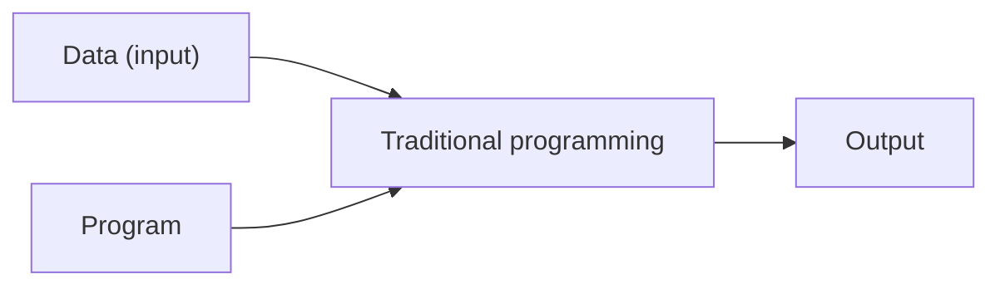
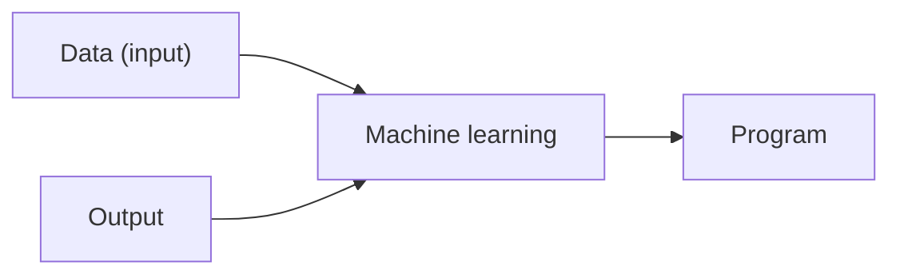
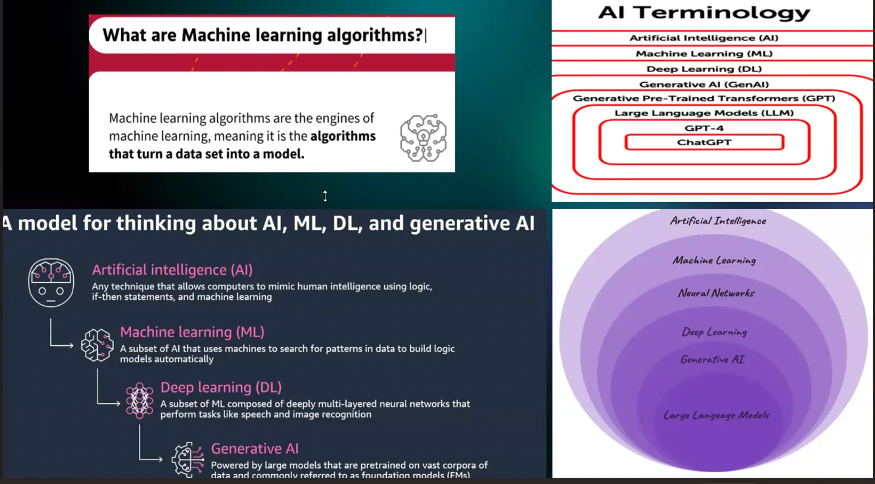
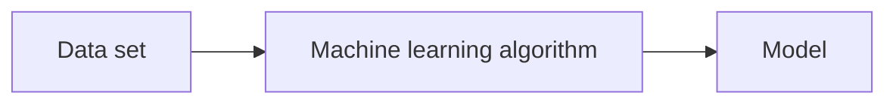
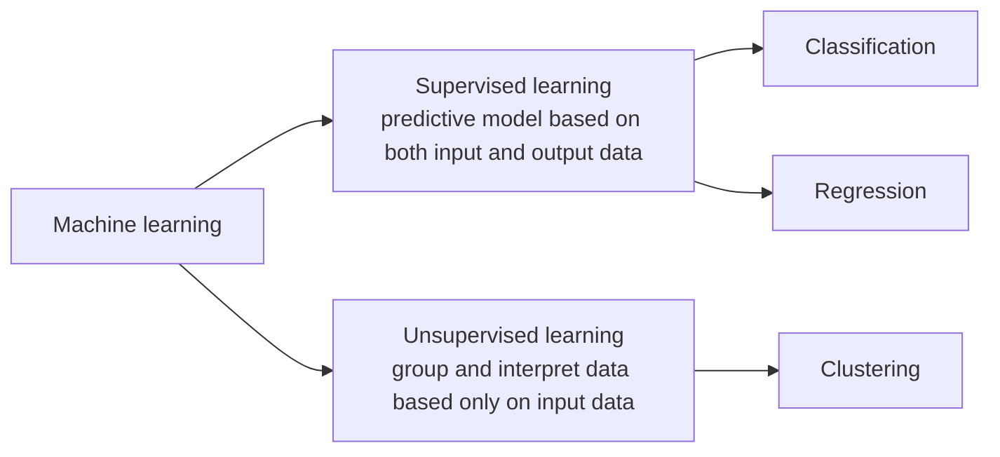
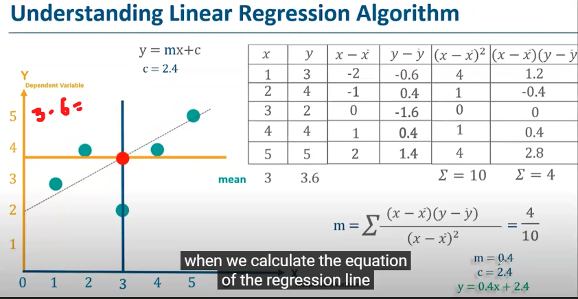

# Machine Learning

## What is machine learning?

> Machine learning is the field of study that gives computers the capability to learn without being explicitly programmed.

- In normal programming, a person writes **every rule** the computer must follow.
- In machine learning, the person gives the computer **examples** (data), and the computer finds the rules by itself.
- The result of learning is a **model** (a "program" that the computer wrote), which can then be used on new data.

## Traditional programming vs machine learning





| | Traditional programming | Machine learning |
| - | ----------------------- | ---------------- |
| What we give the computer | **Data** (input) and the **program** (the rules) | **Data** (input) and the **output** (the answers) |
| What we get back | The **output** | The **program** (the rules, called the model) |
| Who writes the rules? | The programmer | The computer, by learning from the data |
| Good for | Problems where the rules are known and simple | Problems where the rules are hard to write, or change with the data |

The two flows are the **reverse** of each other: traditional programming goes from `data + program` to `output`, and machine learning goes from `data + output` to `program`.

## Example: Celsius to Fahrenheit

**Traditional programming:** we know the rule, `F = C × 9/5 + 32`, so we write it.

```python
def to_fahrenheit(c):
    return c * 9 / 5 + 32          # the program (the rule) is written by the programmer

print(to_fahrenheit(100))          # 212.0   output
print(to_fahrenheit(25))           # 77.0
```

**Machine learning:** we do **not** write the rule. We give data (Celsius) and the output (Fahrenheit), and the computer learns the rule.

```python
import numpy as np
from sklearn.linear_model import LinearRegression

celsius = np.array([-40, -10, 0, 10, 20, 30, 40])           # data (input)
fahrenheit = np.array([-40, 14, 32, 50, 68, 86, 104])       # output

model = LinearRegression().fit(celsius.reshape(-1, 1), fahrenheit)    # learning: data + output -> program

print(model.coef_[0], model.intercept_)       # 1.8  32.0     the learned program: F = 1.8 x C + 32
print(model.predict([[100]])[0])              # 212.0         the learned program on new data
print(model.predict([[25]])[0])               # 77.0
```

- The model found the rule `F = 1.8 × C + 32` from the examples only. This is the same line `y = mx + c` from the regression notes: `m = 1.8` and `c = 32`.
- With real data there is some noise. With a little noise in the Fahrenheit values, the model still finds nearly the same rule (`1.789 × C + 32.3`) and predicts `211.2` for 100 degrees, close to the true 212.
- The more (and the better) the examples, the better the learned program.

## AI, machine learning and deep learning

The three terms are nested like circles: AI is the biggest, machine learning is inside it, and deep learning is inside machine learning.

```text
┌──────────────────────────────────────────────┐
│  Artificial Intelligence                     │
│   ┌──────────────────────────────────────┐   │
│   │  Machine Learning                    │   │
│   │   ┌──────────────────────────────┐   │   │
│   │   │  Deep Learning               │   │   │
│   │   └──────────────────────────────┘   │   │
│   └──────────────────────────────────────┘   │
└──────────────────────────────────────────────┘
```

| Term | Meaning | Example |
| ---- | ------- | ------- |
| **Artificial intelligence (AI)** | The big field: making machines do things that need human intelligence | A chatbot, a game-playing program, a self-driving car |
| **Machine learning (ML)** | A part of AI: the machine **learns from data** instead of following only written rules | A spam filter, a house price prediction |
| **Deep learning (DL)** | A part of ML: it uses **neural networks with many layers** | Recognizing faces in photos, speech to text, large language models (LLMs) |

- Every deep learning model is machine learning, and every machine learning model is AI. The other way round is not true.

## Definitions


- **Artificial intelligence (AI):** a broad discipline with the goal of creating intelligent machines, as opposed to the natural intelligence shown by humans and animals. It has become a catch-all term for the long-term ambition of the field to build machines that emulate and then exceed the full range of human cognition.
- **Machine learning (ML):** a subset of AI that often uses statistical techniques to give machines the ability to "learn" from data without being explicitly given the instructions for how to do so. This process is known as "training" a "model" using a learning "algorithm" that progressively improves the model performance on a specific task.
- **Reinforcement learning (RL):** an area of ML concerned with developing software agents that learn goal-oriented behavior by trial and error in an environment that provides rewards or penalties in response to the agent's actions (called a "policy") towards achieving that goal.
- **Deep learning (DL):** an area of ML that attempts to mimic the activity in layers of neurons in the brain to learn how to recognise complex patterns in data. The "deep" in deep learning refers to the large number of layers of neurons in contemporary ML models that help to learn rich representations of data to achieve better performance gains.

## What are machine learning algorithms?



Machine learning algorithms are the **engines** of machine learning: they are the algorithms that **turn a data set into a model**.



- In the Celsius example above, `LinearRegression` is the **algorithm** and the learned rule `F = 1.8 × C + 32` is the **model**.

## AI terminology: from AI to ChatGPT

Each term is a part of the one before it, like nested circles:

```text
Artificial Intelligence (AI)
└─ Machine Learning (ML)
   └─ Deep Learning (DL)
      └─ Generative AI (GenAI)
         └─ Generative Pre-Trained Transformers (GPT)
            └─ Large Language Models (LLM)
               └─ GPT-4
                  └─ ChatGPT
```

The same idea as a second picture (class slide): AI, machine learning, neural networks, deep learning, generative AI and large language models, from the outside to the inside.

### A model for thinking about AI, ML, DL and generative AI

| Term | Meaning |
| ---- | ------- |
| **Artificial intelligence (AI)** | Any technique that allows computers to mimic human intelligence using logic, if-then statements and machine learning |
| **Machine learning (ML)** | A subset of AI that uses machines to search for patterns in data to build logic models automatically |
| **Deep learning (DL)** | A subset of ML composed of deeply multi-layered neural networks that perform tasks like speech and image recognition |
| **Generative AI** | Powered by large models that are pre-trained on vast corpora of data and commonly referred to as foundation models (FMs) |

- See `generative-vs-agentic-ai.md` for generative AI in more detail.

## Types of machine learning

| Type | Data | What it learns | Example |
| ---- | ---- | -------------- | ------- |
| **Supervised learning** | Labeled data (has the output `y`) | Regression (`y` is a number), classification (`y` is a category) | House price, spam or not spam |
| **Unsupervised learning** | Unlabeled data (no `y`) | Clustering: groups in the data | Grouping customers |
| **Reinforcement learning** | The environment, with rewards | The best actions by trial and error | A game player, a robot |

The details (regression and classification algorithms, structured and unstructured data) are in `pandas.md`, section "EDA and Machine Learning".



## Understanding the linear regression algorithm



Linear regression is the first supervised algorithm: it finds the line `y = mx + c` that is closest to the data points. Here is the calculation by hand (the class example, 5 points).

| `x` | `y` | `x − x̄` | `y − ȳ` | `(x − x̄)²` | `(x − x̄)(y − ȳ)` |
| --- | --- | ------- | ------- | ---------- | ---------------- |
| 1 | 3 | −2 | −0.6 | 4 | 1.2 |
| 2 | 4 | −1 | 0.4 | 1 | −0.4 |
| 3 | 2 | 0 | −1.6 | 0 | 0 |
| 4 | 4 | 1 | 0.4 | 1 | 0.4 |
| 5 | 5 | 2 | 1.4 | 4 | 2.8 |
| mean: `x̄ = 3` | `ȳ = 3.6` | | | **Σ = 10** | **Σ = 4** |

**The steps**

1. Find the mean of `x` and the mean of `y`: `x̄ = 3` and `ȳ = 3.6`. This is the **mean point** `(3, 3.6)`, the red dot in the picture.
2. For every point, find how far it is from the mean: `x − x̄` and `y − ȳ`.
3. Square the `x` distances and add them: `Σ(x − x̄)² = 10`.
4. Multiply the `x` distance by the `y` distance for every point and add them: `Σ(x − x̄)(y − ȳ) = 4`.
5. The slope `m` is the ratio of the two sums. The intercept `c` comes from the mean point.

```text
        Σ (x − x̄)(y − ȳ)       4
m  =  ─────────────────────  =  ──  =  0.4
           Σ (x − x̄)²          10

c  =  ȳ − m · x̄  =  3.6 − 0.4 × 3  =  2.4

y  =  0.4 x + 2.4
```

- The best fit line **always passes through the mean point** `(x̄, ȳ)`. That is why `c = ȳ − m · x̄` works.
- The slope `m = 0.4`: when `x` goes up by 1, `y` goes up by 0.4.
- Prediction: for `x = 6`, `ŷ = 0.4 × 6 + 2.4 =` **4.8**.
- The line is the one with the smallest sum of squared errors (SSE). See `statistics.md`, "Sum of squares: SST, SSR and SSE".

The same result with Python:

```python
import numpy as np

x = np.array([1, 2, 3, 4, 5])
y = np.array([3, 4, 2, 4, 5])

m = ((x - x.mean()) * (y - y.mean())).sum() / ((x - x.mean()) ** 2).sum()   # 4 / 10
c = y.mean() - m * x.mean()                                                 # 3.6 - 0.4 * 3
print(m, c)                          # 0.4  2.4

print(np.polyfit(x, y, 1))           # [0.4 2.4]   the same, with NumPy
```

## The machine learning workflow

1. **Collect the data** (the examples).
2. **Clean and explore it** (EDA: missing values, outliers, encoding). See the EDA notes.
3. **Split** the data into a training part and a test part.
4. **Train** the model on the training data (`fit`): the computer learns the program.
5. **Evaluate** it on the test data: MAE, MSE, RMSE and R² for regression, or accuracy for classification. See `statistics.md`.
6. **Predict** for new data (`predict`).

### ML workflow or ML pipeline (class notes)

```text
1- dataset
2- independent variable (x) & dependent variable (y)
3- x --> x_train & x_test
4- y --> y_train & y_test
5- divide the data into 80-20 | 70-30 | 75-25
```

| Step | Meaning |
| ---- | ------- |
| 1. Dataset | The data we start with (a table: rows are examples, columns are variables) |
| 2. Independent variable (`x`) and dependent variable (`y`) | `x` is the input (the features we know). `y` is the output we want to predict (the label) |
| 3. `x` → `x_train` and `x_test` | The inputs are split into a training part and a test part |
| 4. `y` → `y_train` and `y_test` | The outputs are split in the **same rows**, so each `x` keeps its `y` |
| 5. Divide the data: 80-20, 70-30 or 75-25 | The share for training and testing. For example 80-20 means 80% of the rows train the model and 20% test it |

- The model **learns** from `x_train` and `y_train` (`fit`), and is **checked** on `x_test` and `y_test`. The test part is data the model has never seen, so the score is honest.
- A bigger training part (80-20) gives the model more to learn from. A bigger test part (70-30) gives a more reliable score. 80-20 is the common choice.

```python
import pandas as pd
from sklearn.model_selection import train_test_split

df = pd.read_csv("purchased_data.csv")          # 1- dataset: State, Age, Salary, Purchased

x = df[["Age", "Salary"]]                       # 2- independent variables (x)
y = df["Purchased"]                             #    dependent variable (y)

# 3, 4 and 5: x -> x_train, x_test and y -> y_train, y_test, with an 80-20 split
x_train, x_test, y_train, y_test = train_test_split(
    x, y, test_size=0.20, random_state=42)      # 0.30 gives 70-30, 0.25 gives 75-25

print(len(x_train), len(x_test))                # 80% of the rows, 20% of the rows
```

- `test_size=0.20` is the test share (20%), so the training share is the remaining 80%.
- `random_state=42` makes the random split the same every time we run it.

### The 7 steps of machine learning (class picture)

| # | Step | What happens |
| - | ---- | ------------ |
| 1 | **Gathering data** | Collect the examples |
| 2 | **Preparing that data** | Clean it and get it ready (EDA, encoding) |
| 3 | **Choosing a model** | Pick the algorithm that fits the problem |
| 4 | **Training** | The model learns from the training data (`fit`) |
| 5 | **Evaluation** | Check the model on the test data |
| 6 | **Hyperparameter tuning** | Adjust the model settings to improve the result |
| 7 | **Prediction** | Use the model on new data (`predict`) |

## Preprocessing data with scikit-learn

Source: [scikit-learn, "Preprocessing data"](https://scikit-learn.org/stable/modules/preprocessing.html).

Raw data is rarely ready for a model. The `sklearn.preprocessing` module has **transformers** that clean and reshape the features first. They all follow the same pattern:

```text
fit(x_train)         learn from the TRAINING data (mean, min, categories ...)
transform(x_train)   apply it to the training data
transform(x_test)    apply the SAME learned values to the test data   (never fit on the test data)
fit_transform(x)     fit and transform in one call
```

- Fitting on the training part only keeps the test part "unseen", so the test score stays honest (the split is in "ML workflow or ML pipeline").
- A transformer can be the first step of a **Pipeline**, so the same steps run for training and for new data: `make_pipeline(StandardScaler(), LogisticRegression())`.

| Need | Tool | Section |
| ---- | ---- | ------- |
| Features on different scales | `StandardScaler`, `MinMaxScaler`, `MaxAbsScaler`, `RobustScaler` | Scaling |
| Skewed or unusual distribution | `QuantileTransformer`, `PowerTransformer` | Non-linear transformations |
| Compare rows (text, clustering) | `Normalizer` | Normalization |
| Text categories to numbers | `OrdinalEncoder`, `OneHotEncoder`, `LabelEncoder`, `TargetEncoder` | Encoding |
| Numbers to bins or 0/1 | `KBinsDiscretizer`, `Binarizer` | Discretization |
| Missing values | `SimpleImputer` | Imputation |
| Curves and interactions | `PolynomialFeatures`, `SplineTransformer` | Polynomial features |
| Your own function | `FunctionTransformer` | Custom transformers |

### Scaling the features

Many models (SVM, linear models with regularization, k-nearest neighbors) work badly when one feature is much bigger than the others, for example `Salary` (tens of thousands) next to `Age` (tens). Scaling puts the features on a comparable scale.

| Scaler | What it does | When to use it |
| ------ | ------------ | -------------- |
| **`StandardScaler`** | Removes the mean and divides by the standard deviation: `z = (x − mean) / std`. Each column gets mean 0 and variance 1 | The usual first choice. This is the **z-score** from `statistics.md` |
| **`MinMaxScaler`** | Rescales each column to a range, by default `[0, 1]` | When you need bounded values |
| **`MaxAbsScaler`** | Divides each column by its largest absolute value, so the data lies in `[−1, 1]`. It does not shift the data | Sparse data, or data already centered at 0 |
| **`RobustScaler`** | Uses the **median and the IQR** (the middle part of the data) instead of the mean and standard deviation | When the data has **outliers**, because they distort the mean and the standard deviation |

```python
import numpy as np
from sklearn import preprocessing

X_train = np.array([[ 1., -1.,  2.],
                    [ 2.,  0.,  0.],
                    [ 0.,  1., -1.]])

scaler = preprocessing.StandardScaler().fit(X_train)
print(scaler.mean_)               # [1.   0.   0.33]   the mean of each column
print(scaler.scale_)              # [0.81 0.81 1.24]   the standard deviation of each column
print(scaler.transform(X_train))
# [[ 0.   -1.22  1.33 ]
#  [ 1.22  0.   -0.27 ]
#  [-1.22  1.22 -1.06 ]]
```

```python
min_max = preprocessing.MinMaxScaler()
print(min_max.fit_transform(X_train))
# [[0.5        0.         1.        ]
#  [1.         0.5        0.33333333]
#  [0.         1.         0.        ]]

print(min_max.transform(np.array([[-3., -1., 4.]])))
# [[-1.5         0.          1.66666667]]    new data outside the training range goes outside [0, 1]
```

The formula of `MinMaxScaler` for a range `(min, max)`:

```text
X_std    = (X − X.min) / (X.max − X.min)
X_scaled = X_std × (max − min) + min
```

- `StandardScaler(with_mean=False)` or `(with_std=False)` switches off the centering or the scaling.
- **Sparse data** (mostly zeros): centering would destroy the zeros, so use `MaxAbsScaler`, or `StandardScaler(with_mean=False)`.

### Non-linear transformations

Both change the **shape** of the distribution, and both keep the order of the values inside a column.

| Transformer | What it does | When to use it |
| ----------- | ------------ | -------------- |
| **`QuantileTransformer`** | Maps each column to a **uniform** distribution on `[0, 1]` (or to a normal one with `output_distribution="normal"`) using the quantiles of the data | Skewed data and outliers: it is less sensitive to outliers than scaling. It does distort distances and correlations |
| **`PowerTransformer`** | A formula that pushes the data towards a **normal** (Gaussian) shape and reduces skew. Two methods: `yeo-johnson` (positive and negative values) and `box-cox` (positive values only) | When a model likes normal-looking features. Plot the data before and after, it does not work for every distribution |

```python
pt = preprocessing.PowerTransformer(method="box-cox", standardize=False)
X_lognormal = np.random.RandomState(616).lognormal(size=(3, 3))
print(pt.fit_transform(X_lognormal))     # the skewed values moved towards a normal shape
```

```text
Box-Cox (x > 0):   (x^λ − 1) / λ   when λ ≠ 0       ln(x)   when λ = 0
```

- The `λ` (lambda) is found from the data by maximum likelihood.
- `PowerTransformer` also standardizes its output (mean 0, variance 1) unless `standardize=False`.

### Normalization

`Normalizer` scales each **row** (each sample) to have a length (norm) of 1. The scalers above work on columns, this one works on rows.

```python
X = [[ 1., -1.,  2.],
     [ 2.,  0.,  0.],
     [ 0.,  1., -1.]]

print(preprocessing.normalize(X, norm="l2"))
# [[ 0.408 -0.408  0.816]
#  [ 1.     0.     0.   ]
#  [ 0.     0.707 -0.707]]
```

- The norm can be `l1`, `l2` or `max`.
- Use it when you compare samples with a dot product or a kernel, for example in **text classification and clustering**.
- `Normalizer().fit(X)` does nothing (it keeps no values), so it can sit in a Pipeline.

### Encoding categorical features

Models need numbers, but columns like `State` hold text. The simple idea, "Mumbai = 0, Bangalore = 1, ...", has a problem: the model reads the numbers as an **order** (2 is more than 1), which is wrong for names of cities.

| Encoder | Output | When to use it |
| ------- | ------ | -------------- |
| **`OrdinalEncoder`** | One integer column per feature: `0` to `n_categories − 1` | Categories that **have an order** (small, medium, large), or tree-based models |
| **`OneHotEncoder`** | One **0/1 column per category** (one-hot, dummy variables). Exactly one `1` in each row | Categories **without an order** (cities, colours), for linear models |
| **`LabelEncoder`** | Integers `0` to `n − 1` for a **single column** | The **target `y`** (for example `Yes` and `No`) |
| **`TargetEncoder`** | Each category is replaced by a smoothed average of the target | A feature with **very many** categories (ZIP codes) |

```python
enc = preprocessing.OrdinalEncoder()
X = [["male", "from US", "uses Safari"], ["female", "from Europe", "uses Firefox"]]
enc.fit(X)
print(enc.transform([["female", "from US", "uses Safari"]]))     # [[0. 1. 1.]]
```

```python
enc = preprocessing.OneHotEncoder()
enc.fit(X)
print(enc.transform([["female", "from US", "uses Safari"],
                     ["male", "from Europe", "uses Safari"]]).toarray())
# [[1. 0. 0. 1. 0. 1.]
#  [0. 1. 1. 0. 0. 1.]]
print(enc.categories_)
# [array(['female', 'male']), array(['from Europe', 'from US']), array(['uses Firefox', 'uses Safari'])]
```

Useful options of `OneHotEncoder`:

| Option | Effect |
| ------ | ------ |
| `drop="first"` | One column less per feature (`n − 1`). This avoids **collinearity** (the dummy columns add up to 1), which matters for linear regression without regularization |
| `drop="if_binary"` | Drops a column only for features with 2 categories |
| `handle_unknown="ignore"` | A category not seen in training gives an all-zero row instead of an error |
| `handle_unknown="infrequent_if_exist"` | An unseen category goes to the "infrequent" group, or to all zeros |
| `min_frequency`, `max_categories` | Group the rare categories into one "infrequent" column |

- **Missing values:** `OrdinalEncoder` keeps `np.nan` as `nan` (or use `encoded_missing_value=-1`). `OneHotEncoder` treats a missing value as its own category.
- `TargetEncoder`: use `fit_transform` on the training data, not `fit(...).transform(...)`. It uses cross-fitting, so a row's own target does not leak into its encoding.

### Discretization (binning)

Turns a continuous column into **bins**. It can give a linear model some non-linearity and makes a feature easier to read.

```python
X = np.array([[ -3., 5., 15 ],
              [  0., 6., 14 ],
              [  6., 3., 11 ]])

est = preprocessing.KBinsDiscretizer(n_bins=[3, 2, 2], encode="ordinal").fit(X)
print(est.transform(X))
# [[0. 1. 1.]
#  [1. 1. 1.]
#  [2. 0. 0.]]
```

- `KBinsDiscretizer` strategies: `uniform` (equal width), `quantile` (equal number of values), `kmeans`.
- `Binarizer` is the case of 2 bins: values above a threshold become `1`, the rest `0`.

```python
binarizer = preprocessing.Binarizer().fit(X)
print(binarizer.transform(X))
# [[1. 0. 1.]
#  [1. 0. 0.]
#  [0. 1. 0.]]
```

### Imputation of missing values

Models cannot take `NaN`, so the missing values are filled before training. The class is `SimpleImputer` (from `sklearn.impute`): the default strategy is the **mean**, and it also has `median`, `most_frequent` and `constant`. See also the missing value treatment in `pandas.md`.

### Polynomial features and custom transformers

```python
from sklearn.preprocessing import PolynomialFeatures, FunctionTransformer

X = np.arange(6).reshape(3, 2)
print(PolynomialFeatures(2).fit_transform(X))
# [[ 1.  0.  1.  0.  0.  1.]        columns: 1, x1, x2, x1², x1·x2, x2²
#  [ 1.  2.  3.  4.  6.  9.]
#  [ 1.  4.  5. 16. 20. 25.]]

log = FunctionTransformer(np.log1p)                  # any Python function as a transformer
print(log.transform(np.array([[0, 1], [2, 3]])))
# [[0.         0.69314718]
#  [1.09861229 1.38629436]]
```

- `PolynomialFeatures` adds powers and interaction terms (`x1 · x2`), so a linear model can fit a curve. `SplineTransformer` does the same with smoother B-spline pieces.

### Example: preprocessing the purchased data (`ml_sklearn.py`)

The file `purchased_data.csv` has 10 rows: `State`, `Age`, `Salary` (the inputs `x`) and `Purchased` (the output `y`). Two values are missing: the `Age` of one Bangalore row and the `Salary` of one Hyderabad row.

```python
import numpy as np
import matplotlib.pyplot as plt
import pandas as pd

dataset = pd.read_csv(r"C:\Users\Admin\03_MY_LEARNING\purchased_data.csv")
x = dataset.iloc[:, :-1].values          # State, Age, Salary   (all columns except the last)
y = dataset.iloc[:, 3].values            # Purchased            (the 4th column)


# 1. Imputation: fill the missing Age and Salary with the column mean
from sklearn.impute import SimpleImputer

imputer = SimpleImputer()                          # default strategy = "mean"
imputer = imputer.fit(x[:, 1:3])                   # learn the mean of Age and Salary
x[:, 1:3] = imputer.transform(x[:, 1:3])           # fill the missing values


# 2. Encoding: text to numbers
from sklearn.preprocessing import LabelEncoder

labelencoder_x = LabelEncoder()
x[:, 0] = labelencoder_x.fit_transform(x[:, 0])    # State: Bangalore 0, Hyderabad 1, Mumbai 2

labelencode_y = LabelEncoder()
y = labelencode_y.fit_transform(y)                 # Purchased: No 0, Yes 1


# 3. Split into training and test data (80-20)
from sklearn.model_selection import train_test_split

x_train, x_test, y_train, y_test = train_test_split(
    x, y, test_size=0.2, train_size=0.8, random_state=0)
```

| Step | What happens in this data |
| ---- | ------------------------- |
| `x = ...iloc[:, :-1]`, `y = ...iloc[:, 3]` | Independent variables `x` (`State`, `Age`, `Salary`) and dependent variable `y` (`Purchased`) |
| `SimpleImputer()` on `x[:, 1:3]` | The missing `Age` becomes the mean age of the 9 known values (`38.78`), and the missing `Salary` the mean salary (`63,777.78`) |
| `LabelEncoder` on `State` | `Bangalore = 0`, `Hyderabad = 1`, `Mumbai = 2` (alphabetical order) |
| `LabelEncoder` on `y` | `No = 0`, `Yes = 1` |
| `train_test_split(..., test_size=0.2)` | 10 rows: **8 for training** and **2 for testing**. `random_state=0` gives the same split every run |

Notes on this example:

- `test_size=0.2` and `train_size=0.8` say the same thing, one of them is enough.
- The imputer is fitted on **all** the rows here. In a real project, split first and fit the imputer on `x_train` only, then `transform` both parts (the data leakage point above).
- `LabelEncoder` is made for the **target `y`**. For a feature like `State` the numbers `0, 1, 2` look like an order, which is wrong for cities. The safer way is `OneHotEncoder` (one 0/1 column per city). Use it **instead of** the `LabelEncoder` on `State`, so `x` still holds the text at that point:

```python
from sklearn.compose import ColumnTransformer
from sklearn.preprocessing import OneHotEncoder

ct = ColumnTransformer([("state", OneHotEncoder(), [0])], remainder="passthrough")
x = ct.fit_transform(x)          # 3 State columns (0/1), then Age and Salary
```

- After the split, a scaler is usually next: fit on `x_train`, and use the same values on `x_test`.

```python
from sklearn.preprocessing import StandardScaler

sc = StandardScaler()
x_train = sc.fit_transform(x_train)     # learns the mean and std from the training data
x_test = sc.transform(x_test)           # applies the same mean and std
```

## Quick reference

| Term | Meaning |
| ---- | ------- |
| Machine learning | Computers learn without being explicitly programmed |
| Traditional programming | Data + program, gives the output |
| Machine learning (flow) | Data + output, gives the program (the model) |
| Model | The program that the computer learned |
| Training (`fit`) | Learning the program from the data |
| Prediction (`predict`) | Using the learned program on new data |
| AI > ML > DL | Deep learning is inside machine learning, which is inside AI |
