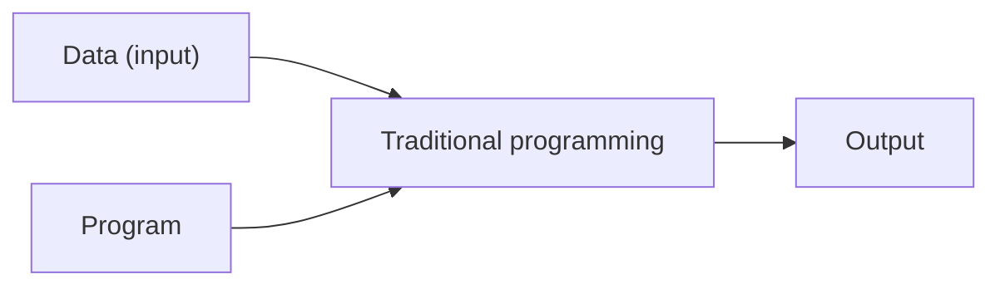
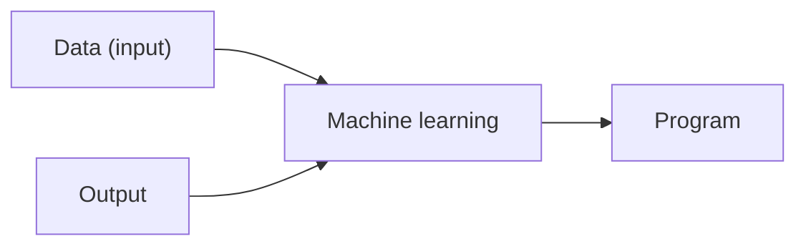
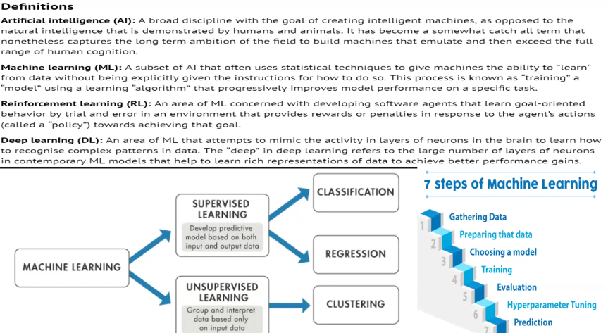
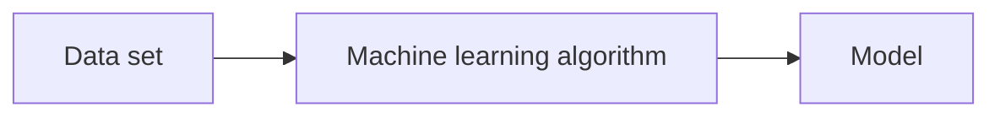
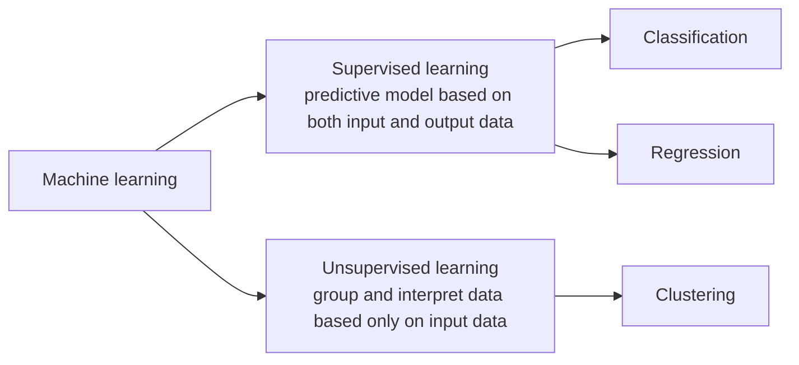

# Machine Learning

## What is machine learning?

> Machine learning is the field of study that gives computers the capability to learn without being explicitly programmed.

- In normal programming, a person writes **every rule** the computer must follow.
- In machine learning, the person gives the computer **examples** (data), and the computer finds the rules by itself.
- The result of learning is a **model** (a "program" that the computer wrote), which can then be used on new data.

## Traditional programming vs machine learning





| | Traditional programming | Machine learning |
| - | ----------------------- | ---------------- |
| What we give the computer | **Data** (input) and the **program** (the rules) | **Data** (input) and the **output** (the answers) |
| What we get back | The **output** | The **program** (the rules, called the model) |
| Who writes the rules? | The programmer | The computer, by learning from the data |
| Good for | Problems where the rules are known and simple | Problems where the rules are hard to write, or change with the data |

The two flows are the **reverse** of each other: traditional programming goes from `data + program` to `output`, and machine learning goes from `data + output` to `program`.

## Example: Celsius to Fahrenheit

**Traditional programming:** we know the rule, `F = C × 9/5 + 32`, so we write it.

```python
def to_fahrenheit(c):
    return c * 9 / 5 + 32          # the program (the rule) is written by the programmer

print(to_fahrenheit(100))          # 212.0   output
print(to_fahrenheit(25))           # 77.0
```

**Machine learning:** we do **not** write the rule. We give data (Celsius) and the output (Fahrenheit), and the computer learns the rule.

```python
import numpy as np
from sklearn.linear_model import LinearRegression

celsius = np.array([-40, -10, 0, 10, 20, 30, 40])           # data (input)
fahrenheit = np.array([-40, 14, 32, 50, 68, 86, 104])       # output

model = LinearRegression().fit(celsius.reshape(-1, 1), fahrenheit)    # learning: data + output -> program

print(model.coef_[0], model.intercept_)       # 1.8  32.0     the learned program: F = 1.8 x C + 32
print(model.predict([[100]])[0])              # 212.0         the learned program on new data
print(model.predict([[25]])[0])               # 77.0
```

- The model found the rule `F = 1.8 × C + 32` from the examples only. This is the same line `y = mx + c` from the regression notes: `m = 1.8` and `c = 32`.
- With real data there is some noise. With a little noise in the Fahrenheit values, the model still finds nearly the same rule (`1.789 × C + 32.3`) and predicts `211.2` for 100 degrees, close to the true 212.
- The more (and the better) the examples, the better the learned program.

## AI, machine learning and deep learning

The three terms are nested like circles: AI is the biggest, machine learning is inside it, and deep learning is inside machine learning.

```text
┌──────────────────────────────────────────────┐
│  Artificial Intelligence                     │
│   ┌──────────────────────────────────────┐   │
│   │  Machine Learning                    │   │
│   │   ┌──────────────────────────────┐   │   │
│   │   │  Deep Learning               │   │   │
│   │   └──────────────────────────────┘   │   │
│   └──────────────────────────────────────┘   │
└──────────────────────────────────────────────┘
```

| Term | Meaning | Example |
| ---- | ------- | ------- |
| **Artificial intelligence (AI)** | The big field: making machines do things that need human intelligence | A chatbot, a game-playing program, a self-driving car |
| **Machine learning (ML)** | A part of AI: the machine **learns from data** instead of following only written rules | A spam filter, a house price prediction |
| **Deep learning (DL)** | A part of ML: it uses **neural networks with many layers** | Recognizing faces in photos, speech to text, large language models (LLMs) |

- Every deep learning model is machine learning, and every machine learning model is AI. The other way round is not true.

## Definitions



- **Artificial intelligence (AI):** a broad discipline with the goal of creating intelligent machines, as opposed to the natural intelligence shown by humans and animals. It has become a catch-all term for the long-term ambition of the field to build machines that emulate and then exceed the full range of human cognition.
- **Machine learning (ML):** a subset of AI that often uses statistical techniques to give machines the ability to "learn" from data without being explicitly given the instructions for how to do so. This process is known as "training" a "model" using a learning "algorithm" that progressively improves the model performance on a specific task.
- **Reinforcement learning (RL):** an area of ML concerned with developing software agents that learn goal-oriented behavior by trial and error in an environment that provides rewards or penalties in response to the agent's actions (called a "policy") towards achieving that goal.
- **Deep learning (DL):** an area of ML that attempts to mimic the activity in layers of neurons in the brain to learn how to recognise complex patterns in data. The "deep" in deep learning refers to the large number of layers of neurons in contemporary ML models that help to learn rich representations of data to achieve better performance gains.

## What are machine learning algorithms?


Machine learning algorithms are the **engines** of machine learning: they are the algorithms that **turn a data set into a model**.



- In the Celsius example above, `LinearRegression` is the **algorithm** and the learned rule `F = 1.8 × C + 32` is the **model**.

## AI terminology: from AI to ChatGPT

Each term is a part of the one before it, like nested circles:

```text
Artificial Intelligence (AI)
└─ Machine Learning (ML)
   └─ Deep Learning (DL)
      └─ Generative AI (GenAI)
         └─ Generative Pre-Trained Transformers (GPT)
            └─ Large Language Models (LLM)
               └─ GPT-4
                  └─ ChatGPT
```

The same idea as a second picture (class slide): AI, machine learning, neural networks, deep learning, generative AI and large language models, from the outside to the inside.

### A model for thinking about AI, ML, DL and generative AI

| Term | Meaning |
| ---- | ------- |
| **Artificial intelligence (AI)** | Any technique that allows computers to mimic human intelligence using logic, if-then statements and machine learning |
| **Machine learning (ML)** | A subset of AI that uses machines to search for patterns in data to build logic models automatically |
| **Deep learning (DL)** | A subset of ML composed of deeply multi-layered neural networks that perform tasks like speech and image recognition |
| **Generative AI** | Powered by large models that are pre-trained on vast corpora of data and commonly referred to as foundation models (FMs) |

- See `generative-vs-agentic-ai.md` for generative AI in more detail.

## Types of machine learning

| Type | Data | What it learns | Example |
| ---- | ---- | -------------- | ------- |
| **Supervised learning** | Labeled data (has the output `y`) | Regression (`y` is a number), classification (`y` is a category) | House price, spam or not spam |
| **Unsupervised learning** | Unlabeled data (no `y`) | Clustering: groups in the data | Grouping customers |
| **Reinforcement learning** | The environment, with rewards | The best actions by trial and error | A game player, a robot |

The details (regression and classification algorithms, structured and unstructured data) are in `pandas.md`, section "EDA and Machine Learning".



## The machine learning workflow

1. **Collect the data** (the examples).
2. **Clean and explore it** (EDA: missing values, outliers, encoding). See the EDA notes.
3. **Split** the data into a training part and a test part.
4. **Train** the model on the training data (`fit`): the computer learns the program.
5. **Evaluate** it on the test data: MAE, MSE, RMSE and R² for regression, or accuracy for classification. See `statistics.md`.
6. **Predict** for new data (`predict`).

### The 7 steps of machine learning (class picture)

| # | Step | What happens |
| - | ---- | ------------ |
| 1 | **Gathering data** | Collect the examples |
| 2 | **Preparing that data** | Clean it and get it ready (EDA, encoding) |
| 3 | **Choosing a model** | Pick the algorithm that fits the problem |
| 4 | **Training** | The model learns from the training data (`fit`) |
| 5 | **Evaluation** | Check the model on the test data |
| 6 | **Hyperparameter tuning** | Adjust the model settings to improve the result |
| 7 | **Prediction** | Use the model on new data (`predict`) |

## Quick reference

| Term | Meaning |
| ---- | ------- |
| Machine learning | Computers learn without being explicitly programmed |
| Traditional programming | Data + program, gives the output |
| Machine learning (flow) | Data + output, gives the program (the model) |
| Model | The program that the computer learned |
| Training (`fit`) | Learning the program from the data |
| Prediction (`predict`) | Using the learned program on new data |
| AI > ML > DL | Deep learning is inside machine learning, which is inside AI |
