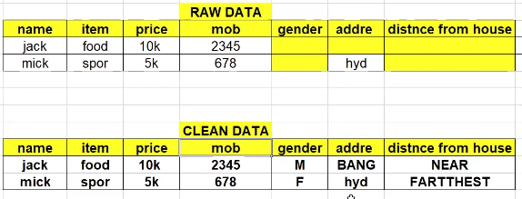
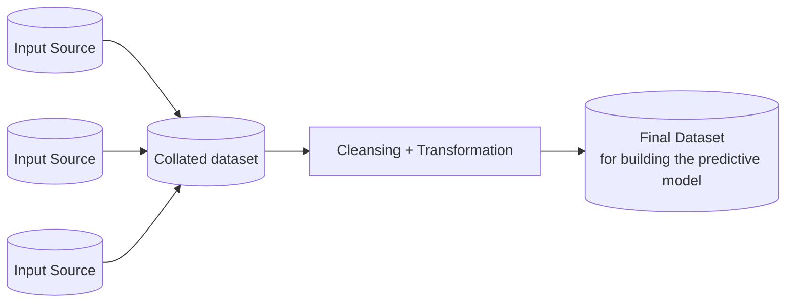
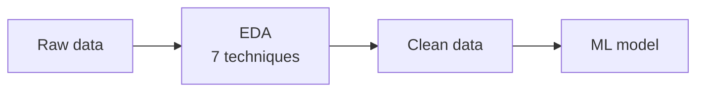

# Pandas

- Pandas is a Python library used to work with **structured data** (tables), such as Excel sheets and CSV files.
- Install: `pip install pandas`. Import: `import pandas as pd`.
- Its main data structure is the **DataFrame**, a table of rows * columns (see "Data Type vs Data Structure" in the main notes).
- Pandas documentation / source: [github.com/pandas-dev/pandas](https://github.com/pandas-dev/pandas)

## Data is 2 types

### 1. Structured data

Structured == labeled data = supervised learning ==== **Machine Learning**

- Excel sheet
- CSV
- Data that is in table format

### 2. Unstructured data

Unstructured == unlabeled data = unsupervised learning === **AI, Gen AI, Agentic AI**

- PDF
- Image
- Voice
- XML
- Video
- Audio
- JSON
- BSON
- Website

| | Structured | Unstructured |
| - | ---------- | ------------ |
| Also called | Labeled data | Unlabeled data |
| Learning type | Supervised learning | Unsupervised learning |
| Used in | Machine learning | AI, Gen AI, Agentic AI |
| Examples | Excel, CSV, tables | PDF, image, voice, XML, video, audio, JSON, BSON, website |

## Pandas works with structured data

Pandas has two main data structures:

| Structure | Dimension | Meaning |
| --------- | --------- | ------- |
| Series | 1D | One column of values with an index |
| DataFrame | 2D | A table of rows * columns |

```python
import pandas as pd

s = pd.Series([10, 20, 30])
print(s[0])              # 10

df = pd.DataFrame({
    "name": ["Asha", "Ravi"],
    "age": [25, 30]
})
print(df)
#    name  age
# 0  Asha   25
# 1  Ravi   30

print(df.shape)          # (2, 2)   (2 rows, 2 columns)
```

Reading structured files into a DataFrame:

```python
df = pd.read_csv("data.csv")       # CSV file
df = pd.read_excel("data.xlsx")    # Excel sheet (needs the openpyxl package)
print(df.head())                   # first 5 rows
```

## Raw Data vs Clean Data

- **Raw data** -- data as it was collected. It often has missing (empty) values.
- **Clean data** -- raw data after the missing values are filled and the mistakes are fixed, so it is ready for analysis.

### Raw data

| name | item | price | mob | gender | addre | distnce from house |
| ---- | ---- | ----- | --- | ------ | ----- | ------------------ |
| jack | food | 10k | 2345 | (empty) | (empty) | (empty) |
| mick | spor | 5k | 678 | (empty) | hyd | (empty) |

### Clean data

| name | item | price | mob | gender | addre | distnce from house |
| ---- | ---- | ----- | --- | ------ | ----- | ------------------ |
| jack | food | 10k | 2345 | M | BANG | NEAR |
| mick | spor | 5k | 678 | F | hyd | FARTHEST |

- The empty cells in the raw data (`gender`, `addre`, `distnce from house`) are filled in the clean data.
- Empty cells are shown as `NaN` or `None` in a Pandas DataFrame.

### Cleaning the data with Pandas

```python
import pandas as pd

raw = pd.DataFrame({
    "name": ["jack", "mick"],
    "item": ["food", "spor"],
    "price": ["10k", "5k"],
    "mob": [2345, 678],
    "gender": [None, None],
    "addre": [None, "hyd"],
    "distnce": [None, None]
})

print(raw.isnull().sum())   # count of empty cells in each column
                            # gender 2, addre 1, distnce 2, the others 0

clean = raw.copy()
clean["gender"] = ["M", "F"]                      # fill the values
clean["addre"] = clean["addre"].fillna("BANG")    # fill only the empty cells
clean["distnce"] = ["NEAR", "FARTHEST"]

print(clean)
```

| Function | What it does |
| -------- | ------------ |
| `isnull()` | Shows `True` where a cell is empty |
| `isnull().sum()` | Counts the empty cells in each column |
| `fillna(value)` | Fills the empty cells with a value |
| `dropna()` | Removes the rows that have empty cells |

### What is data cleansing?

Data cleansing (also called data cleaning) is the process of finding and fixing problems in raw data so it is accurate and ready for analysis. It is the step that turns the raw data table into the clean data table above.

| Problem | Example | Fix |
| ------- | ------- | --- |
| Missing values | Empty `gender` cell | Fill it in (`fillna()`) or remove the row (`dropna()`) |
| Duplicates | The same row appears twice | Remove duplicates (`drop_duplicates()`) |
| Wrong data type | Price stored as text `"10k"` instead of the number `10000` | Convert the type (`astype()`) |
| Inconsistent format | `hyd`, `Hyd` and `HYD` for the same city | Make them consistent (`str.upper()`, `str.lower()`) |
| Typos and wrong values | `spor` instead of `sport` | Correct the value (`replace()`) |
| Outliers | An age of `500` | Check it, then fix or remove it |

```python
df = df.drop_duplicates()                      # remove duplicate rows
df["addre"] = df["addre"].str.upper()          # same format for every value
df["gender"] = df["gender"].fillna("Unknown")  # fill empty cells
```

- Why it matters: bad data gives bad results. A machine learning model trained on missing or wrong values will make poor predictions.
- Data cleaning usually takes a big share of the time in a data project.
- Pandas docs on working with missing data: [Working with missing data](https://pandas.pydata.org/pandas-docs/stable/user_guide/missing_data.html)

## Common DataFrame Functions

`df` is a DataFrame. Example: `df = pd.read_excel("countries_dummy.xlsx")`

| Function | What it does |
| -------- | ------------ |
| `pd.read_excel("file.xlsx")` | Reads an Excel file into a DataFrame |
| `df.head()` | Shows the first 5 rows (`df.head(10)` shows 10) |
| `df.tail()` | Shows the last 5 rows |
| `df.info()` | Shows the column names, non-null counts and data types |
| `df.isnull()` | Shows `True` where a cell is empty |
| `df.isna()` | Same as `isnull()` |
| `df.isnull().sum()` | Counts the empty cells in each column |
| `df.shape` | Gives `(rows, columns)` |
| `df.columns` | Gives the column names |

```python
import pandas as pd

df = pd.read_excel("countries_dummy.xlsx")

print(df.head())             # first 5 rows
print(df.tail())             # last 5 rows
print(df.shape)              # (195, 5)   (195 rows, 5 columns)
print(df.columns)            # Index(['CountryName', 'CountryCode', 'BirthRate', 'InternetUsers', 'IncomeGroup'], ...)
df.info()                    # column names, non-null counts, data types
print(df.isnull().sum())     # empty cells in each column
```

- `read_excel` is a function of `pd` (`pd.read_excel`), not of `df`, because it creates the DataFrame.
- `shape` and `columns` are attributes, so they are written **without** `()`. Writing `df.columns()` gives a `TypeError`.
- `info()` and `head()` are methods, so they need `()`.

## Slicing in Pandas

```python
df[0:5]                          # first 5 rows (position, the stop is not included)
df["CountryName"]                # one column
df[["CountryName", "BirthRate"]] # more than one column (note the double brackets)
```

### loc and iloc

| | `loc` | `iloc` |
| - | ----- | ------ |
| Uses | Labels (row index label, column name) | Positions (numbers) |
| Stop value | **Included** | **Not included** (`n-1` rule, same as Python slicing) |

```python
df.loc[0:4, "CountryName"]           # rows 0 to 4 (5 rows), one column
df.loc[0:4, ["CountryName", "BirthRate"]]
df.iloc[0:5, 0:2]                    # rows 0 to 4, columns 0 and 1
df.iloc[:, 1]                        # all rows, column at position 1
df.iloc[-3:]                         # last 3 rows
```

### Filtering rows (like a mask in NumPy)

```python
df[df["IncomeGroup"] == "Low income"]                              # only Low income rows
df[(df["BirthRate"] > 30) & (df["InternetUsers"] < 10)]            # two conditions, use & not "and"
```

## Pandas Overview

- Pandas is a library to handle DataFrames.
- It is very important for data cleaning and missing value treatment.
- Slicing in Pandas (see "Slicing in Pandas" above).
- Pandas integrates easily with NumPy, Matplotlib and Seaborn.

```python
import numpy as np
import pandas as pd
import matplotlib.pyplot as plt
import seaborn as sns
```

### Where to write the code

| Tool | File type |
| ---- | --------- |
| Jupyter | Opens only `.ipynb` files (notebooks) |
| Spyder | Works with `.py` files (Python scripts) |

### Quick reference

| Function | What it gives |
| -------- | ------------- |
| `len(df)` | Number of rows |
| `df.head()` | Top 5 rows |
| `df.tail()` | Bottom 5 rows |
| `df.info()` | Information about the DataFrame |
| `df.columns` | List of the columns of the DataFrame |
| `df.isnull()` / `df.isna()` | `True` where a cell is empty |
| `df.isnull().sum()` | Number of empty cells in each column |

```python
print(len(df))              # 195   (number of rows)
print(df.head())            # top 5 rows
print(df.tail())            # bottom 5 rows
df.info()                   # information about the DataFrame
print(df.columns)           # the column names
print(df.isnull().sum())    # empty cells in each column
```

- `len(df)` gives only the number of rows. `df.shape` gives both `(rows, columns)`.

## Categorical Data in Pandas

- For categorical data (text columns such as `IncomeGroup`), Pandas by default captures the column as `object`. In newer Pandas (3.0 and above) it shows as `str`.
- You need to convert `object` to `category` first, and then do the visualization.

```python
df = pd.read_excel("countries_dummy.xlsx")

print(df["IncomeGroup"].dtype)        # object  (str in Pandas 3.0+)

df["IncomeGroup"] = df["IncomeGroup"].astype("category")

print(df["IncomeGroup"].dtype)        # category
df.info()                             # IncomeGroup now shows as category
```

### Useful category functions

```python
print(df["IncomeGroup"].cat.categories)
# Index(['High income', 'Low income', 'Lower middle income', 'Upper middle income'], ...)

print(df["IncomeGroup"].nunique())    # 4   (number of different categories)
print(df["IncomeGroup"].value_counts())   # how many rows in each category
```

### Visualization after converting

```python
import matplotlib.pyplot as plt

df["IncomeGroup"].value_counts().plot(kind="bar")   # bar chart of rows per category
plt.ylabel("Number of countries")
plt.show()
```

- `CountryName` and `CountryCode` are text too, but they are not good categories because almost every value is different. Use `category` for columns with a few repeated values.
- A `category` column also uses less memory than `object` (`IncomeGroup` makes `info()` show a smaller memory usage).

## describe(), Rename Columns and Add New Columns

### describe()

- `df.describe()` always gives information about the **numerical** columns only. It does not give information about the categorical (text) columns.
- Numerical columns get: `count`, `mean`, `std`, `min`, `25%`, `50%`, `75%`, `max`.

```python
print(df.describe())
#        BirthRate  InternetUsers
# count  195 ...
# mean   ...
# std    ...
# min    ...
# 25%    ...
# 50%    ...
# 75%    ...
# max    ...
```

To get information about the categorical (text) columns, ask for them:

```python
print(df.describe(include="object"))   # text columns: count, unique, top, freq
print(df.describe(include="all"))      # numerical and text columns together
```

| For text columns | Meaning |
| ---------------- | ------- |
| `count` | Number of non-empty values |
| `unique` | Number of different values |
| `top` | The most common value |
| `freq` | How many times the top value appears |

- In Pandas 3.0 and above the text columns are `str`, so `include="str"` is the clearer form. `include="object"` still works but gives a warning. `include="all"` works in every version.

### Rename an attribute (column) from the existing df

```python
df = df.rename(columns={"InternetUsers": "InternetUse"})
print(df.columns)    # ['CountryName', 'CountryCode', 'BirthRate', 'InternetUse', 'IncomeGroup']
```

- The format is `{"old name": "new name"}`. You can rename more than one column in the same dictionary.
- `rename()` returns a new DataFrame, so save it back with `df = ...`.

### How to add a new column to the existing df

```python
df["InternetFraction"] = df["InternetUse"] / 100       # calculated from an existing column
df["HighInternet"] = df["InternetUse"] > 50            # True / False column
df["Source"] = "Dummy data"                            # same value in every row

print(df.shape)      # (195, 8)   (3 new columns added)
```

- The new column is added at the end of the DataFrame.
- The new column name goes inside the square brackets on the left of `=`.

### Table: where the data comes from

- A DataFrame is like a **table**. In an organization, such tables are found in the organization's database (db).
- In real work, you read a table from the database into a DataFrame, for example with `pd.read_sql()`.

## Pandas - 1

Topics: read one or more attributes, add and multiply columns, rename columns, filter use case, `describe()`, transpose, `unique()` and `nunique()`, `dtypes`.

### How to read a single attribute, 2 attributes, more than 2 attributes

```python
df["CountryName"]                                     # single attribute (one column) -> Series
df[["CountryName", "BirthRate"]]                      # 2 attributes -> DataFrame (double brackets)
df[["CountryName", "BirthRate", "InternetUsers"]]     # more than 2 attributes
```

- One name in single brackets gives a Series. A list of names in double brackets gives a DataFrame.

### How to add new columns, multiply the columns

```python
df["Product"] = df["BirthRate"] * df["InternetUsers"]   # multiply two columns
df["Sum"] = df["BirthRate"] + df["InternetUsers"]       # add two columns
```

- The operation happens row by row, and the result is saved as a new column at the end.

### How to rename the columns

```python
df = df.rename(columns={"InternetUsers": "InternetUse"})
```

### Use case: filter out internet users < 2 and birth rate > 40

```python
result = df[(df["InternetUsers"] < 2) & (df["BirthRate"] > 40)]
print(result[["CountryName", "BirthRate", "InternetUsers"]])
```

- Put each condition in its own brackets `( )` and join them with `&` (and) or `|` (or). Do not use the words `and` / `or`.
- Example result from our data: rows like Togo (birth rate 44.176, internet users 1.03) and Mozambique (47.628, 1.47). The exact rows depend on your generated file.

### describe() -- descriptive stats

`df.describe()` gives the descriptive statistics of the numerical columns:

| Row | Meaning |
| --- | ------- |
| `count` | Number of non-empty values |
| `mean` | Average |
| `std` | Standard deviation |
| `min` | Smallest value |
| `25%` | 25th percentile (first quartile) |
| `50%` | 50th percentile, the **median** |
| `75%` | 75th percentile (third quartile) |
| `max` | Largest value |

- `describe()` has no `mode` row. Get the mean, median and mode separately:

```python
df["BirthRate"].mean()           # mean
df["BirthRate"].median()         # median (same as the 50% row)
df["IncomeGroup"].mode()[0]      # mode: the most common value (here "High income")
df["BirthRate"].std()            # standard deviation
```

- By default `describe()` gives only numerical information. For categorical (text) columns use `df.describe(include="object")` or `include="all"`.

### Transpose the dataset

Transpose swaps rows and columns, with `.T`. It is useful for a wide `describe()` output.

```python
print(df.describe())      # statistics as rows, columns as columns
print(df.describe().T)    # each column becomes a row, easier to read with many columns
```

### unique(), nunique() and dtypes

```python
df["IncomeGroup"].unique()     # the different values: ['Lower middle income', 'Low income', 'High income', 'Upper middle income']
df["IncomeGroup"].nunique()    # 4   (how many different values)
df.nunique()                   # nunique() of every column
df.dtypes                      # data type of every column
```

| Function | Gives |
| -------- | ----- |
| `unique()` | The list of different values in a column |
| `nunique()` | The count of different values |
| `dtypes` | The data type of each column (`float64`, `object` / `str`, ...) |

## Outliers and Data Analysis (pandas + plt + sns)

For analysis and visualization we use three libraries together:

```python
import pandas as pd                 # pandas -> data
import matplotlib.pyplot as plt     # plt    -> plotting
import seaborn as sns               # sns    -> easy, good-looking statistical graphs
```

### What is an outlier?

- A statistical outlier is a data point that is **very far from the other individual data points**.
- OUTLIER == ANOMALY DETECTION. Finding outliers is the same idea as finding anomalies (unusual values).
- Example from `countries_outliers.xlsx`: a `BirthRate` of `140.365` when most countries are between about 8 and 50, or `InternetUsers` of `487.67` (a percentage cannot be above 100).

### Types of analysis

| Type | Plot the graph using | Example |
| ---- | -------------------- | ------- |
| Univariate analysis | 1 variable | Histogram or box plot of `BirthRate` |
| Bivariate analysis | 2 variables | `BirthRate` vs `InternetUsers` |
| Multivariate analysis | More than 2 variables | `BirthRate` vs `InternetUsers` for each `IncomeGroup` |

```python
df = pd.read_excel("countries_outliers.xlsx")

# 1. Univariate analysis (1 variable)
sns.boxplot(x=df["BirthRate"])                  # outliers appear as dots far from the box
plt.show()
sns.histplot(df["BirthRate"])
plt.show()

# 2. Bivariate analysis (2 variables)
sns.scatterplot(x="BirthRate", y="InternetUsers", data=df)
plt.show()
sns.boxplot(x="IncomeGroup", y="BirthRate", data=df)
plt.show()

# 3. Multivariate analysis (more than 2 variables)
sns.scatterplot(x="BirthRate", y="InternetUsers", hue="IncomeGroup", data=df)   # 3 variables
plt.show()
sns.pairplot(df, hue="IncomeGroup")             # every numeric column against every other
plt.show()
```

- Install the plotting libraries with `pip install matplotlib seaborn`.
- In a box plot, the dots outside the whiskers are the outliers.
- In a scatter plot, an outlier is a point far away from the rest.

### Finding outliers with the IQR rule

```python
q1 = df["BirthRate"].quantile(0.25)
q3 = df["BirthRate"].quantile(0.75)
iqr = q3 - q1                           # IQR = Q3 - Q1

lower = q1 - 1.5 * iqr
upper = q3 + 1.5 * iqr

outliers = df[(df["BirthRate"] < lower) | (df["BirthRate"] > upper)]
print(outliers[["CountryName", "BirthRate"]])
```

- A value below `Q1 - 1.5 x IQR` or above `Q3 + 1.5 x IQR` is treated as an outlier. This is the same rule a box plot uses for its dots.
- A statistical outlier is not always an error. A high but real value is still flagged, so check the value before removing it.

## Pandas and Seaborn Roadmap

| # | Topic | Where in these notes |
| - | ----- | -------------------- |
| 1 | Importing data into Python | `pd.read_excel()`, `pd.read_csv()` (Common DataFrame Functions) |
| 2 | DataFrame via pandas | Pandas, Series and DataFrame (top of this file) |
| 3 | Exploring datasets: `head()`, `tail()`, `info()`, `describe()` | Common DataFrame Functions, Pandas - 1 |
| 4 | Renaming columns | describe(), Rename Columns and Add New Columns |
| 5 | Subsetting DataFrames | Slicing in Pandas (`loc`, `iloc`) |
| 6 | Basic operations with a DataFrame | Pandas - 1 (add and multiply columns) |
| 7 | Filtering DataFrames | Slicing in Pandas, Pandas - 1 (filter use case) |
| 8 | Seaborn introduction | Seaborn Introduction (below) |
| 9 | Univariate, bivariate, multivariate analysis | Outliers and Data Analysis |

## Seaborn Introduction

Seaborn (`sns`) is a library built on Matplotlib. It draws statistical graphs from a DataFrame with very little code.

```python
import pandas as pd
import matplotlib.pyplot as plt
import seaborn as sns

df = pd.read_excel("countries_outliers.xlsx")
```

| Plot | Used for | Analysis |
| ---- | -------- | -------- |
| `.distplot()` | Distribution (shape) of one numerical column | Univariate |
| `.boxplot()` | Spread and outliers of a column | Univariate (or bivariate with a category) |
| `.lmplot()` | Relationship between two columns, with an optional regression line | Bivariate |
| `hue` parameter | Colors the points or bars by a category column | Multivariate |

### .distplot() -- distribution of one variable

```python
sns.distplot(df["BirthRate"])                    # old name, shows a deprecation warning
sns.histplot(df["BirthRate"], kde=True)          # newer replacement: histogram + smooth line
sns.displot(df["BirthRate"], kde=True)           # newer replacement (figure-level)
plt.show()
```

- `distplot()` is deprecated in newer seaborn and will be removed. Use `histplot()` or `displot()` with `kde=True` for the same result.

### .boxplot() -- spread and outliers

```python
sns.boxplot(x=df["BirthRate"])                          # one variable
sns.boxplot(x="IncomeGroup", y="BirthRate", data=df)    # one box per category
plt.show()
```

- The box shows Q1 to Q3 (with the median line inside). The whiskers show the normal range.
- The dots outside the whiskers are the **outliers**.

### .lmplot() and fit_reg

```python
sns.lmplot(x="BirthRate", y="InternetUsers", data=df)                   # points + regression line
sns.lmplot(x="BirthRate", y="InternetUsers", data=df, fit_reg=False)    # points only, no line
plt.show()
```

- `fit_reg=True` (default) draws the regression (best-fit) line. `fit_reg=False` removes the line and shows only the points.
- A point far from the line or from the other points is an outlier.

### hue parameter

```python
sns.lmplot(x="BirthRate", y="InternetUsers", data=df, hue="IncomeGroup", fit_reg=False)
sns.scatterplot(x="BirthRate", y="InternetUsers", hue="IncomeGroup", data=df)
plt.show()
```

- `hue` colors the points by a category (here `IncomeGroup`), so the graph shows 3 variables at once. That is multivariate analysis.

## Where to Get Datasets

| Site | What it is |
| ---- | ---------- |
| [kaggle.com](https://www.kaggle.com) | A repository (datasets and competitions) used by data scientists and data analysts across the globe |
| [huggingface.co](https://huggingface.co) | Used for Gen AI and LLMs. It hosts models (LLM to LLM models) and datasets |
| UCI Machine Learning Repository ([archive.ics.uci.edu](https://archive.ics.uci.edu)) | A collection of free datasets for learning and research |
| IMDb ([imdb.com](https://www.imdb.com)) | A database of movies with their IMDb ratings |

- The IMDb data is big: about 20 million records (`20M` = `2 crore`).
- The same kind of file (CSV or Excel) can be loaded with `pd.read_csv()` or `pd.read_excel()`.

### Industry

- In industry you get a client requirement.
- Can you solve it in 1 day? Highly impossible. Real projects use large datasets and take time to clean, analyse and explain.

### Why is Excel limited for data analysis?

Excel is fine for small data, but it has these limits:

**1. Size limits**

- An Excel sheet has a limit of **1,048,576 rows** (and 16,384 columns).
- A dataset with 20 million (2 crore) records does not fit in Excel. `rating.csv` has 20,000,263 rows, about 19 times the limit, so Excel would cut the data off.

**2. Speed and memory**

- Big files become very slow to open, filter, sort and calculate. Formulas such as `VLOOKUP` over many rows are slow.
- Excel can freeze or crash when it runs out of memory.
- Pandas works on the data in memory with code, so it can handle much larger data, much faster.

**3. Steps can't be easily repeated**

- Cleaning in Excel is mostly manual clicks. When new data arrives, you repeat every step by hand.
- In Pandas the steps are saved as code, and you run the same code again on the new file.

**4. Limited analysis and machine learning**

- Excel has basic statistics and charts. For machine learning, advanced statistics and graphs like box plots or pair plots, use Python libraries such as scikit-learn, Matplotlib and Seaborn.

**5. Combining data**

- Joining several big tables in Excel is awkward. In Pandas, `merge()` joins tables on a common column such as `movieId` in one line.

**6. Quiet errors**

- Excel can change values on its own, such as turning text into dates or dropping leading zeros. It is also easy to overwrite a formula by mistake and not notice.

| | Excel | Pandas |
| - | ----- | ------ |
| Row limit | 1,048,576 per sheet | No fixed limit (depends on the computer's memory) |
| Speed on big data | Slow, can freeze | Much faster |
| Repeating steps | Manual | Run the same code again |
| Combining tables | `VLOOKUP`, manual | `merge()` |
| Visualization and ML | Basic charts | Matplotlib, Seaborn, scikit-learn and more |

- Excel's Power Pivot and Power Query add features for bigger data, but for large datasets and machine learning most people still use Python.

## Series in Pandas

- A Series is a **1D** (one-dimensional) labeled array. It holds one column of values with an index.
- A DataFrame is a collection of Series (each column is a Series).
- A Series holds one data type, such as `int64`, `float64` or text.

### Data used in this section

The data is in the folder `C:\My-Drive\01-Gen-AI\archive` (the MovieLens movie ratings data):

| File | Columns | Rows |
| ---- | ------- | ---- |
| `movie.csv` | `movieId`, `title`, `genres` | 27,278 |
| `rating.csv` | `userId`, `movieId`, `rating`, `timestamp` | 20,000,263 (20 million, 2 crore) |
| `tag.csv` | `userId`, `movieId`, `tag`, `timestamp` | 465,564 |

```python
import pandas as pd

path = r"C:\My-Drive\01-Gen-AI\archive"
movies = pd.read_csv(path + r"\movie.csv")
```

### Creating a Series

```python
# 1. From a list (the index is 0, 1, 2, ... by default)
s = pd.Series([10, 20, 30, 40])

# 2. With your own index (labels) and a name
marks = pd.Series([10, 20, 30], index=["a", "b", "c"], name="marks")

# 3. From a dictionary (keys become the index)
d = pd.Series({"x": 1, "y": 2})

# 4. From a column of a DataFrame (the most common way)
title = movies["title"]
print(type(title))       # <class 'pandas.Series'>
print(title.head(3))
# 0             Toy Story (1995)
# 1               Jumanji (1995)
# 2      Grumpier Old Men (1995)
# Name: title, dtype: str
```

```python
# 5. Make movieId the index, so the Series is: movieId -> title
t = movies.set_index("movieId")["title"]
print(t.head(3))
# movieId
# 1             Toy Story (1995)
# 2               Jumanji (1995)
# 3      Grumpier Old Men (1995)
# Name: title, dtype: str
```

### Reading values (indexing and slicing)

```python
print(t.loc[1])              # Toy Story (1995)   (by label: movieId 1)
print(t.iloc[0])             # Toy Story (1995)   (by position: the first value)
print(t.loc[[1, 2]])         # movieId 1 and movieId 2

print(title[0:3].tolist())   # ['Toy Story (1995)', 'Jumanji (1995)', 'Grumpier Old Men (1995)']
                             # (positions 0 to 2, the stop is not included)

toy = title[title.str.contains("Toy Story")]    # filter: titles that contain "Toy Story"
print(toy.shape)             # (8,)
print(toy.tolist()[:3])      # ['Toy Story (1995)', 'Toy Story 2 (1999)', 'Toy Story 3 (2010)']
```

- `loc` uses the **label** (the index value). `iloc` uses the **position**.

### Attributes

| Attribute | Gives (for the `t` Series) |
| --------- | -------------------------- |
| `t.values` | The values as an array: `['Toy Story (1995)', 'Jumanji (1995)', ...]` |
| `t.index` | The index: `Index([1, 2, 3, ...], name='movieId')` |
| `t.dtype` | The data type: `str` (shown as `object` in older Pandas) |
| `t.shape` | `(27278,)` (a Series has only one dimension) |
| `t.size` | Number of values: `27278` |
| `t.name` | The name of the Series: `title` |

### Operations on a Series

Operations work on every value at once (no loop needed).

```python
ids = movies["movieId"]
print(ids.min(), ids.max())     # 1 131262
print(ids.nunique())            # 27278   (how many different values)

genre_count = movies["genres"].str.split("|").str.len()   # how many genres each movie has
print(genre_count.head(3).tolist())    # [5, 3, 2]
print(genre_count.max())               # 10

print(movies["genres"].value_counts().head(3))
# genres
# Drama          4520
# Comedy         2294
# Documentary    1942
```

### A big Series: the ratings

The `rating.csv` file has 20 million rows, which is far more than Excel's limit of 1,048,576 rows. Read only the column you need to save memory.

```python
rating = pd.read_csv(path + r"\rating.csv", usecols=["rating"])["rating"]

print(rating.shape)        # (20000263,)
print(rating.dtype)        # float64
print(rating.mean())       # 3.5255...
print(rating.median())     # 3.5
print(rating.min(), rating.max())    # 0.5 5.0

print(rating.value_counts().sort_index())
# rating
# 0.5     239125
# 1.0     680732
# 1.5     279252
# 2.0    1430997
# 2.5     883398
# 3.0    4291193
# 3.5    2200156
# 4.0    5561926
# 4.5    1534824
# 5.0    2898660

print(rating.describe())   # count, mean, std, min, 25%, 50%, 75%, max
```

- `usecols=["rating"]` reads only that one column. Reading the whole file takes much more memory.
- The most common rating is `4.0` (5,561,926 times).

### Series vs DataFrame

```python
col = movies["title"]               # single brackets -> Series
print(col.shape)                    # (27278,)

two = movies[["title"]]             # double brackets -> DataFrame (even with one column)
print(type(two))                    # <class 'pandas.DataFrame'>
print(two.shape)                    # (27278, 1)
```

| | Series | DataFrame |
| - | ------ | --------- |
| Dimension | 1D | 2D |
| Shape | `(rows,)` | `(rows, columns)` |
| Like | One column | A table |
| Example | `movies["title"]` | `movies[["movieId", "title"]]` |

## Pandas - 2

Topics: outlier, how to detect outliers (by numbers and by graphs), box plot and IQR, `displot` / `distplot` / `lmplot`, adding colour to a graph, a simple POC (country analysis project).

```python
import pandas as pd
import matplotlib.pyplot as plt
import seaborn as sns

df = pd.read_excel("countries_outliers.xlsx")
```

### Outlier

- An outlier is a data point far from the other observations.
- Outlier == anomaly detection.

### How to detect outliers: by numbers or by graphs

| Way | Method |
| --- | ------ |
| By numbers | IQR rule (inter quartile range) |
| By graphs | Box plot, histogram / distribution plot (`displot`), scatter plot (`lmplot`) |

### Box plot and IQR (Q3 - Q1)

- IQR = inter quartile range = **Q3 - Q1**.
- Q1 is the 25% value and Q3 is the 75% value (the same rows as in `describe()`).
- A value is an outlier if it is below `Q1 - 1.5 x IQR` or above `Q3 + 1.5 x IQR`. The box plot draws these as dots beyond the whiskers.

```python
q1 = df["BirthRate"].quantile(0.25)
q3 = df["BirthRate"].quantile(0.75)
iqr = q3 - q1                                  # Q3 - Q1

lower = q1 - 1.5 * iqr
upper = q3 + 1.5 * iqr

outliers = df[(df["BirthRate"] < lower) | (df["BirthRate"] > upper)]
print(len(outliers))                           # how many outliers (depends on your file)

clean = df[(df["BirthRate"] >= lower) & (df["BirthRate"] <= upper)]   # data without outliers
print(df.shape, clean.shape)

sns.boxplot(x=df["BirthRate"])                 # dots outside the whiskers = outliers
plt.show()
```

### sns.displot(), sns.distplot() and sns.lmplot()

```python
sns.displot(df["BirthRate"], kde=True)         # distribution (histogram + smooth line)
sns.distplot(df["BirthRate"])                  # old name, deprecated (use displot or histplot)
sns.lmplot(x="BirthRate", y="InternetUsers", data=df)    # scatter plot + regression line
plt.show()
```

- Outliers show up as a bar far to the right of the histogram, or as a point far away from the others in the `lmplot`.

### How to add colour to the graph

```python
sns.boxplot(x=df["BirthRate"], color="green")                    # one colour
sns.displot(df["BirthRate"], kde=True, color="red")              # one colour
sns.boxplot(x="IncomeGroup", y="BirthRate", data=df,
            hue="IncomeGroup", palette="Set2", legend=False)     # a different colour for each group
sns.lmplot(x="BirthRate", y="InternetUsers", data=df,
           hue="IncomeGroup", palette="Set1")                    # colour the points by a category
plt.show()
```

| Parameter | What it does |
| --------- | ------------ |
| `color="red"` | One colour for the whole graph |
| `hue="IncomeGroup"` | A different colour for each category in that column |
| `palette="Set2"` | The set of colours used with `hue` (others: `"Set1"`, `"viridis"`, `"coolwarm"`) |

### Simple POC: country analysis project

POC = proof of concept, a small project that shows the idea works. The steps for a country analysis project:

1. **Import the data**: `df = pd.read_excel("countries_outliers.xlsx")`
2. **Explore**: `df.head()`, `df.info()`, `df.describe()`, `df.shape`
3. **Check missing values**: `df.isnull().sum()`
4. **Convert text to category**: `df["IncomeGroup"] = df["IncomeGroup"].astype("category")`
5. **Find the outliers**: IQR rule and box plot (above)
6. **Remove or fix the outliers**: `clean = df[(df["BirthRate"] >= lower) & (df["BirthRate"] <= upper)]`
7. **Analyse**: univariate (histogram), bivariate (scatter plot), multivariate (`hue="IncomeGroup"`)
8. **Report the findings**: for example, which income group has the highest birth rate

```python
print(clean.groupby("IncomeGroup")["BirthRate"].mean().sort_values(ascending=False))
# average birth rate of each income group (Low income comes first in our data)
```

- The same steps apply to a GDP analysis. Our dummy file has `BirthRate`, `InternetUsers` and `IncomeGroup`, but no GDP column, so replace the column names with the GDP column when you have that data.

## Process to Create a Dataset for Predictive Models



| Step | What happens |
| ---- | ------------ |
| 1. Input sources | The data comes from many places (Excel files, CSV files, databases) |
| 2. Collated dataset | All the sources are collected and joined into one dataset |
| 3. Cleansing + Transformation | The data is cleaned and changed into the form the model needs (the circled step in the diagram) |
| 4. Final dataset | The ready dataset used to build the predictive model |

- **Cleansing** -- fix the problems: missing values, duplicates, wrong values (see "What is data cleansing?").
- **Transformation** -- change the data: convert data types, rename columns, create new columns, convert categories to numbers.
- A predictive model is only as good as the dataset it learns from, so most of the time in a project goes into this cleansing and transformation step.

### Example with Pandas

```python
import pandas as pd

# 1. Input sources (three small sources with the same columns)
s1 = pd.DataFrame({"name": ["jack", "mick"], "price": ["10k", "5k"], "gender": [None, "M"]})
s2 = pd.DataFrame({"name": ["mick", "tina"], "price": ["5k", "7k"], "gender": ["M", "F"]})
s3 = pd.DataFrame({"name": ["raj"], "price": ["9k"], "gender": [None]})

# 2. Collated dataset: join all the sources into one
collated = pd.concat([s1, s2, s3], ignore_index=True)
print(collated.shape)                                  # (5, 3)

# 3a. Cleansing
clean = collated.drop_duplicates().copy()              # mick appears twice -> 4 rows
clean["gender"] = clean["gender"].fillna("Unknown")    # fill the empty cells

# 3b. Transformation
clean["price"] = clean["price"].str.replace("k", "000").astype(int)    # "10k" -> 10000 (a number)
clean["gender"] = clean["gender"].astype("category")                   # text -> category
final = clean.rename(columns={"price": "price_num"}).reset_index(drop=True)

# 4. Final dataset
print(final)
#    name  price_num   gender
# 0  jack      10000  Unknown
# 1  mick       5000        M
# 2  tina       7000        F
# 3   raj       9000  Unknown

final.to_excel("final_dataset.xlsx", index=False)       # save it (needs openpyxl)
```

| Function | Used for |
| -------- | -------- |
| `pd.concat()` | Collating (joining) the sources into one dataset |
| `drop_duplicates()`, `fillna()`, `dropna()` | Cleansing |
| `astype()`, `rename()`, `str.replace()` | Transformation |
| `to_excel()` / `to_csv()` | Saving the final dataset |

## EDA: The Foundation of Machine Learning

EDA (Exploratory Data Analysis) is the foundation of machine learning. How?

- EDA techniques help to convert **raw data** into **clean data** for the **ML model**.
- A model learns from the data, so bad data gives a bad model.
- There are **7 techniques** to follow, after step 0 (business understanding).



| Step | Technique | What you do |
| ---- | --------- | ----------- |
| 0 | Business understanding | Understand the business and the problem first |
| 1 | Variable identification | Find the variables (columns) and their types |
| 2 | Univariate analysis | Study one variable at a time |
| 3 | Bivariate analysis | Study two variables together |
| 4 | Outlier treatment | Find and treat the extreme values |
| 5 | Missing variable treatment | Find the empty values |
| 6 | Variable imputation | Fill the empty values |
| 7 | Variable creation | Create new variables from the existing ones |

### 0. Business understanding

- Understand the business before touching the data. Examples of domains: **bank, service, manufacture, SCM (supply chain management), FMCG (fast-moving consumer goods), product**.
- No business runs without a customer, so the data is always about customers or what they buy.
- This is a non-technical job (all non-technical): it needs talking to the business people, not code.

### Steps 1 to 7 with Pandas

The code uses `countries_outliers.xlsx` (columns `CountryName`, `CountryCode`, `BirthRate`, `InternetUsers`, `IncomeGroup`).

```python
import pandas as pd
import numpy as np
import seaborn as sns
import matplotlib.pyplot as plt

df = pd.read_excel("countries_outliers.xlsx")
```

**1. Variable identification** -- which columns are numerical and which are categorical.

```python
df.info()
numerical = df.select_dtypes(include="number").columns.tolist()     # ['BirthRate', 'InternetUsers']
categorical = df.select_dtypes(exclude="number").columns.tolist()   # ['CountryName', 'CountryCode', 'IncomeGroup']
```

**2. Univariate analysis** -- one variable at a time.

```python
print(df.describe())                    # numerical: count, mean, std, min, 25%, 50%, 75%, max
print(df["IncomeGroup"].value_counts()) # categorical: rows in each category
sns.histplot(df["BirthRate"])           # shape of one variable
plt.show()
sns.boxplot(x=df["BirthRate"])          # dots outside the whiskers = outliers
plt.show()
```

**3. Bivariate analysis** -- two variables together.

```python
sns.scatterplot(x="BirthRate", y="InternetUsers", data=df)
plt.show()
print(df[["BirthRate", "InternetUsers"]].corr())   # a negative number: when birth rate goes up, internet use goes down
```

**4. Outlier treatment** -- find the extreme values (IQR rule) and cap them.

```python
q1 = df["BirthRate"].quantile(0.25)
q3 = df["BirthRate"].quantile(0.75)
iqr = q3 - q1
lower, upper = q1 - 1.5 * iqr, q3 + 1.5 * iqr

print(((df["BirthRate"] < lower) | (df["BirthRate"] > upper)).sum())   # how many outliers
df["BirthRate"] = df["BirthRate"].clip(lower, upper)    # cap: values above or below the limits are set to the limits
df["InternetUsers"] = df["InternetUsers"].clip(0, 100)  # it is a percentage, so 0 to 100 is the only valid range
```

**5. Missing variable treatment** -- find the empty values.

```python
print(df.isnull().sum())                 # empty cells in each column (this file has none)

df.loc[[0, 1, 2], "BirthRate"] = np.nan  # make some empty cells to practise
df.loc[3, "IncomeGroup"] = np.nan
print(df.isnull().sum())                 # BirthRate 3, IncomeGroup 1
```

**6. Variable imputation** -- fill the empty values.

```python
df["BirthRate"] = df["BirthRate"].fillna(df["BirthRate"].median())        # numerical: mean or median
df["IncomeGroup"] = df["IncomeGroup"].fillna(df["IncomeGroup"].mode()[0]) # categorical: mode (most common value)
print(df.isnull().sum().sum())           # 0
```

**7. Variable creation** -- create new variables from the existing ones.

```python
df["InternetLevel"] = pd.cut(df["InternetUsers"], bins=[0, 20, 60, 100], labels=["Low", "Medium", "High"])
df["BirthPerInternet"] = df["BirthRate"] / df["InternetUsers"]
print(df.shape)                          # (195, 7): two new columns
```

| Step | Pandas / Seaborn used |
| ---- | --------------------- |
| 1 | `info()`, `dtypes`, `select_dtypes()` |
| 2 | `describe()`, `value_counts()`, `histplot()`, `boxplot()` |
| 3 | `scatterplot()`, `corr()` |
| 4 | `quantile()`, `clip()` |
| 5 | `isnull().sum()` |
| 6 | `fillna()`, `median()`, `mode()` |
| 7 | `pd.cut()`, new columns |

- Remember the order: first understand the business, then identify the variables, analyse them, treat the outliers, find and fill the missing values, and last create new variables.

### 1. Variable identification in detail

Every column in the data is a variable. We identify which variables are the input and which one we want to predict.

| | Independent variable | Dependent variable |
| - | -------------------- | ------------------ |
| Symbol | `x1, x2, x3, x4, x5 ... xn` | `y` |
| Also called | Non-target attribute, non-predicted attribute | Target variable, predicted variable |
| Role | The input. Used to make the prediction | The output. The value we want to predict |

#### Example: a family with 4 attributes

`family()` has 4 attributes:

| Member | Variable |
| ------ | -------- |
| Dad (govt employee) | Dependent variable (`y`) |
| Mom (housewife) | Independent variable (`x1`) |
| Son (4th) | Independent variable (`x2`) |
| Daughter (3rd) | Independent variable (`x3`) |

#### Math formula and ML formula

```text
Math formula:  y = x1 + x2 + x3
ML formula:    y = m1x1 + m2x2 + m3x3
```

- `y` depends on `x1`, `x2` and `x3`.
- In the ML formula, `m1`, `m2` and `m3` are the **weights** (coefficients). They tell how much each independent variable affects `y`.
- The ML model learns the values of `m1`, `m2` and `m3` from the data. (Usually a constant `c` is added at the end: `y = m1x1 + m2x2 + m3x3 + c`.)

```python
import numpy as np

x1 = np.array([1, 2, 3, 4, 5])
x2 = np.array([2, 1, 4, 3, 5])
y = 2 * x1 + 3 * x2 + 1                 # the real rule is hidden in the data: [ 9  8 19 18 26]

A = np.column_stack([x1, x2, np.ones(len(x1))])
m, *_ = np.linalg.lstsq(A, y, rcond=None)
print(m)                                # [2. 3. 1.]  -> m1 = 2, m2 = 3, constant = 1
```

The model found `m1 = 2`, `m2 = 3` and `c = 1` only by looking at the data.

#### In Pandas: split the variables

```python
df = pd.read_excel("countries_outliers.xlsx")

y = df["InternetUsers"]                        # dependent variable (target)
X = df[["BirthRate", "IncomeGroup"]]           # independent variables (x1, x2)
print(X.shape, y.shape)                        # (195, 2) (195,)
```

- `X` (capital) is a DataFrame with the independent variables, and `y` (small) is a Series with the target.
- Which column is the target depends on the question. Here we predict `InternetUsers` from the birth rate and the income group.

## EDA and Machine Learning

- EDA (Exploratory Data Analysis) is the foundation of ML (machine learning). ML is the core subject.
- EDA techniques help to convert raw data into clean data for the ML model.

### 1. Variable identification (more)

- Variable identification: column name in Excel == variable == attribute.
- DV (`y`) = dependent variable, IV (`x1, x2, x3 ...`) = independent variables.
- **Relevant attribute** -- every time, build the model with the relevant attributes.
- **Irrelevant attribute** -- remove the irrelevant attributes (for example `CountryCode` does not help to predict anything).

```python
df = df.drop(columns=["CountryCode"])      # remove an irrelevant attribute
```

### How EDA is connected to machine learning

ML techniques have 3 parts: **regression**, **classification** and **clustering**. The type of the dependent variable (`y`) decides which one to use.

| Technique | Dependent variable (`y`) |
| --------- | ------------------------ |
| Regression | Continuous (a number) |
| Classification | Binary or category |
| Clustering | None (grouping) |

#### Regression

The dependent variable is continuous. Examples: petrol price, gold price, stock price, vehicle price, crypto price, land price, ticket price, flight price, electricity bill, house price.

Regression models:

1. Simple linear regression
2. Multiple linear regression
3. Polynomial regression
4. Lasso regression
5. Ridge regression
6. SVR (support vector regression)
7. KNN regression
8. Time series

```python
from sklearn.linear_model import LinearRegression
import pandas as pd

X = pd.DataFrame({"x1": [1, 2, 3, 4, 5], "x2": [2, 1, 4, 3, 5]})     # independent variables
y = 2 * X["x1"] + 3 * X["x2"] + 1                                      # dependent variable (continuous)

model = LinearRegression().fit(X, y)
print(model.coef_)             # [2. 3.]  -> m1 = 2, m2 = 3
print(model.intercept_)        # 1.0
print(model.predict(pd.DataFrame({"x1": [6], "x2": [6]})))   # [31.]
```

#### Classification

The dependent variable is binary or a category. Examples: yes | no (1 | 0), win | lose, positive | negative review, crash | not crash, hot | cold, fraud | non-fraud, spam | non-spam, +ve | -ve, pass | fail, up | down.

Classification algorithms:

1. Logistic regression (a probability algorithm)
2. SVM (support vector machine)
3. KNN (k-nearest neighbours)
4. Naive Bayes (Bayesian theorem)
5. DT (decision tree)
6. RF (random forest)

```python
from sklearn.linear_model import LogisticRegression

hours = pd.DataFrame({"hours": [1, 2, 3, 4, 5, 6, 7, 8]})
passed = [0, 0, 0, 0, 1, 1, 1, 1]                                  # 0 = fail, 1 = pass

clf = LogisticRegression().fit(hours, passed)
print(clf.predict(pd.DataFrame({"hours": [2, 7]})))                # [0 1]
print(clf.predict_proba(pd.DataFrame({"hours": [7]}))[0][1])       # about 0.95 (probability of pass)
```

#### Clustering

There is no dependent variable. The data is divided into groups.

- PCA (principal component analysis) -- mainly used to reduce the number of columns.
- K-means clustering.

```python
from sklearn.cluster import KMeans

pts = pd.DataFrame({"a": [1, 2, 1, 10, 11, 10], "b": [1, 1, 2, 10, 10, 11]})
km = KMeans(n_clusters=2, n_init=10, random_state=0).fit(pts)
print(km.labels_)              # two groups, e.g. [1 1 1 0 0 0] (the group numbers can swap)
```

### Types of machine learning

| | Supervised learning | Unsupervised learning |
| - | ------------------- | --------------------- |
| Data | Structured data = labeled data | Unstructured data = unlabeled data |
| Techniques | Regression (DV is continuous), classification (DV is binary or category) | Clustering (no dependent variable), grouping |
| Stored in | Structured database = SQL DB (RDBMS): MySQL, PostgreSQL, Oracle | Unstructured database = NoSQL DB (non-relational): MongoDB, Cassandra, HBase |

- **Vector database** -- LLM text is stored in vector format. Used in the **RAG** model. Examples: Pinecone, FAISS, Chroma, Milvus, Qdrant.
- **Reinforcement learning** -- the model interacts with the environment (the situation). Agents come into play here.

### 3. Bivariate analysis: correlation

- Correlation: the relation among 2 attributes.
- The range of correlation is **-1 to 1**.

| Correlation | Range | Meaning |
| ----------- | ----- | ------- |
| Positive (+ve) | 0 to 1 | When one goes up, the other goes up |
| Negative (-ve) | -1 to 0 | When one goes up, the other goes down |
| No correlation | 0 | No straight-line relation |

```python
x = pd.Series([1, 2, 3, 4, 5])

print(x.corr(pd.Series([2, 4, 6, 8, 10])))      # 1.0   (positive)
print(x.corr(pd.Series([10, 8, 6, 4, 2])))      # -1.0  (negative)
print(pd.Series([-2, -1, 0, 1, 2]).corr(pd.Series([4, 1, 0, 1, 4])))   # 0.0  (no correlation)
```

### 4. Outlier treatment

- We detect outliers with graphs (box plot, scatter plot).
- Outliers impact the ML algorithms.
- In real time you cannot always remove the outliers, but we can adjust them by adding a probability function. This function is called the **sigmoid curve**.

```python
import numpy as np

sigmoid = lambda z: 1 / (1 + np.exp(-z))

print(sigmoid(0))        # 0.5
print(sigmoid(5))        # 0.993
print(sigmoid(-5))       # 0.007
print(sigmoid(100))      # 1.0   (a huge outlier is squeezed to 1)
```

- The sigmoid curve squeezes any number, even an extreme outlier, into the range 0 to 1.

### 5. Missing value treatment

- A dataset has 2 types of variables: **numerical** (numbers) and **categorical** (text).
**Question: How to fill missing value in your existing project?**

- If numerical value are missing -- **mean, median, mode**
- If categorical value are missing -- **mode & KNN strategy**

| Missing in | Strategy |
| ---------- | -------- |
| Numerical variable | Mean, median or mode |
| Categorical variable | Mode and KNN strategy |

```python
d = pd.DataFrame({"age": [20, np.nan, 40, 40, np.nan], "city": ["Hyd", "Hyd", None, "Pune", "Hyd"]})

print(d["age"].mean(), d["age"].median(), d["age"].mode()[0])   # 33.33  40.0  40.0
d["age"] = d["age"].fillna(d["age"].median())                   # numerical: mean, median or mode
d["city"] = d["city"].fillna(d["city"].mode()[0])               # categorical: mode ("Hyd")
```

KNN strategy: fill a missing value from the nearest rows (needs scikit-learn).

```python
from sklearn.impute import KNNImputer

data = pd.DataFrame({"a": [1, 2, 3, 4], "b": [10, np.nan, 30, 40]})
print(KNNImputer(n_neighbors=2).fit_transform(data))     # the missing b becomes 20.0
```

#### Example: filling the missing values (mean, median, mode)

The highlighted cells were missing. They are shown here after filling:

**Numerical column**

| Number | How the value was filled |
| ------ | ------------------------ |
| 13 | |
| 15 | |
| **21.4** | missing -> mean |
| 24 | |
| 20 | |
| **21.4** | missing -> mean |
| 35 | |
| **35** | missing -> mode |
| 35 | |
| 35 | |

- **mean = 21.4** -- the mean of 13, 15, 24, 20 and 35: (13 + 15 + 24 + 20 + 35) / 5 = 21.4.
- **median = 24** -- the middle number of the known values 13, 15, 20, 24, 35, 35, 35.
- **mode = 35** -- the number that appears most often (3 times).
- If you take the mean of **all** the known numbers (13, 15, 24, 20, 35, 35, 35), it is `177 / 7 = 25.29`, not 21.4. `fillna(num.mean())` in Pandas uses all the known numbers, so it would fill 25.29.

```python
import pandas as pd
import numpy as np

num = pd.Series([13, 15, np.nan, 24, 20, np.nan, 35, np.nan, 35, 35])

print(num.mean())              # 25.2857...  (all known numbers)
print(num.median())            # 24.0
print(num.mode().tolist())     # [35.0]

# fill like the example: mean 21.4 for the first two, mode 35 for the last one
filled = num.copy()
filled.iloc[[2, 5]] = 21.4
filled.iloc[7] = 35
print(filled.tolist())         # [13.0, 15.0, 21.4, 24.0, 20.0, 21.4, 35.0, 35.0, 35.0, 35.0]

# the usual way: one strategy for the whole column
print(num.fillna(num.median()).tolist())     # missing values become 24.0
print(num.fillna(num.mode()[0]).tolist())    # missing values become 35.0
```

**Categorical column (filled using another column)**

| Categorical | temp |
| ----------- | ---- |
| summer | 50 |
| winter | 10 |
| **summer** (was missing) | 54 |
| rainy | 23 |
| winter | 16 |
| rainy | 27 |
| **winter** (was missing) | 6 |
| summer | 53 |

The rule from the example:

| temp | Category |
| ---- | -------- |
| above 50 | summer |
| 20 to 30 | rainy |
| 1 to 20 | winter |

- The missing category is decided from the `temp` value of the same row: `54` is above 50, so it is `summer`. `6` is in 1 to 20, so it is `winter`.
- This is the idea behind the KNN strategy: use the other columns (similar rows) to fill a missing categorical value, not only the most common one.
- The rule matches every known row (50 and 53 are summer, 23 and 27 are rainy, 10 and 16 are winter). The row with `50` is also summer, so use "50 and above". The ranges 20 to 30 and 1 to 20 both include 20, so choose one side for 20.

```python
df = pd.DataFrame({
    "Categorical": ["summer", "winter", None, "rainy", "winter", "rainy", None, "summer"],
    "temp": [50, 10, 54, 23, 16, 27, 6, 53],
})

def season(t):
    if t >= 50:
        return "summer"
    elif t > 20:
        return "rainy"
    else:
        return "winter"

df["Categorical"] = df["Categorical"].fillna(df["temp"].apply(season))
print(df["Categorical"].tolist())
# ['summer', 'winter', 'summer', 'rainy', 'winter', 'rainy', 'winter', 'summer']
```

- Mean is pulled by very large or very small numbers. Median is better when the column has outliers.
- Mode is a good simple choice for text (categorical) columns. If another column explains the category (like `temp` here), use that column.

### 6 and 7. Variable creation and variable transformation

- A **transformer** is also called an **imputation technique**. It changes the variables into the form the model needs.
- A model can only use numbers, so categorical (text) data must be converted to numerical data.

| Technique | What it does |
| --------- | ------------ |
| Dummy variable / one-hot encoder | Converts categorical data to numerical data. Number of classes == number of columns |
| Label encoder | Converts the categorical values to numbers `0, 1, 2, 3 ...` |

```python
col = pd.DataFrame({"colour": ["Red", "Green", "Blue", "Green"]})

# Dummy variable / one-hot encoder: 3 classes -> 3 columns
print(pd.get_dummies(col["colour"], dtype=int))
#    Blue  Green  Red
# 0     0      0    1
# 1     0      1    0
# 2     1      0    0
# 3     0      1    0

# Label encoder: Blue = 0, Green = 1, Red = 2
from sklearn.preprocessing import LabelEncoder
print(LabelEncoder().fit_transform(col["colour"]))    # [2 1 0 1]
```

#### Example: seasons (dummy variable or one-hot encoder)

A `season` column has 5 classes: summer, winter, rainy, autumn, spring. The one-hot encoder makes **5 columns** (number of classes == number of columns). In each row, only the column of its own class is `1` and all the others are `0`.

| season (before) | SUMMER | WINTER | RAINY | autumn | spring |
| --------------- | ------ | ------ | ----- | ------ | ------ |
| summer | 1 | 0 | 0 | 0 | 0 |
| winter | 0 | 1 | 0 | 0 | 0 |
| summer | 1 | 0 | 0 | 0 | 0 |
| rainy | 0 | 0 | 1 | 0 | 0 |
| winter | 0 | 1 | 0 | 0 | 0 |
| rainy | 0 | 0 | 1 | 0 | 0 |
| winter | 0 | 1 | 0 | 0 | 0 |
| summer | 1 | 0 | 0 | 0 | 0 |
| autumn | 0 | 0 | 0 | 1 | 0 |
| spring | 0 | 0 | 0 | 0 | 1 |

```python
season = pd.Series(["summer", "winter", "summer", "rainy", "winter", "rainy", "winter", "summer", "autumn", "spring"])

dummies = pd.get_dummies(season, dtype=int)[["summer", "winter", "rainy", "autumn", "spring"]]
print(dummies)
#    summer  winter  rainy  autumn  spring
# 0       1       0      0       0       0
# 1       0       1      0       0       0
# 2       1       0      0       0       0
# 3       0       0      1       0       0
# 4       0       1      0       0       0
# 5       0       0      1       0       0
# 6       0       1      0       0       0
# 7       1       0      0       0       0
# 8       0       0      0       1       0
# 9       0       0      0       0       1

print(dummies.shape)               # (10, 5)  -> 5 classes, 5 columns
print((dummies.sum(axis=1) == 1).all())   # True: every row has exactly one 1
```

- `pd.get_dummies()` sorts the new columns alphabetically. The `[[...]]` part only puts them in the same order as the example.
- Add the encoded columns to the data with `pd.concat([df, dummies], axis=1)`, and drop the original text column.
- Some models do not need the last column, because it can be worked out from the others (if all 4 are 0, it must be the 5th class). `pd.get_dummies(season, drop_first=True)` makes 4 columns instead of 5.

#### Example: seasons (label encoder)

The label encoder converts each categorical value to a number (`0, 1, 2, 3, 4`). The column stays **one column** (the one-hot encoder made 5 columns).

| Categorical | Label |
| ----------- | ----- |
| summer | 0 |
| winter | 1 |
| summer | 0 |
| rainy | 2 |
| winter | 1 |
| rainy | 2 |
| winter | 1 |
| summer | 0 |
| autumn | 3 |
| spring | 4 |

The numbers in this example follow the order in which each category first appears: summer = 0, winter = 1, rainy = 2, autumn = 3, spring = 4.

```python
season = pd.Series(["summer", "winter", "summer", "rainy", "winter", "rainy", "winter", "summer", "autumn", "spring"])

# 1. Order of first appearance (same as the example)
codes, uniques = pd.factorize(season)
print(codes)                    # [0 1 0 2 1 2 1 0 3 4]
print(uniques.tolist())         # ['summer', 'winter', 'rainy', 'autumn', 'spring']

# 2. Your own numbers with a dictionary (same result here)
mapping = {"summer": 0, "winter": 1, "rainy": 2, "autumn": 3, "spring": 4}
print(season.map(mapping).tolist())      # [0, 1, 0, 2, 1, 2, 1, 0, 3, 4]

# 3. scikit-learn LabelEncoder: numbers follow the ALPHABETICAL order
from sklearn.preprocessing import LabelEncoder
le = LabelEncoder()
print(le.fit_transform(season))          # [3 4 3 1 4 1 4 3 0 2]
print(le.classes_.tolist())              # ['autumn', 'rainy', 'spring', 'summer', 'winter']
print(le.inverse_transform([0, 1]))      # ['autumn' 'rainy']  (numbers back to text)
```

- `LabelEncoder` gives `autumn = 0, rainy = 1, spring = 2, summer = 3, winter = 4` (alphabetical), so its numbers are different from the example above. Both are valid, they just use a different order.
- The number is only a code. A model may read `4` as "bigger than" `1`, so use label encoding when the order makes sense (or for the target `y`), and one-hot encoding when it does not.

- One-hot encoding has no order between the classes. Label encoding gives an order (`0 < 1 < 2`), so it is better when the categories have a real order.
